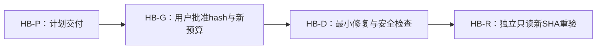

# Issue #11 helper 映像与 Unicode 路径绑定最小修复 Implementation Plan v1

> **For agentic workers:** 本版 **awaiting_approval**。仅用户批准固定 SHA 与新阶段预算后，Product 才可开新的独立 Dev/Review 会话；执行者使用 `superpowers:executing-plans`，不在本 Plan 会话执行。真实 helper/I/O、终止、GUI 各有独立门槛。

**Goal：** 消除授权“自身 helper”与实际启动映像/工作目录的编码错绑，完整验证失败收束，不重做 R1/R2。
**Architecture：** 仅在现有 `tests/io_activity_checks.cpp` 内将 Windows 路径链保留为 UTF-16，使用显式绝对 `lpApplicationName` 的 CreateProcessW；用实际进程句柄的映像查询和 PID/creation 双字段分别验证不同事实。复用现有实验协议，新增同源、零实验副作用的绑定检查入口，不建立公共进程框架。
**Tech Stack：** Windows 11 x64、C++20、既有 Qt6/Core/Widgets、CMake≥3.21、Ninja/MinGW；Win32 GetCommandLineW/CommandLineToArgvW、GetModuleFileNameW、CreateProcessW、QueryFullProcessImageNameW。
**Spec：** 原批准 `doc/plans/2026-10-29-issues-6-11-17-parallel-plan-v1.md` 的任务11、§5.4/5.5；主工程 `.workflow/parallel-plan-20261029-6-11-17/issue11-helper-replan/plan-1-contract.md`；本版为该范围内关键方案/验收修订，必须重新批准。

- run=`parallel-plan-20261029-6-11-17`；Plan task=`issue11-helper-replan`；attempt=1。
- 分析固定 head=`0627ab4e1db5734162377ffba1b11e09b2ed1ca6`，只读 WT=`E:/Git/TMOG-Public-WorkTree/issue11-io-20261030`。
- 原v1 SHA=`d776056e1f579c195be14b37b113c72dd8e9ffebfe7cdb10194a63cdc19899e5`；全局v3 SHA=`ac8f189d42c207249b17af356262cc3fe09815e28ce2697f1129eb6f208cd69c`，用户已选变体A（批准事实来自 Product 合同，不从原文件草稿字样推翻批准记录）。旧文件不改。

## Global Constraints

- 本次只规划，不改业务/CMake/settings/state/events，不构建、不运行 helper/I/O/终止/GUI，不提交/PR/Issue。
- 原 `repair_rounds=2` 已耗尽，保持原计数；推荐另登记 `helper_binding_stage`：最多 **1次新 Dev + 1次独立 Review**，失败即交用户，不自动再返工。这是待批准预算，不是已获第三轮授权；建议每配置构建15分钟、check120秒、产物每树≤2GiB。
- 不变更全局v3A顺序：本修复与新Review仅作为既有 T11R 的重新技术验收门槛；T11T仍在 T13T→T17U 之前，11H/原安全实机/UI仍决定 #11 整票完成。若 Product 需要给全局DAG新增节点，另派全局Plan修订批准，不自行改全局表。
- 只处理自行构建、登记且可信（无并发替换、无不可信链接）的自身 EXE 与自造目录，不防御恶意同权限攻击者替换磁盘映像/DLL。映像路径核对不是签名/hash/防TOCTOU保证，不新增驱动、提权或安装策略。
- 新 Review 不改 tracked 文件，即使还原也违规；所有故意失败探针只在登记构建目录的独立源码快照内，日志亦只在那里。不追认旧 Review 的 TEMP/源码/build根操作。
- 无 Qt/索引/权限/实机条件时明确 BLOCKED/未测，不能把跳过当 PASS；各角色只写自己的报告/ops，Product唯一写状态与看板。

## Review Focus

1. EXE/WorkDir 含中文、非ACP字符、空格、尾反斜杠：往返参数必须逐 UTF-16 单元相同，不用 `.string()` 或短路径回退；HB1/HB2。
2. 路径 API 返回0/截断、命令过长、非法数值/缺参数：创建目录/管道/helper之前失败，不沿截断路径启动；HB3/HB4。
3. spawn 成功但实际映像不同/无法查询、PID或tick不符：不发 write/read、不写可信身份记录，关闭输入等待自然退出；HB5。
4. 分片身份行、无响应、半途退出、第二管道失败：有界等待与句柄归属准确，不能同步无限 ReadFile/泄漏或伪报取消；HB6。
5. “探针在副本”但 CMake 编译 tracked 原件：必须提供 compile_commands/build.ninja 的实际绝对源路径与源码hash，负探针 exit1、正常恢复 exit0；Review步骤R2。

## 1. 核查事实与问题账本

| 来源 | 查得事实 | 影响/建议 | 受影响任务 |
|---|---|---|---|
| fixed head `io_activity_checks.cpp:92-132,285-288` | main/parse_args 使用 char argv；WorkDir从窄串构造 | 仅换 W spawn 仍丢失入口Unicode；改真实宽解析入口 | HB-D/HB-R/11H |
| 同文件:368-384 | 两次 MAX_PATH GetModuleFileNameW，一次完全不检查，一次仅查0 | 合并为一次有界扩容读取；在 WorkDir 创建前处理失败/截断 | HB-D/HB-R |
| 同文件:393-427 | EXE与WorkDir `.string()`→vector<char>→CreateProcessA(nullptr,…)，工作目录继承父cwd | 宽路径端到端、显式应用路径、明确宽工作目录 | HB-D/HB-R/11H |
| 同文件:438-494 | PID+creation核spawn结果，不核映像；身份ReadFile无限阻塞且只读一次 | 映像另核，身份分片有界，失败同一收束出口 | HB-D/HB-R |
| 同文件:404-407,443-493,595-635 | 第二管道失败未释放已建管道；早期身份失败只关句柄不确认退出；父退出后OS收回句柄 | 最小修复同一启动链的资源失败分支；不得声称父退出后还保留可用句柄 | HB-D/HB-R |
| review-3.md与澄清§2/§3/§4、ops9行 | 旧报告“始终自身映像”论证撤回；T9曾就地改tracked测试；14日志在build根；仅02/03/05三组完整intent→receipt | 旧技术测试留历史来源；不迁移当前PASS，不追认越界，新Review独立重验。澄清§1写“5组”自身亦计数矛盾，以实际行表为准 | HB-R/Product采信 |

源码事实由指定WT CLI CodeGraph及其未覆盖范围的Read核查；MCP带projectPath的初次宽泛查询未返回目标符号，**不采作目标链证据**。CLI status确认WT索引v1.6.2 complete、pending0、mismatch=null，定向tests查询覆盖真实WT。CMake配置未被索引覆盖，使用专用Read。

## 2. 方案选择与准确修改路径

拒绝A：只改 CreateProcessA→W，仍保留 `.string()`/char argv，甚至产生类型不匹配，未解决根因。
拒绝B：强制ASCII或GetShortPathName回退，扩大支持限制且短名并不保证存在，不满足原本未限ASCII的合同。
**采用C：同一文件内端到端宽路径＋显式应用名＋启动后映像观测＋统一失败收束。** 不顺带LOW死代码/i18n/注释整理；仅修正本链错误说明。

候选Dev精确 allowed_paths（仅后续批准有效）：
- `tests/io_activity_checks.cpp`：宽入口/纯函数测试/启动核验/失败收束。
- `CMakeLists.txt`：仅io_activity target链接 `shell32`，注册安全 `io_helper_binding_checks` 命令 `io_activity_checks --check-helper-binding-only`、TIMEOUT120；实验入口本身仍不add_test。
- `doc/plans/2026-10-29-issue-11-acceptance.md`：追加新阶段SHA/命令/结果/未测，不改历史结论冒充新PASS。
- 本版批准文件的WT副本 `doc/plans/2026-10-30-issue-11-helper-binding-repair-plan-v1.md`：按批准hash同步，不修订其正文。
- **禁止**src/**、tests/io_table_checks.cpp、process_checks、process_ops_checks、旧批准三票计划、settings/.gitignore及其他路径。超域则BLOCKED。

## 3. 局部任务拓扑与空闲派发

以下是本请求的局部阶段依赖，不覆盖/重排全局DAG。报告目录由Product在后续合同给出独立task/attempt，不沿用旧Review报告。

| task_id | Issue | 角色 | depends_on | 允许修改路径 | 验收摘要 |
|---|---|---|---|---|---|
| HB-P | #11 | plan | - | 主工程本版计划；本任务plan-1报告/ops/附件 | 交付固定hash待批准；不执行 |
| HB-G | #11 | product | HB-P | -（状态由共享合同授权） | 用户批准本版hash与新预算；真实实验授权另记 |
| HB-D | #11 | dev | HB-G | §2四个精确文件；WT/build/issue11-binding-dev/{debug,release}/；自己的报告/ops | HB1..6同源安全检查、R1/R2/R3安全回归，冻结新head |
| HB-R | #11 | review | HB-D | WT/build/issue11-binding-review/下独立debug/release/snapshot/probe目录；自己的报告/ops | tracked只读，独立双配置回归及副本负探针，固定新head技术结论 |



任务表与图同源；Dev/Review时间和产物路径均隔离，代码检查需HB-D完成冻结才启动HB-R。此链最多一个活动执行角色，不能为了填空并开同票写者。Product照全局批准就绪前沿派不相关任务，本Plan交付后关闭，不占位等批准。HB-R技术通过后才重新认定T11R已交付，并按现有全局T11T继续集成/新SHA复审；技术通过不解锁完整#11关票。

## 4. HB-D 实施步骤与接口

接口全部在 `io_activity_checks.cpp` 匿名命名空间，非公共头文件：
- `std::optional<Options> parse_args(int argc, const wchar_t* const* argv, int& exit_code)`；Options.work_dir仍 `fs::path`，其原生Windows字符为wchar_t。
- `std::optional<std::wstring> own_executable_path(std::string& error)`：GetModuleFileNameW从256 WCHAR倍增，最多32768容量，只有返回0<n<size才接受，失败/截断不产路径；复用一次结果计算exe_dir。
- `std::wstring quote_windows_arg(const std::wstring& value)`：始终带引号；引号前n反斜杠编码2n+1，闭引号前n编码2n，其余保留；禁止嵌入NUL。
- `std::optional<std::wstring> helper_command_line(const fs::path& exe, const Options& options, std::string& error)`：固定9个token（argv0、allow、helper、work-dir及值、budget及值、max及值）；含NUL总长度≤32767，否则无结果。
- `int run_helper_binding_checks()`：纯参数/状态算法及CommandLineToArgvW解析检查，无文件、进程创建、窗口、IO计数采样；failures>0返回1，不使用assert使Release跳过。

- [ ] **D1先RED：** 写HB1..6断言，新增 `--check-helper-binding-only` 独立精确入口。它在任何实验路径之前且只有这一个参数时调用检查，不授实验权限；与其他参数混用exit4。其余路径先检查授权token，无token（包括单独--helper）exit2零副作用。
- [ ] **D2真实宽入口：** 保留 `int main()` 避免新MinGW `-municode` 入口约束；使用 GetCommandLineW→CommandLineToArgvW，LocalFree配对；传宽argv进parse_args，不先UTF8/ACP转换。数值用wcstoull/wcstoll完整消费检查（拒绝符号错误/尾垃圾/溢出、零、缺值）；原budget1..300、max1..67108864保持。给日志编码不参与路径决策。
- [ ] **D3准备路径：** 从完整自身路径得exe_dir/project_root兜底；命令长度和参数先检查，随后保留原WorkDir绝对/非空/reparse安全检查。父可创建登记空目录；helper只接受父已准备、存在且非链接的绝对目录，不自行create_directories/嵌套spawn。不承诺自动支持所有超MAX_PATH/UNC环境：实际不支持须清楚失败，不截断成功，不为此改注册表/manifest。
- [ ] **D4启动：** 用 `STARTUPINFOW`、NUL结尾可写 `vector<wchar_t>`；`CreateProcessW(exe.native().c_str(), cmd_buf.data(), …, TRUE, 0, nullptr, options.work_dir.native().c_str(), &si, &pi)`。显式宽应用路径不得带包装引号，不搜索PATH/调用shell。原父端去继承保留；GetLastError在CloseHandle前保存；部分CreatePipe成功也必须收束。
- [ ] **D5映像与身份分离：** 对自身和pi.hProcess用QueryFullProcessImageNameW(flags0)各自完整读取，将结果 `fs::path::lexically_normal()` 后逐UTF-16相等才接受；相同查询格式消除GetModuleFileNameW可能短名差异，不用宽泛大小写/前缀相似代替相等。查失败/不相同保守拒绝exit8。此为可信目录边界下观测核验，**不是文件hash/防并发替换证明**。通过前仅允许identity请求，不允许write/read/可信身份日志；再核pi PID与GetProcessTimes真实非零tick，对响应严格完整数字解析。
- [ ] **D6统一失败收束：** 启动后读取identity用PeekNamedPipe检查可读量、累积到换行，最多255字节，轮询间隔≤10ms；用总预算从准备启动前计时，握手最长5秒且≤剩余预算，检测进程退出/管道断开/响应过长。只有数据可读才ReadFile，禁止无界同步读取；WriteFile必须核全量写入。失败设置取消、不推进段，关闭stdin写端令EOF，持pi.hProcess等待最多10秒自然退出；确认退出码再关句柄。超时/WAIT_FAILED→exit9，日志实际PID/tick（未知明确unknown）/映像/句柄归属，目录保留、转用户，不强杀；父退出后句柄会回收，不能写“可跨进程保留句柄”。各原早期失败分支都走该收束逻辑；未spawn只关闭实际已持资源。
- [ ] **D7GREEN与回归：** 按§5双配置。只在全部安全验收通过后精确add本次四文件正常commit，保留hooks、不amend；head交Product冻结，不推送。新输入/状态check必须≥1实际断言且Release同样可失败。

### HB断言（D1必须实现，不能仅写测试名字）

| ID | 精确输入/可观察断言 |
|---|---|
| HB1 | EXE=`L"C:\\受控 Ω\\程序 空格.exe"`，WorkDir=`L"C:\\受控 Ω\\空目录\\"`；build命令→CommandLineToArgvW后argc=9，argv[0]/argv[4]与原串逐UTF-16相同，flags/numeric次序精确；再测非BMP字符和双引号纯字符串转义（后者不是有效文件名） |
| HB2 | 空串、空格、连续反斜杠、尾反斜杠逐一quote→解析单参数原值；宽parse的Options.work_dir.native()等原WorkDir，不依赖本机ACP |
| HB3 | 注入路径读取返回0、返回n==capacity、扩容后完整值；失败/持续截断没有可用路径，准备阶段spawn计数=0；命令含NUL/长度含终止符32768拒绝，32767边界可构造 |
| HB4 | 无flag与--helper单独→2；缺work-dir/值、预算0/301/30junk、max0/67108865/18446744073709551616、负号/未知flag→4或缺目录5且spawn=0；有效30/16777216与Unicode路径完整保留 |
| HB5 | 注入same-image+PID/tick匹配可进入identity后活动；different-image/query-failed/PID不符/tick0或不符均不进入活动、trusted-log计数0、EOF收束被调用；不能用PID/tick通过替代image匹配 |
| HB6 | 注入第二CreatePipe失败→已持资源关闭一次；identity分成3片形成一行→成功；无响应/过长/子提前退出→有界失败；失败后自然退出→8，不能确认退出→9；各失败无write/read且不终止进程 |

API失败/句柄状态用文件内局部可替换函数或决策输入实现最小测试缝，不新增通用后端接口；计数来自真正被调用的同一启动准备/收束函数，不能写测试自己的独立模拟算法冒充生产路径覆盖。实际CreateProcess/自然EOF操作是否成立仍属§6实测门槛，不被fake替代。

## 5. 准确安全验证命令（未来批准后执行，本Plan未跑）

Product合同固定 `$WT` 为后续真实新树，fresh origin/main集成与旧fixed成果迁入由Product限定；不直接把旧WT当未授权新Dev写域。下列工具路径来自原计划/本轮旧报告，执行者先核存在与版本，不安装或换工具绕过。

```powershell
$CMAKE='D:/InstallApplication/CMake/bin/cmake.exe'
$CTEST='D:/InstallApplication/CMake/bin/ctest.exe'
$QT='E:/InstallApplication/Qt/6.12.0/mingw_64'
$GXX='E:/InstallApplication/Qt/Tools/mingw1310_64/bin/g++.exe'
$NINJA='E:/InstallApplication/Qt/Tools/Ninja/ninja.exe'
$env:PATH="$QT/bin;$(Split-Path $GXX);$env:PATH"
$env:QT_QPA_PLATFORM='offscreen'
$env:QT_QPA_PLATFORM_PLUGIN_PATH="$QT/plugins/platforms"
# $BROOT由合同指定：Dev build/issue11-binding-dev，Review build/issue11-binding-review
foreach ($cfg in 'Debug','Release') {
  $B="$BROOT/$($cfg.ToLower())"
  & $CMAKE -S $WT -B $B -G Ninja "-DCMAKE_BUILD_TYPE=$cfg" "-DCMAKE_PREFIX_PATH=$QT" "-DCMAKE_CXX_COMPILER=$GXX" "-DCMAKE_MAKE_PROGRAM=$NINJA" -DCMAKE_EXPORT_COMPILE_COMMANDS=ON
  if ($LASTEXITCODE -ne 0) { throw 'configure failed' }
  & $CMAKE --build $B --parallel 2
  if ($LASTEXITCODE -ne 0) { throw 'build failed' }
  $rx='^(process_checks|close_lifecycle_checks|sampling_recovery_checks|stale_persistence_checks|io_table_checks|io_helper_binding_checks)$'
  & $CTEST --test-dir $B -N -R $rx
  if ($LASTEXITCODE -ne 0) { throw 'inventory failed' }
  # 必须逐名恰6项；Qt跳过/0 tests失败，不只看regex输出exit0。
  & $CTEST --test-dir $B -j 1 --timeout 120 --output-on-failure -R $rx
  if ($LASTEXITCODE -ne 0) { throw 'safe regression failed' }
  & "$B/io_activity_checks.exe" --check-helper-binding-only
  if ($LASTEXITCODE -ne 0) { throw 'binding checks failed' }
  & "$B/io_activity_checks.exe"
  if ($LASTEXITCODE -ne 2) { throw 'unauthorized gate changed' }
  & "$B/io_activity_checks.exe" --helper
  if ($LASTEXITCODE -ne 2) { throw 'helper gate changed' }
}
```

不得无筛选全量ctest（含smoke/真实process_ops）。参数负例用安全check内部调用解析，不在未授权进程中以allowflag试探边界。R1必须覆盖生产MainWindow失败置陈旧/成功清除且旧代际拒绝；R2选择复用不误选与数值排序；R3原7预算断言及消费/取消/EOF静态核对和HB新断言。新增检查不使旧5项可省略。

### HB-R：独立只读审查与副本负探针

- [ ] **R1核固定SHA：** git head/status、批准计划hash、指定WT CodeGraph status/explore；OCR工程 `open-code-review-delegate`只做preview/rule与host审查，不执行fix。独立原件Debug/Release按上段重建，记录6项库存、检查数、日志hash。源码冻结期间Dev停止写。
- [ ] **R2登记副本：** 在全新 `$BROOT`下创建固定 `$H`的Git源码快照，不复制旧obj/EXE/索引；仅在此副本反转io_table T9及HB1一个断言，每次探针单独目录。PowerShell命令形态如下（$H为Product固定审查head，不运行占位符）：

```powershell
git -C $WT archive --format=zip --output="$BROOT/source-$H.zip" $H
if ($LASTEXITCODE -ne 0) { throw 'snapshot failed' }
Expand-Archive -LiteralPath "$BROOT/source-$H.zip" -DestinationPath "$BROOT/snapshot"
# Review用自己的plan/报告前缀附件记录精确副本修改；只能编辑snapshot/tests下。
foreach ($cfg in 'Debug','Release') {
  $PB="$BROOT/probe-$($cfg.ToLower())"
  & $CMAKE -S "$BROOT/snapshot" -B $PB -G Ninja "-DCMAKE_BUILD_TYPE=$cfg" "-DCMAKE_PREFIX_PATH=$QT" "-DCMAKE_CXX_COMPILER=$GXX" "-DCMAKE_MAKE_PROGRAM=$NINJA" -DCMAKE_EXPORT_COMPILE_COMMANDS=ON
  if ($LASTEXITCODE -ne 0) { throw 'probe configure failed' }
  & $CMAKE --build $PB --target io_table_checks io_activity_checks --parallel 2
  if ($LASTEXITCODE -ne 0) { throw 'probe build failed' }
  & "$PB/io_table_checks.exe"
  if ($LASTEXITCODE -ne 1) { throw 'T9 probe did not fail correctly' }
  & "$PB/io_activity_checks.exe" --check-helper-binding-only
  if ($LASTEXITCODE -ne 1) { throw 'HB1 probe did not fail correctly' }
}
# 精确恢复snapshot内两处断言后重复configure/build/直跑，预期均exit0；禁止恢复WT原件。
```

- [ ] **R3证明实际源：** 解析probe的compile_commands.json，io_table对象源必须是 `$BROOT/snapshot/tests/io_table_checks.cpp`，io_activity对象源必须是相应snapshot文件，不是 `$WT/tests/...`；保存副本hash/探针diff/编译命令。原MainWindow/model来自该固定SHA快照同源，不能混旧EXE。负探针双配置目标运行exit1且含指定FAIL行；还原**副本**或再建正常快照，重新编译exit0。原WT tracked文件前后hash及git diff为空仅作终态证据，过程路径证据另列；不修改原件再“还原”。
- [ ] **R4出结论：** 所有intent/receipt成对、日志在登记子目录；技术PASS只覆盖静态与安全fake。真实授权路径/11H/真实终止/人工UI仍未测。探针、源码路径、退出码缺任何一项不得复用旧review-3 PASS。发现FAIL停止本新阶段，交用户，不自行重开第二新Dev。

## 6. 真实实验与人工门槛（另批，不随计划批准自动执行）

- [ ] Product分别取得：①自身helper启动/EOF验证与受控I/O权限；②既有process_ops真实受控终止权限；③普通实际UI点验条件。不将①并为②。
- [ ] ①固定新head、两个配置，登记可信EXE副本/运行库与空实验目录（均在允许build下），至少ASCII基线和 `受控 Ω 空格` EXE/WorkDir组合；Windows trailing separator参数另一空目录。EXE副本及依赖hash、父意图绝对映像、Query实际映像、helper PID/tick/句柄、解析后WorkDir原生串、实际cwd、data.bin路径都记录，不能仅写“启动成功”。不创建假其他EXE用于错绑；真实错映像失败用HB注入。
- [ ] ①使用原合同命令预算30秒、max16777216：`& "$EXE" --allow-controlled-io --work-dir "$EXP" --budget-seconds 30 --max-bytes 16777216`，每项原生命令检查exit0，其他为FAIL/BLOCKED。$EXE/$EXP由用户批准的未来合同给真实值，不是本次默认授权。最多一个helper、一个data.bin，idle/write/read各≥2有效样本；同口径累计/QPC/趋势核验，不把物理Disk/文件大小当oracle。验证EOF自然退出，不能确认exit9保留目录记录身份，绝不强杀。
- [ ] ②仅另授权后在对应Release及Debug用ctest精确 `-R '^process_ops_checks$' -j 1 --timeout 60 --output-on-failure`。③按原#11实际UI列/units/排序/陈旧/选择点验，不能offscreen通过冒充人工签字。
- [ ] 技术与实测结果分开落验收；真实未测可仅技术accepted并继续既有技术集成门槛，#11保持OPEN。main变化必须重新评估集成、复审新SHA，#13A许可不绕过11T。

## 7. 批准待办、风险与自查

- [ ] 用户批准本版固定hash（关键方案与新增安全验收），并批准另记1Dev+1Review新阶段预算；旧repair_rounds不清零。
- [ ] 用户另决定§6各真实实验/终止/UI门槛与真实路径，缺条件不占Plan会话。
- [ ] Product保留旧review过程越界来源，决定旧证据采信/产物归属，不由本计划改团队配置或开展TeamReview。

风险：保守映像路径比较可拒绝特殊别名，但不会误当已授权；Query失败必须阻塞不能fallback A。路径宽化不保证所有文件系统/库支持长路径；故障注入不证明Windows真实收束。局部测试缝必须驱动同源路径，避免自测镜像算法；snapshot探针若源路径证明失败，验收失败。新功能/额外路径/扩大威胁边界须新版审批。

自查：四候选文件与原链对应；HB1..6覆盖五类Review Focus；表图只有HB-P→G→D→R，无重叠并发；旧R1/R2/R3与真实门槛保留；未来命令和本次只读证据分开；未宣告批准或启动第三轮。实施顺序：批准→RED安全检查→宽链/收束→GREEN双配置→新head冻结→独立副本负探针及重验→既有T11T集成→另批实机门槛。

## 来源

- 原批准三票v1、全局v3A及本任务合同（上述路径/hash）。
- `.workflow/parallel-plan-20261029-6-11-17/issue11-io/{dev-3,review-3,review-3-clarification}.md`及dev/review ops；历史自报不升级本次工具证据。
- https://learn.microsoft.com/en-us/windows/win32/api/processthreadsapi/nf-processthreadsapi-createprocessw
- https://learn.microsoft.com/en-us/windows/win32/api/libloaderapi/nf-libloaderapi-getmodulefilenamew
- https://learn.microsoft.com/en-us/windows/win32/api/shellapi/nf-shellapi-commandlinetoargvw
- https://learn.microsoft.com/en-us/windows/win32/api/winbase/nf-winbase-queryfullprocessimagenamew
