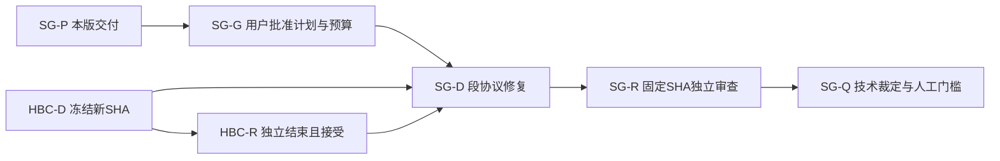

# Issue #11 段协议最小修复 Implementation Plan v1

> **For agentic workers:** **awaiting_approval**。仅规划；用户批准本版 SHA-256 和独立预算后，由 Product 按共享合同派独立 Dev/Review。实施者使用 `superpowers:executing-plans`，本 Plan 不实施、不派发、不发布。

**Goal：** 消除成功路径必然返回6及取消/预算尽后仍发送活动命令的问题，以生产同源控制/结果函数和可失败 fake oracle 验证。
**Architecture：** 在现有单文件抽取 idle→write→read 控制与最终判定；EOF收束不再改变活动失败状态。复用 HBC 的 HelperOps 单调时钟、真实 WriteFile 和 bounded_teardown 观测，fake只替换操作结果，不复制控制算法。
**Tech Stack：** 现有 Windows x64、C++20、Win32、Qt 6.12.0/MinGW 13.1、CMake/Ninja；不新增依赖/CMake目标。
**Spec：** `.workflow/parallel-plan-20261029-6-11-17/issue11-segment-replan/plan-1-contract.md`；HB主计划 `doc/plans/2026-10-30-issue-11-hb-coverage-repair-plan-v1.md` §7，SHA-256 `b2614b353cca24151a3dc597b5f64f2656980e695183be1ae34edad767828fb9`。

- run=`parallel-plan-20261029-6-11-17`；task=`issue11-segment-replan`；attempt=1。
- 静态证据仅 Git 对象 `53fd43efd85308133adfb6acc7812c1495c5410f`；不是未来开发基点。
- 用户只批准“另制定段协议计划”，未批准本方案或实施预算。旧计划/批准版本保留；全局 v3A 与 #13A 不变。

## Global Constraints

- 当前仅新计划和本task报告/ops/附件可写；不改源码、CMake、旧文档、state/events/BOARD/配置，不实验/构建/提交/发布。
- 后续 **HBC-D冻结新head且HBC-R独立审查结束并获Product接受**，本版/独立预算获用户批准，才可启动段协议 Dev。HBC失败/修订则等待新裁定，不趁Review结束但FAIL抢写同文件。
- 未来 `$HBC_SHA` 使用届时被接受的冻结完整SHA；若变化重新核验计划适配/允许路径、更新合同及独立Review。不能用旧53fd43e覆盖HBC成果。
- 仅最小段控制/最终结果修复；保留宽链/映像/HB生产API注入、旧R1/R2/R3检查、字节预算公式、helper文本协议和授权gate。
- 推荐另记 `segment_protocol_stage`：**1 Dev + 1 独立 Review，0自动返工**；不清零已耗尽旧轮次。每配置构建≤15分钟，每安全check≤120秒，角色产物≤2GiB，超限BLOCKED。预算也 awaiting_approval。
- 真实helper/I/O/EOF、受控终止、UI、集成发布分别保留既有人工批准；fake技术通过不证明真实I/O成功，不关闭 #11，不自动解锁11H/11T。

## Review Focus

1. 首段采样失败/不足后不得发write/read；SG2同时断言命令序列与实际发送回调次数。
2. write命令部分写/失败或write段不足后不得发read；SG3覆盖两类失败。
3. 发送前剩余毫秒恰0/负值，以及上段成功后到期，不得发下一命令；SG4覆盖边界。
4. 三段成功并EOF后子进程非0、退出码未知/WAIT_FAILED/超时，不得记OK；SG5覆盖状态与日志一致。
5. 段边界QPC不递增、最后有效样本后的时间推进及收束标志，不得伪造样本/清除失败；SG1/SG6覆盖。

## 1. 已查证问题、来源与影响

行号均为固定对象，不引用独立Dev动态文件。

| 来源 | 事实与影响 | 建议/受影响任务 |
|---|---|---|
| main :1272→:1295/:1317 | 无条件cancel=true后无清除，日志!cancel及all_ok永假；抵达末段即使样本足够、helper exit0也INCOMPLETE/6 | EOF只收束资源，不置活动失败；SG-D/R、11H |
| :1207/:1231→:1246/:1260 | 采样失败/不足置cancel，调用者无guard继续WriteFile(write/read) | 每活动命令前重读cancel及剩余预算；SG-D/R |
| :1199-1233及wall_start :987附近 | 段时限min(5000,remaining)，预算到期退出段后仍继续命令；同步调用不具硬截止保障 | 统一单调deadline边界检查；不声称解决同步硬超时 |
| helper :916-946 | write实际创建/追加data.bin，read实际读；命令发出有真实副作用潜力，不是仅日志错误 | fake记录实际send命令；真实实验另批 |
| :1284-1321与HB §2/§7 | 末段重复退出观测/判定，日志未包括样本门槛；未知退出码原末段返回6但新合同指定9 | 复用HBC teardown观测，同一结果分类驱动日志和返回；未知→9需本版独立批准 |

未动态复现，本轮未运行任何exe；静态源足以证明恒false/缺guard，不把它写成运行PASS。早期HB启动失败8/9语义不改，只有已进入段活动后的结果分类纳入本版。

## 2. 精确候选文件与同源接口

未来SG-D仅三个tracked文件：
1. `tests/io_activity_checks.cpp`：固定对象§9–11段协议区域及同匿名命名空间中的局部控制/结果/安全检查、必要include与既有安全入口调用。届时按HBC新SHA定位，不按旧行号机械覆盖。
2. `doc/plans/2026-10-29-issue-11-acceptance.md`：只追加本阶段SHA、oracle/命令/结果/限制，保留历史。
3. `doc/plans/2026-10-30-issue-11-segment-protocol-repair-plan-v1.md`：批准文件字节相同WT副本。

不改根/其他CMake、src/**、io_table_checks.cpp、helper循环/宽解析/启动核验算法、HB主计划、配置/.gitignore。无法在此域完成则BLOCKED，不新增通用进程框架。

接口建议名称固定，执行前与HBC已接受签名核对；HBC HelperOps/TeardownObservation不得另造镜像：
- `struct SegmentOutcome { bool cancelled=false; int idle_samples=0, write_samples=0, read_samples=0; std::uint64_t requested_write_bytes=0; };` 记录父请求额度而非实测I/O字节；真实累计计数日志保持IoSample口径。
- `struct SegmentIo`：局部 `std::function<bool(IoSample&)> sample`、`std::function<bool(const std::string&)> send`、`std::function<void(const std::string&, const IoSample&, const IoSample&)> log_sample`。生产sample绑定take_io_sample持有句柄，send绑定HBC ops.WriteFile并要求完整写，log绑定原差分日志语句；fake仅脚本化样本/发送成败与调用记录，不操作文件/真实进程。无环境开关/全局mock模式。
- `void drive_segment(const std::string& name, int& valid_count, bool& cancelled, std::int64_t wall_deadline_ms, const HelperOps& ops, const SegmentIo& io)`：搬现有采样循环，同一真实函数计数，仅qpc递增才有效，门槛2，段deadline=min(now+5000,wall_deadline)。采样失败/不足置cancelled；必要睡眠≤min(300,剩余段毫秒)，达到2即完成，不在成功后额外固定Sleep。已开始的同步sample/log耗时不具硬保证。
- `SegmentOutcome run_activity_segments(std::int64_t wall_deadline_ms, std::uint64_t max_bytes, const HelperOps&, const SegmentIo&)`：idle完成后发write，再write采样，再read及read采样；复用count_pending_loop_iterations与4096 chunk/half-budget公式。**紧邻每次send前**读取cancelled和`wall_deadline_ms - ops.now_ms()`，任一取消或≤0置失败并不调用send；发送失败（含部分写）置失败并停止后续活动。不因EOF清除/设置此失败位。requested_write_bytes只在完整命令发送后记录，不冒称实际写入量。
- `enum class ActivityResult { Ok, Incomplete, Unknown };`；`ActivityResult classify_activity_result(const SegmentOutcome&, const TeardownObservation&)`：未确认退出、WAIT_FAILED/超时或exit_code_known=false→Unknown；否则cancelled/任一样本<2/child_exit_code非0→Incomplete；其余Ok。映射`activity_exit_code(ActivityResult)`为0/6/9；`activity_result_name(ActivityResult)`为OK/INCOMPLETE/UNKNOWN。日志和返回必须消费同一个分类值，禁止再手写!cancel判断。
- main ready后调用run_activity_segments，接着调用同一HBC bounded_teardown填观测（其返回8不是活动结果），最后分类、写日志、返回。EOF已由teardown关闭stdin发生，不需额外cancel.store(true)；exit9沿用HBC同源真实身份诊断/句柄归属，不重关句柄、不强杀。
- `void segment_protocol_checks()` 在既有 `run_helper_binding_checks()` 安全入口内调用，复用显式check/failures（Release也有效）；`--check-helper-binding-only`仍是纯安全入口，无新增CTest注册。旧HB断言保留并标明新SG项属于独立已批阶段。

必须查到：`main→run_activity_segments→drive_segment`、`main→bounded_teardown→classify_activity_result`；`run_helper_binding_checks→segment_protocol_checks→同一run/drive/teardown/classify`。fake不能自行写成功状态、EOF次数或固定0/6/9替生产分类。

## 3. 任务拓扑、空闲派发与看板

局部串行细化既有T11R问题，不修改全局v3A。Product按批准拓扑派发；计划等待不阻塞无关就绪任务。Plan交付即关闭，不占位等批准。

| task_id | Issue | 角色 | depends_on | 允许修改路径 | 验收摘要 |
|---|---|---|---|---|---|
| SG-P | #11 | plan | - | 主工程本版计划、本task plan-1报告/ops/附件 | 只读固定对象，交付hash待批 |
| SG-G | #11 | product | SG-P | 仅共享合同自身决策/state/events/BOARD | 用户批准本版hash与独立预算 |
| HBC-D | #11 | dev（外部已登记） | 原HB批准拓扑 | HB主计划§2三文件；自身产物/报告 | 冻结HBC新head |
| HBC-R | #11 | review（外部已登记） | HBC-D | tracked只读；自身专用build/报告 | 独立审查结束且Product接受该SHA |
| SG-D | #11 | dev | SG-G,HBC-D,HBC-R | §2三文件；WT/build/issue11-segment-dev/**；自身报告/ops | RED→同源修复→双配置GREEN，冻结新head |
| SG-R | #11 | review | SG-D | tracked只读；WT/build/issue11-segment-review/**；自身报告/ops | 固定新head独立双配置/变异验收 |
| SG-Q | #11 | product | SG-R | 仅自身共享合同记录 | 核实技术结果与人工门槛，不自动实验/发布 |



图仅依赖边、不设置类别/状态色；上表为文本等价。HBC/SG同文件有依赖路径，Dev与Review禁止同时写；HBC-P/G等旧外部依赖仍按原拓扑保留，不用本表清零或重派。Review产物独占自己的根。

## 4. SG-D 可观察验收与步骤

fake clock初始0，只有sleep或脚本操作推进；每case≤2000次操作，超出显式FAIL防挂死。fake未脚本化调用/落入真实文件或进程API均FAIL。正常采样用qpc=1,2,3（至少3次采样、2个有效差分），非递增不计。

| ID | 脚本输入 | 必须观察到的断言 |
|---|---|---|
| SG1 | deadline=30000，max_bytes=16777216；三段有效；teardown WAIT_OBJECT_0、exit0 | 命令恰`write 8392704\n`、`read\n`顺序各1；样本各≥2；真实teardown stdin CloseHandle恰1；cancelled=false；同源分类Ok/日志OK/exit0 |
| SG2 | idle首次sample=false；另idle qpc始终相同直到5000ms不足 | send回调总次数0、write/read均0；cancelled=true；确认exit0仍Incomplete/6；不是fake自己设零计数 |
| SG3 | write send失败/部分写；另write采样失败/不足 | 命令尝试仅write一次、read发送0；相应write_samples不足、cancelled=true；确认exit0→6 |
| SG4 | deadline=0/-1；idle达标后fake log推进到deadline；write达标后推进到deadline；发送前剩余1ms对照 | 到期无新的write/read；已有命令不追溯删除；恰1ms可发送但同步返回后到期不得再发下一条；失败结果6 |
| SG5 | 复用SG1段观测，teardown分别exit7、GetExitCode失败、WAIT_FAILED、持续WAIT_TIMEOUT | exit7→Incomplete/6；后三者Unknown/9；日志分别INCOMPLETE/UNKNOWN，与退出一致；实际EOF/等待/API账本可核，不硬编码观测 |
| SG6 | qpc重复/回退夹在有效样本间；read失败；已有cancelled=true直接drive | 非递增不增计数；足够有效差分才完成；read失败→6；预取消sample/send0；EOF不能清除失败使之OK |

SG1请求量依据旧公式：half=8388608，max_iters=half/4096+1=2049，剩余总cap允许2049，因此8392704。这是父请求字节，不是实际完成I/O，也不是新修预算公式。若HBC改变此公式或接口，BLOCKED交Product核实，不擅改变验收。

- [ ] D1核HBC已接受SHA、批准记录/预算/路径，创建独立合同产物根并按共享CodeGraph预检定位实际新函数；不使用旧53fd43e作为代码基点。
- [ ] D2写SG1–SG6调用生产控制的安全断言，记录RED命名失败及exit1；接口尚未存在可先编译RED，不能把旧HB PASS当新增覆盖。
- [ ] D3仅搬真实段循环/控制/判定，按§2分离EOF与失败并加紧邻send guard；复用HB teardown，不改HB语义。
- [ ] D4运行§5双配置全部安全验证、追加验收及计划副本；记录head、compile_commands与日志hash。精确3文件提交保留hooks，不amend/push。

## 5. 准确未来验证命令与产物（本轮未执行）

`$WT`/`$HBC_SHA`/`$H`由Product后续合同绑定，不是待猜路径：$HBC_SHA为被接受HBC head，$H为SG-D冻结head。工具路径源自HB计划，执行前检查存在/版本，不安装或换版本绕过。Dev `$BROOT="$WT/build/issue11-segment-dev"`；Review为`.../issue11-segment-review`，必须全新登记。

```powershell
$CMAKE='D:/InstallApplication/CMake/bin/cmake.exe'
$CTEST='D:/InstallApplication/CMake/bin/ctest.exe'
$QT='E:/InstallApplication/Qt/6.12.0/mingw_64'
$GXX='E:/InstallApplication/Qt/Tools/mingw1310_64/bin/g++.exe'
$NINJA='E:/InstallApplication/Qt/Tools/Ninja/ninja.exe'
$env:PATH="$QT/bin;$(Split-Path $GXX);$env:PATH"
$env:QT_QPA_PLATFORM='offscreen'
$env:QT_QPA_PLATFORM_PLUGIN_PATH="$QT/plugins/platforms"
$rx='^(process_checks|close_lifecycle_checks|sampling_recovery_checks|stale_persistence_checks|io_table_checks|io_helper_binding_checks)$'
git -C $WT rev-parse HEAD
if ($LASTEXITCODE -ne 0) { throw 'head query failed' }
# 执行前HEAD必须等于合同基点；Review必须等于H。初始基点必须含HBC_SHA。
foreach ($cfg in 'Debug','Release') {
  $B="$BROOT/$($cfg.ToLower())"
  & $CMAKE -S $WT -B $B -G Ninja "-DCMAKE_BUILD_TYPE=$cfg" "-DCMAKE_PREFIX_PATH=$QT" "-DCMAKE_CXX_COMPILER=$GXX" "-DCMAKE_MAKE_PROGRAM=$NINJA" -DCMAKE_EXPORT_COMPILE_COMMANDS=ON
  if ($LASTEXITCODE -ne 0) { throw 'configure failed' }
  & $CMAKE --build $B --parallel 2
  if ($LASTEXITCODE -ne 0) { throw 'build failed' }
  & $CTEST --test-dir $B -N -R $rx
  if ($LASTEXITCODE -ne 0) { throw 'inventory failed' }
  # 逐名恰6项，缺Qt/0项/Skipped均不是通过。
  & $CTEST --test-dir $B -j 1 --timeout 120 --output-on-failure -R $rx
  if ($LASTEXITCODE -ne 0) { throw 'safe regression failed' }
  & "$B/io_activity_checks.exe" --check-helper-binding-only
  if ($LASTEXITCODE -ne 0) { throw 'HB/SG failed' }
  & "$B/io_activity_checks.exe"
  if ($LASTEXITCODE -ne 2) { throw 'authorization gate changed' }
  & "$B/io_activity_checks.exe" --helper
  if ($LASTEXITCODE -ne 2) { throw 'helper gate changed' }
  & "$B/io_activity_checks.exe" --check-helper-binding-only extra
  if ($LASTEXITCODE -ne 4) { throw 'mixed gate changed' }
}
```

不得全量ctest或运行任何`--allow-controlled-io`；安全入口中fake无目录/真实helper创建。日志须逐SG ID输出，不用总PASS数替代矩阵。

### SG-R 独立快照负例与原件只读

- [ ] R1核固定H/计划hash/只读原件前置status及文件hash、CodeGraph定向同源调用，使用工程`open-code-review-delegate`只读preview/rule+host独立审查；不fix。
- [ ] R2从H独立archive，每变异独立case，只改生产一处：M1在EOF前把活动cancelled置true（SG1 FAIL）；M2移除write发送前guard（SG2/SG4 FAIL）；M3移除read guard（SG3/SG4 FAIL）；M4把分类固定Ok（SG5/SG6 FAIL）；M5忽略未知exit观测按成功处理（SG5 FAIL）。不反转断言、不把编译错误当可失败oracle。
- [ ] R3各case Debug/Release编译exit0、安全入口exit1且对应命名FAIL；正常未变异快照重新构建exit0，任一变异仍绿即FAIL，无自动返工。

```powershell
# 每CASE父目录先检查并登记全新目录；CASE=M1..M5或normal。
$S="$BROOT/$CASE/source"
git -C $WT archive --format=zip "--output=$BROOT/$CASE/source-$H.zip" $H
if ($LASTEXITCODE -ne 0) { throw 'archive failed' }
Expand-Archive -LiteralPath "$BROOT/$CASE/source-$H.zip" -DestinationPath $S
# 专用编辑工具仅修改S中已读生产语句一处，保存diff；normal不改。
foreach ($cfg in 'Debug','Release') {
  $PB="$BROOT/$CASE/$($cfg.ToLower())"
  & $CMAKE -S $S -B $PB -G Ninja "-DCMAKE_BUILD_TYPE=$cfg" "-DCMAKE_PREFIX_PATH=$QT" "-DCMAKE_CXX_COMPILER=$GXX" "-DCMAKE_MAKE_PROGRAM=$NINJA" -DCMAKE_EXPORT_COMPILE_COMMANDS=ON
  if ($LASTEXITCODE -ne 0) { throw 'probe configure failed' }
  & $CMAKE --build $PB --target io_activity_checks --parallel 2
  if ($LASTEXITCODE -ne 0) { throw 'mutation must compile' }
  & "$PB/io_activity_checks.exe" --check-helper-binding-only
  $want=($CASE -eq 'normal' ? 0 : 1)
  if ($LASTEXITCODE -ne $want) { throw 'mutation oracle failed' }
}
```

- [ ] R4核每compile_commands绝对io_activity源码为本case `$S/tests/io_activity_checks.cpp`，无WT原件/别case源泄漏；原件前后hash/status一致。保存case源码、zip、diff、编译命令、输出/退出码及hash，在≤2GiB预算内不足即停止，不偷偷减验收。
- [ ] R5原件双配置六项回归和所有SG/HB均通过才能建议技术PASS，固定H回报；未知真实实验保持未验证。快照来自受信任本工程，脚本不从解包目录运行。

## 6. 人工门槛、风险及实施顺序

**批准待办：** 本v1固定hash、独立segment_protocol_stage预算、0自动返工及新增unknown→9/日志UNKNOWN语义。不得沿用“仅另制定计划”作为修复批准；关键方案/验收改变需新审批与新SHA独立验收。

**明确未解决风险：** guard保证取消/截止后不开始下一活动命令，不承诺同步WriteFile/sample/log/helper读写已开始操作的硬墙钟上限；已发送write/read不会被EOF逆向撤回，helper可能继续当前I/O。若用户要求绝对硬超时、非阻塞/overlapped管道、helper命令确认/取消、恶意I/O防护，另规划架构/权限/验收，不在本版顺带实现。保持原≤10秒收束及轮询容差，不冒称全程严格≤30秒。

真实helper/EOF/I/O仍需单独批准可信EXE、独立空WorkDir、Unicode/非ACP/空格/尾分隔符、30秒/16777216字节、1helper/1数据文件、每段≥2有效样本及真实PID/tick/映像/cwd/日志；受控终止/UI/发布依旧独立门槛。技术修复不证明helper write-error后退出0具有数据操作成功语义，此类协议ACK/实际字节确认要求另列问题，不能宣称本版验证真实吞吐成功。

顺序：SG-P交付关闭→用户批准SG计划/预算（可与HBC并行等待）→HBC-D冻结/HBC-R独立结束且接受→绑定新SHA启动SG-D RED/GREEN→固定H SG-R快照+回归→Product技术裁定→各既有人工实验/集成门槛。全局v3A不改，当前不操作Issue/PR。

## 7. 交付自查及证据

自查：合同五类oracle映射SG1–6；3路径/no CMake；HBC先完成且新SHA绑定；表图依赖一致、同域串行；取消与EOF分离；unknown9与日志一致；独立可编译生产变异；预算/人工/硬超时范围明确。没有本轮运行PASS。

固定源码来自`git show 53fd43e:tests/io_activity_checks.cpp`与根`CMakeLists.txt`（安全target/test已存在）；HB计划hash本轮实测相符。CodeGraph当前磁盘源码不能证明指定历史对象，本轮不查询动态业务树；自动hook片段不用于旧基线证据。技能调用/版本/来源及tool_evidence与self_report详见本task `plan-1.md`。
