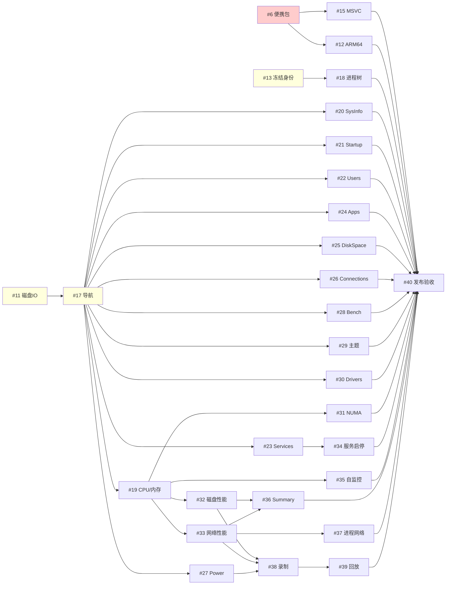

# Windows 全量路线拓扑与执行顺序 v1（草稿，待用户批准）

- 日期：2026-10-30
- 依据：`2026-10-27-windows-issues-index.md`（GitHub 原生依赖映射）、`2026-10-27-windows-development-order.md`（推荐顺序，即 #41 正文）、2026-10-30 GitHub Issue 实际状态。
- 范围：全部 OPEN 的 Windows 实施票。#1 已完成；#2（macOS/Linux）按既有决定暂缓，不进入本拓扑；#41 是本路线的总览票，#40 完成后随之关闭。
- 状态：awaiting_approval。批准后 Product 以本文件为全局 DAG 源，按 `.claude/agent-team/README.md`“任务拓扑、空闲派发与看板”派发；各票仍需各自的单票计划（由 Plan 产出并经批准）后才能进入 Dev。

## 1. 当前状态（2026-10-30）

| 已关闭 | 进行中（有分支） | 未开始 |
|---|---|---|
| #1 #5 #7 #8 #9 #10 #14 #16 | #6（blocked）#11（复审中）#13（A 已验收，待授权）#17（17S 已验收，待 17U） | #12 #15 #18–#40 |

## 2. 任务拓扑表

依赖取自 GitHub 原生阻塞关系；已关闭的前置不再列出。“写域”为预计共享修改面，两票写域重叠时即使无依赖边也不能同时写（见第 4 节）。

| task | Issue | 内容 | depends_on（未关闭） | 预计写域 | 人工/环境门槛 |
|---|---|---|---|---|---|
| T6 | #6 | 便携包许可证与干净环境 | - | CMake、scripts/packaging | 干净 Win11 实机、第三方义务确认 |
| T11 | #11 | 进程磁盘 I/O | - | 进程采样、进程表 | - |
| T13 | #13 | 结束确认冻结身份 | - | MainWindow、进程操作 | B 真实实验、第四项人工确认 |
| T17 | #17 | 导航与显示设置 | T11（17U 迁入在 #11 集成后） | MainWindow 导航、settings | - |
| T15 | #15 | MSVC x64 验收 | T6 | CMake、构建脚本 | MSVC 工具链 |
| T12 | #12 | ARM64 实机验收 | T6 | CMake、构建脚本 | ARM64 实机（无则保持阻塞） |
| T18 | #18 | 进程搜索/树形/详情 | T13 | 进程页 | - |
| T19 | #19 | 整机 CPU/内存性能 | T17 | 性能页框架、采样 | - |
| T20 | #20 | System Info | T17 | 新页面 | - |
| T21 | #21 | Startup apps | T17 | 新页面 | - |
| T22 | #22 | Users | T17 | 新页面 | - |
| T23 | #23 | Services 只读 | T17 | 新页面 | - |
| T24 | #24 | Installed Apps | T17 | 新页面 | - |
| T25 | #25 | Disk Space | T17 | 新页面 | - |
| T29 | #29 | 主题 | T17 | 全局样式、settings | - |
| T30 | #30 | Drivers | T17 | 新页面 | - |
| T26 | #26 | Connections 本机查看 | T17 | 新页面 | - |
| T27 | #27 | Power & Freq | T17 | 新页面、传感器 | 无可靠来源时如实标不可用 |
| T28 | #28 | Benchmarks | T17 | 新页面 | 不运行破坏性压力测试 |
| T34 | #34 | 服务启停 | T23 | Services 页 | 仅受控服务 |
| T31 | #31 | 逻辑核与 NUMA | T19 | 性能页 | - |
| T32 | #32 | 磁盘活动性能 | T19 | 性能页 | - |
| T33 | #33 | 网络接口性能 | T19 | 性能页 | - |
| T35 | #35 | 自监控 | T19 | 采样/诊断 | - |
| T36 | #36 | Summary | T32、T33 | Summary 页 | - |
| T37 | #37 | 进程网络活动 | T33 | 进程页、网络采样 | 维护者确认的测量合同（#7 已定） |
| T38 | #38 | Flight Recorder 录制 | T32、T33、T27 | 录制模块 | - |
| T39 | #39 | Flight Recorder 回放 | T38 | 录制模块 | 不可信输入边界 |
| T40 | #40 | 全功能与发布验收 | 以上全部 | - | 维护者整体验收 |

## 3. 拓扑图

## 4. 执行顺序（波次）

同一波内无依赖，可按 `Max_Dev=5`、`Max_Review=3` 空位并行；波次是最早可开工时间，不要求整波结束才开下一波。

| 波次 | 任务 | 说明 |
|---|---|---|
| W0 收尾 | #11 → #17(17U)；#13；#6 | 先解阻塞：#11 复审合入后 17U 迁入完成 #17；#13 取得授权后发布；#6 核查中断后续做 |
| W1 | #19、#18、#15 | #17 合入即开 #19（关键路径）；#13 关闭后 #18；#6 关闭后 #15 |
| W2 | #32、#33、#31、#35 + 只读页 #20 #21 #22 #23 #24 #25 #30 | 性能子页优先占 Dev 空位，剩余空位给只读页 |
| W3 | #36、#37、#26、#27、#28、#29、#34 | #27 优先（#38 依赖它） |
| W4 | #38 → #39 | 关键路径尾段 |
| W5 | #12（有 ARM64 设备时可提前）、#40 | #40 最后，#41 随之关闭 |

**关键路径**：#11 → #17 → #19 → #32/#33 → #38 → #39 → #40（#27 须在 #38 前完成）。

**空位分配优先级**：① 关键路径任务；② 解锁后继最多的任务（#17、#19、#33、#23）；③ 其余按 #41 推荐顺序。

## 5. 写域冲突与合入规则

- #17 之后的十余个页面票都会改 MainWindow 导航注册和根 CMakeLists。规定：每个页面票把页面实现放在独立源文件，导航注册与 CMake 只追加一行；Product 允许同时开发，但**合入 main 严格逐个**，后合入者在前一个合并后由 Dev 更新分支并复审新 SHA（README“PR、Issue 和本地同步”第 4 条）。
- #19/#31/#32/#33/#35 共享性能页框架：#19 先定框架，其后四票并行时各自只加子视图文件，冲突时按依赖顺序合入。
- 涉及构建系统的 #6/#15/#12 串行，不与其他改根 CMake 结构的票同时写。

## 6. 门槛与不可自动推进项

- #13 B 实验与人工确认、#6 干净实机与合规确认、#12 ARM64 设备、#15 MSVC 工具链、#40 整体验收：Product 遇到即用 AskUserQuestion 交用户，期间不阻塞其他就绪任务。
- 每票进入 Dev 前需单票计划批准；Product 可一次请多个 Plan（Max_Plan=3）为下一波预先出计划，计划批准可批量询问用户。
