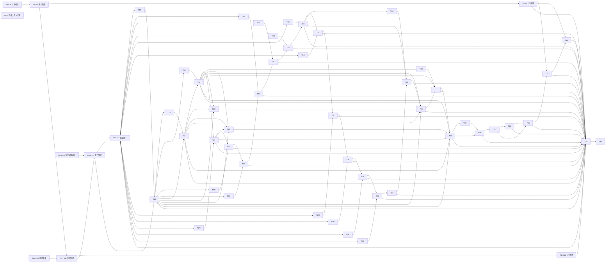

# Windows 全量路线拓扑与执行顺序 v2 Implementation Plan

> **For agentic workers:** 仅 Product 在固定版本/SHA 获用户批准后按共享合同派发；单票执行者使用 `superpowers:executing-plans`。本文件是路线，不是新功能实施批准，不启动 Dev。

**Goal：** 覆盖全部 OPEN Issue，以真实路径依赖消除 v1 的并行写域冲突，同时保留独立实现空位与人工门槛。
**Architecture：** 复用 C++20/Qt Widgets、单采样调度及既有设置；新页面分为独立实现 I 与共享注册集成 T。I 不写 MainWindow、根 CMake、共享采样/配置文件；T 按明确链串行，不预建插件框架。
**Tech Stack：** Windows 11；CMake ≥3.21；Qt6 Core/Widgets；既有 MinGW，MSVC/ARM64 需各票工具条件。路线校验仅 Python 标准库。
**Spec：** 主工程 AGENTS.md、`.claude/agent-team/README.md`；全部 OPEN Issue 正文/原生依赖；旧全局 v1 与三票批准 v1、#13 批准 v1（摘要见报告）。

- 身份：run=`parallel-plan-20261029-6-11-17`，task=`master-topology-v2`，attempt=1，role=plan，project_root=`E:/Git/TMOG-Public`。
- 版本：v2；状态 **awaiting_approval**；基点 `origin/main=2eb4b9dc466cd41d3379a405d0ebe2c4ad3221d3`（Product 本次 fetch 记录，非 Plan 新 fetch）。旧 v1 未批准、保留原样；本版 SHA 在报告给出。
- 远程快照：2026-10-30T09:43Z，只读 gh；31 OPEN：#2、#6、#11、#12、#13、#15、#17–#41。无 v1 之外新增票。8 个既有 CLOSED（#1 #5 #7 #8 #9 #10 #14 #16）不重新开发。

## Global Constraints

- 计划只在 `doc/plans/`；运行记录在 `.workflow/`；历史 `.claude/workflow/` 按 `.workflow/` 解析，原记录不改写。
- 新路线批准不代替单票计划批准；未来单票精确路径/接口/测试/人工标准须另获批准。下表为路线允许路径上限，不能由 Product 临时扩大；改变共享写域须 Plan 新版本。
- 所有交集写域必须有可达依赖；独立 worktree 和顺序合并均不能替代该边。Review 期间同票 Dev 停写，每次 head 变化旧 PASS 失效。
- 不新增插件、服务、数据库、MVVM、驱动、自动提权；不连接厂商服务、不运行原件/补丁、不复用厂商资产。
- 不执行构建、功能测试、真实 UI/终止/服务/负载/系统实验；安装、干净环境、外部分发、签名与公网发布均保留用户门槛。
- `Max_Dev=5 / Max_Review=3 / Max_IssueWriter=2 / Max_Plan=3` 是上限，不保证开满；所有已占用/待命/阻塞/关闭未确认窗口计入占用。
- 各票默认完整闭环后关闭；技术切片合并不等于整票关闭。原生 OPEN 前置的后继保持阻塞，除非旧批准方案明确技术切片依赖（#11/#17 不原生依赖 #6）。

## Review Focus

1. 两个页面都只“追加一行”仍共享文件：校验所有交集路径存在可达边；负例 overlap 必须失败。
2. 漏依赖/环：校验节点完整和无环；负例 missing/cycle 必须失败。
3. 技术 PASS 冒充人工完整验收：T6/T11/T13/T17 等关闭节点明确人工项；不从 accepted 推断 CLOSED。
4. 新 OPEN 或旧草稿漏覆盖：精确核对 OPEN 集合及全部计划分类，coverage 负例必须失败；新发现项需新路线版本。
5. 旧基点/模块/批准记录被移用：#17S 固定模块身份与 #11 新 SHA 复审分层；旧日志、含乱码的批准记录不升级为亲见用户确认。

## 1. 当前恢复事实与问题清单

| 来源 | 事实/影响 | 建议与受影响任务 |
|---|---|---|
| Product 合同、相关 state 局部 | #11 attempt3/repair_round2 head `0627ab4e1db5734162377ffba1b11e09b2ed1ca6`；Dev 已关闭，待独立最终复审。state 仍 starting，不能以旧 BOARD 的 attempt2 信息覆盖实况 | T11R 可按旧批准技术合同立即复审，不等待 v2；PASS 只绑定固定 head，发布仍由 Product 核条件 |
| Product 合同、state 局部 | #6 head `940c5fbaad333a7416a6b50753edaab15d4a7b7c`；三脚本未提交、license-sources.json/licenses 未跟踪、中断 intent 未配对 | T6R 只读查归属；T6T 之前先补明确修复合同。未跟踪许可文件不在原允许表内，不能借本路线直接追认扩权或重跑中断脚本 |
| 原三票批准 v1、state | #17S accepted 固定 `30eec4db54bf7bd57ad19a14d00e06ddf9088227`，非整票完成 | T17S 只读核证，T17U 依赖 T11T 与模块；不重开发17S、不独立发布关17 |
| #13 原批准/澄清、Product/state | A-only accepted `8eea083521e2a0c3f114b916567869cc091da090`；B/第四人工/发布未授权 | T13T 保留独立发布决定；T13 保留真实与人工。共享增量在链后部集成，避免未授权 #13 发布阻断 #17 与性能主线；新顺序须用户批准 |
| v1 §2/§5 | 根 CMake/MainWindow 同写却无边；性能框架与构建票亦仅文字排他 | v2 增 I/T 拆分与串行 T 链；T15→T12 构建边显式，且都排在新页面公共集成之后 |
| BOARD（未经实核） | 6 个未入库草稿，状态/head 信息过时 | 仅作为发现清单，不当实时验收；由 Product 重建 BOARD，本 Plan 不写它 |

## 2. 拓扑与精确写域

角色 `review` 为只读核证、`dev` 为后续获批实现、`product` 为用户门槛/闭环记账、`plan` 为暂缓记录。每行 task_id 可直接用于 state 的 depends_on/allowed_paths；所有路径为工程相对**精确文件**，`;` 分隔，`-` 表示无业务写入。角色自己的报告/ops与独立已登记产物在各自任务合同内，不能共享；不把通用 `doc/plans/**` 当授权。

I 切片只写自身命名的源文件及独立测试目录 CMake；能链接既有已合入接口，不能复制共享实现为测试替身。`tests/issueN/CMakeLists.txt` 是局部生产同源检查，不是新框架。I 验收=Debug/Release 局部检查+独立固定 SHA Review，模块交付即可完成，不单独宣称整页验收。T 验收=迁入固定模块、生产注册、全量安全回归、新固定 SHA Review/集成；整票 T<number> 另含原 AC/人工/发布闭环。

| task_id | Issue | 角色 | depends_on | allowed_paths | 验收摘要 |
|---|---|---|---|---|---|
| T6R | #6 | review | - | - | 核中断intent与修改归属，不重跑 |
| T11R | #11 | review | - | - | 固定0627ab4最终技术复审，旧批准可继续 |
| T17S | #17 | review | - | - | 核accepted模块30eec4及证据，不重开发 |
| T2 | #2 | plan | - | - | 明确macOS/Linux暂缓，无实施 |
| T6T | #6 | dev | T6R | CMakeLists.txt;scripts/package-portable.ps1;scripts/check-package.ps1;packaging/README-PACKAGE.md;packaging/THIRD-PARTY-NOTICES.md;tests/package_checks.ps1;doc/plans/2026-10-29-issue-6-integration-acceptance.md;doc/plans/2026-10-29-issues-6-11-17-parallel-plan-v1.md | 原批准技术范围修复复审与允许的部分集成；额外许可路径另合同 |
| T6 | #6 | product | T6T | - | 干净Win11普通用户与第三方材料签字，完整AC后关闭 |
| T11T | #11 | dev | T11R,T6T | src/ProcessSnapshot.h;src/ProcessSampler.h;src/ProcessSampler.cpp;src/platform/WindowsProcesses.cpp;src/ProcessTableModel.h;src/ProcessTableModel.cpp;tests/process_checks.cpp;CMakeLists.txt;tests/io_table_checks.cpp;tests/io_activity_checks.cpp;doc/plans/2026-10-29-issue-11-acceptance.md;doc/plans/2026-10-29-issues-6-11-17-parallel-plan-v1.md | 不重开发已验收实现；必要新基点集成/安全回归和新SHA复审 |
| T11 | #11 | product | T11T | - | 受控I/O、原安全实机及UI门槛，完整AC后关闭 |
| T17U | #17 | dev | T11T,T17S | src/MainWindow.h;src/MainWindow.cpp;src/main.cpp;CMakeLists.txt;src/DisplaySettings.h;src/DisplaySettings.cpp;tests/settings/settings_checks.cpp;tests/settings/CMakeLists.txt;tests/navigation_settings_checks.cpp;tests/stale_persistence_checks.cpp;doc/plans/2026-10-29-issue-17-acceptance.md;doc/plans/2026-10-29-issues-6-11-17-parallel-plan-v1.md | 按原批准迁入模块，真实导航设置/单worker/关闭路径安全检查 |
| T17 | #17 | product | T17U | - | 实际桌面鼠标键盘缩放重启验收，全部AC后关闭 |
| T19I | #19 | dev | T17 | src/SystemPerformance.h;src/SystemPerformance.cpp;src/PerformancePage.h;src/PerformancePage.cpp;tests/issue19/CMakeLists.txt;tests/issue19/performance_checks.cpp | 系统CPU/内存独立来源与五分钟有界历史/缺样检查 |
| T19 | #19 | dev | T19I,T17U | CMakeLists.txt;src/MainWindow.h;src/MainWindow.cpp;src/SamplingWorker.h;src/SamplingWorker.cpp;tests/issue19/performance_integration_checks.cpp;doc/plans/2026-10-30-issue-19-acceptance.md | 调度集成不重入，与任务管理器同口径趋势及实际UI |
| T32I | #32 | dev | T19 | src/DiskPerformance.h;src/DiskPerformance.cpp;src/DiskPerformanceView.h;src/DiskPerformanceView.cpp;tests/issue32/CMakeLists.txt;tests/issue32/disk_checks.cpp | 设备身份/计数复位/插拔/失败，无吞吐猜活动率 |
| T33I | #33 | dev | T19 | src/NetworkPerformance.h;src/NetworkPerformance.cpp;src/NetworkPerformanceView.h;src/NetworkPerformanceView.cpp;tests/issue33/CMakeLists.txt;tests/issue33/network_checks.cpp | 接口身份/重连复位/缺样有界，不抓载荷 |
| T27I | #27 | dev | T17 | src/PowerPage.h;src/PowerPage.cpp;src/PowerSnapshot.h;src/PowerSnapshot.cpp;tests/issue27/CMakeLists.txt;tests/issue27/power_checks.cpp | 沿#9可信来源，功耗温度无来源明确不可用 |
| T31I | #31 | dev | T19 | src/ProcessorTopologyView.h;src/ProcessorTopologyView.cpp;src/ProcessorTopology.h;src/ProcessorTopology.cpp;tests/issue31/CMakeLists.txt;tests/issue31/topology_checks.cpp | 多组NUMA/未知P-E模型不猜测，特殊硬件证据分层 |
| T35I | #35 | dev | T19 | src/SelfMonitorView.h;src/SelfMonitorView.cpp;tests/issue35/CMakeLists.txt;tests/issue35/self_monitor_checks.cpp | 真实自身身份、非递归测量与开关/开销对照 |
| T20I | #20 | dev | T17 | src/SystemInfoPage.h;src/SystemInfoPage.cpp;tests/issue20/CMakeLists.txt;tests/issue20/system_info_checks.cpp | 系统字段逐项来源与失败、后台查询 |
| T21I | #21 | dev | T17 | src/StartupAppsPage.h;src/StartupAppsPage.cpp;tests/issue21/CMakeLists.txt;tests/issue21/startup_checks.cpp | Run/启动目录只读解析去重，不执行命令 |
| T22I | #22 | dev | T17 | src/UsersPage.h;src/UsersPage.cpp;tests/issue22/CMakeLists.txt;tests/issue22/users_checks.cpp | 会话可信关联/权限与退出，敏感信息本地 |
| T23I | #23 | dev | T17 | src/ServicesPage.h;src/ServicesPage.cpp;tests/issue23/CMakeLists.txt;tests/issue23/services_checks.cpp | SCM只读、部分配置失败和取消资源释放 |
| T24I | #24 | dev | T17 | src/InstalledAppsPage.h;src/InstalledAppsPage.cpp;tests/issue24/CMakeLists.txt;tests/issue24/apps_checks.cpp | 来源/视图/去重与坏记录，不执行卸载 |
| T25I | #25 | dev | T17 | src/DiskSpacePage.h;src/DiskSpacePage.cpp;tests/issue25/CMakeLists.txt;tests/issue25/space_checks.cpp | 卷身份容量与慢卷取消，不扫描/写用户文件 |
| T26I | #26 | dev | T17 | src/ConnectionsPage.h;src/ConnectionsPage.cpp;tests/issue26/CMakeLists.txt;tests/issue26/connections_checks.cpp | 沿#8 v2本机只读合同，退出/PID复用不可误认 |
| T28I | #28 | dev | T17 | src/BenchmarksPage.h;src/BenchmarksPage.cpp;tests/issue28/CMakeLists.txt;tests/issue28/benchmark_checks.cpp | 沿#10有界算法，小输入取消超时检查，不默认负载 |
| T30I | #30 | dev | T17 | src/DriversPage.h;src/DriversPage.cpp;tests/issue30/CMakeLists.txt;tests/issue30/drivers_checks.cpp | 已加载视角，元数据逐项不可用，不加载驱动 |
| T32 | #32 | dev | T32I,T19 | CMakeLists.txt;src/MainWindow.h;src/MainWindow.cpp;src/PerformancePage.h;src/PerformancePage.cpp;src/SamplingWorker.h;src/SamplingWorker.cpp;tests/issue32/disk_integration_checks.cpp;doc/plans/2026-10-30-issue-32-acceptance.md | 磁盘性能注册与受控趋势实机/实际UI，完整AC |
| T33 | #33 | dev | T33I,T32 | CMakeLists.txt;src/MainWindow.h;src/MainWindow.cpp;src/PerformancePage.h;src/PerformancePage.cpp;src/SamplingWorker.h;src/SamplingWorker.cpp;tests/issue33/network_integration_checks.cpp;doc/plans/2026-10-30-issue-33-acceptance.md | 网络性能注册与受控本机流量对照、完整AC |
| T27 | #27 | dev | T27I,T33 | CMakeLists.txt;src/MainWindow.h;src/MainWindow.cpp;src/SamplingWorker.h;src/SamplingWorker.cpp;tests/issue27/power_integration_checks.cpp;doc/plans/2026-10-30-issue-27-acceptance.md | 来源支持矩阵/机型实测、历史缺样及UI，完整AC |
| T31 | #31 | dev | T31I,T27 | CMakeLists.txt;src/MainWindow.h;src/MainWindow.cpp;src/PerformancePage.h;src/PerformancePage.cpp;src/SamplingWorker.h;src/SamplingWorker.cpp;tests/issue31/topology_integration_checks.cpp;doc/plans/2026-10-30-issue-31-acceptance.md | 多组模型及普通实机，特殊机器未测明确标限制 |
| T35 | #35 | dev | T35I,T31 | CMakeLists.txt;src/MainWindow.h;src/MainWindow.cpp;src/SamplingWorker.h;src/SamplingWorker.cpp;tests/issue35/self_monitor_integration_checks.cpp;doc/plans/2026-10-30-issue-35-acceptance.md | 开关实际测量/环境对照记录，完整AC |
| T20 | #20 | dev | T20I,T35 | CMakeLists.txt;src/MainWindow.h;src/MainWindow.cpp;tests/issue20/system_info_integration_checks.cpp;doc/plans/2026-10-30-issue-20-acceptance.md | 普通用户系统字段对照/键盘缩放与失败恢复 |
| T21 | #21 | dev | T21I,T20 | CMakeLists.txt;src/MainWindow.h;src/MainWindow.cpp;tests/issue21/startup_integration_checks.cpp;doc/plans/2026-10-30-issue-21-acceptance.md | 本机只读来源对照与UI，不修改启动项 |
| T22 | #22 | dev | T22I,T21 | CMakeLists.txt;src/MainWindow.h;src/MainWindow.cpp;tests/issue22/users_integration_checks.cpp;doc/plans/2026-10-30-issue-22-acceptance.md | 当前会话对照，多用户缺证据不宣称覆盖 |
| T23 | #23 | dev | T23I,T22 | CMakeLists.txt;src/MainWindow.h;src/MainWindow.cpp;tests/issue23/services_integration_checks.cpp;doc/plans/2026-10-30-issue-23-acceptance.md | 普通用户只读服务实测/搜索刷新完整AC |
| T24 | #24 | dev | T24I,T23 | CMakeLists.txt;src/MainWindow.h;src/MainWindow.cpp;tests/issue24/apps_integration_checks.cpp;doc/plans/2026-10-30-issue-24-acceptance.md | 系统应用按覆盖范围对照/Unicode缺字段UI |
| T25 | #25 | dev | T25I,T24 | CMakeLists.txt;src/MainWindow.h;src/MainWindow.cpp;tests/issue25/space_integration_checks.cpp;doc/plans/2026-10-30-issue-25-acceptance.md | 容量同口径/慢卷不冻结与实际UI |
| T26 | #26 | dev | T26I,T25 | CMakeLists.txt;src/MainWindow.h;src/MainWindow.cpp;tests/issue26/connections_integration_checks.cpp;doc/plans/2026-10-30-issue-26-acceptance.md | 获授权受控本机端点可见及进程关联完整AC |
| T28 | #28 | dev | T28I,T26 | CMakeLists.txt;src/MainWindow.h;src/MainWindow.cpp;tests/issue28/benchmark_integration_checks.cpp;doc/plans/2026-10-30-issue-28-acceptance.md | 用户主动实机有界运行/取消/关闭，完整AC |
| T30 | #30 | dev | T30I,T28 | CMakeLists.txt;src/MainWindow.h;src/MainWindow.cpp;tests/issue30/drivers_integration_checks.cpp;doc/plans/2026-10-30-issue-30-acceptance.md | 普通用户已加载清单对照与权限边界完整AC |
| T34I | #34 | dev | T23 | src/ServiceControl.h;src/ServiceControl.cpp;tests/issue34/CMakeLists.txt;tests/issue34/service_control_checks.cpp | fake策略确认/取消/未知依赖拒绝，不操作真实服务 |
| T36I | #36 | dev | T19,T32,T33 | src/SummaryPage.h;src/SummaryPage.cpp;tests/issue36/CMakeLists.txt;tests/issue36/summary_checks.cpp | 复用同快照、不重复采样、区域失败隔离 |
| T37I | #37 | dev | T33 | src/ProcessNetwork.h;src/ProcessNetwork.cpp;tests/issue37/CMakeLists.txt;tests/issue37/process_network_checks.cpp | 严格#7事件/身份/丢失/权限合同，不按接口分摊 |
| T38I | #38 | dev | T19,T32,T33,T27 | src/RecordingFormat.h;src/RecordingFormat.cpp;src/FlightRecorder.h;src/FlightRecorder.cpp;tests/issue38/CMakeLists.txt;tests/issue38/recording_checks.cpp | 独立格式30分钟/100MiB上限，取消写不损旧文件 |
| T29 | #29 | dev | T30 | CMakeLists.txt;src/MainWindow.h;src/MainWindow.cpp;src/DisplaySettings.h;src/DisplaySettings.cpp;src/Theme.h;src/Theme.cpp;tests/issue29/theme_checks.cpp;doc/plans/2026-10-30-issue-29-acceptance.md | 系统跟随加六主题恢复，语义/焦点/对比非只靠颜色 |
| T34 | #34 | dev | T34I,T29,T23 | CMakeLists.txt;src/MainWindow.h;src/MainWindow.cpp;src/ServicesPage.h;src/ServicesPage.cpp;tests/issue34/service_control_integration_checks.cpp;doc/plans/2026-10-30-issue-34-acceptance.md | 单独授权受控服务启动停止/等待失败，完整AC |
| T36 | #36 | dev | T36I,T34,T19,T32,T33 | CMakeLists.txt;src/MainWindow.h;src/MainWindow.cpp;tests/issue36/summary_integration_checks.cpp;doc/plans/2026-10-30-issue-36-acceptance.md | 已完成页导航、同快照、实际负载UI完整AC |
| T37 | #37 | dev | T37I,T36,T33 | CMakeLists.txt;src/MainWindow.h;src/MainWindow.cpp;src/ProcessTableModel.h;src/ProcessTableModel.cpp;src/SamplingWorker.h;src/SamplingWorker.cpp;tests/issue37/process_network_integration_checks.cpp;doc/plans/2026-10-30-issue-37-acceptance.md | 获授权本机受控网络/权限丢失与安全操作回归 |
| T38 | #38 | dev | T38I,T37,T19,T32,T33,T27 | CMakeLists.txt;src/MainWindow.h;src/MainWindow.cpp;tests/issue38/recording_integration_checks.cpp;doc/plans/2026-10-30-issue-38-acceptance.md | 实际短录制安全保存/限额/缺样，完整AC |
| T39I | #39 | dev | T38 | src/Playback.h;src/Playback.cpp;tests/issue39/CMakeLists.txt;tests/issue39/playback_checks.cpp | 独立格式不可信输入/版本/大小/顺序/取消检查 |
| T39 | #39 | dev | T39I,T38 | CMakeLists.txt;src/MainWindow.h;src/MainWindow.cpp;tests/issue39/playback_integration_checks.cpp;doc/plans/2026-10-30-issue-39-acceptance.md | 实际回放/实时基线分离与坏输入UI，完整AC |
| T13T | #13 | dev | T39 | CMakeLists.txt;src/MainWindow.h;src/MainWindow.cpp;tests/end_confirm_checks.cpp;doc/plans/2026-10-28-issue-13-manual-verification-v4.md;doc/plans/2026-10-28-issue-13-recovery-acceptance.md;doc/plans/2026-10-28-issue-13-recovery-plan-v1.md | 已accepted A不重开发；获发布许可后必要新基点安全集成/复审 |
| T13 | #13 | product | T13T | - | B真实自建helper/第四人工确认另授权，完整AC后关闭 |
| T18 | #18 | dev | T13,T13T | CMakeLists.txt;src/MainWindow.h;src/MainWindow.cpp;src/ProcessTableModel.h;src/ProcessTableModel.cpp;src/ProcessTree.h;src/ProcessTree.cpp;src/ProcessDetails.h;src/ProcessDetails.cpp;tests/issue18/process_tree_checks.cpp;doc/plans/2026-10-30-issue-18-acceptance.md | 搜索/树循环孤儿/PID复用/过滤身份安全与实际UI完整AC |
| T15 | #15 | dev | T6,T18 | CMakeLists.txt;scripts/package-portable.ps1;scripts/check-package.ps1;packaging/README-PACKAGE.md;packaging/THIRD-PARTY-NOTICES.md;tests/package_checks.ps1;doc/plans/2026-10-30-issue-15-acceptance.md | MSVC匹配Qt Debug/Release GUI/包与MinGW回归，安装另授权 |
| T12 | #12 | dev | T6,T15 | CMakeLists.txt;scripts/package-portable.ps1;scripts/check-package.ps1;packaging/README-PACKAGE.md;packaging/THIRD-PARTY-NOTICES.md;tests/package_checks.ps1;doc/plans/2026-10-30-issue-12-acceptance.md | 原生ARM64构建/实机安全/干净包，缺设备保持阻塞 |
| T40 | #40 | review | T6,T11,T12,T13,T15,T17,T18,T19,T20,T21,T22,T23,T24,T25,T26,T27,T28,T29,T30,T31,T32,T33,T34,T35,T36,T37,T38,T39 | - | 全页逐架构矩阵/干净包/安全与隐私整体回归，维护者签字；整改另合同 |
| T41 | #41 | product | T40 | - | 全Windows闭环后总览回写/关闭，不关闭暂缓#2 |

未来单票批准计划文件由其 Plan 唯一写者新建；同步同名批准副本须在任务合同列入精确路径。三票共享已批准副本在 T6T→T11T→T17U 串行同步；T17S 本节点只读，原模块副本不再写。新单票固定副本均独占命名，不允许多个任务编辑全局路线。

## 3. 对应 Mermaid DAG

图只表达依赖/身份，用默认单色及完整文字标签，无自定义类别色；表是可访问的完整数据视图。没有可用 Mermaid 渲染器，本次不宣称视觉渲染验收。



节点 I 的 Issue 映射与验收见表；不存在图内额外隐形派发节点。图中的 `&` 仅为 Mermaid 多边语法，不是批次门槛。

## 4. 实施顺序、方案取舍与空闲派发

- [ ] **W0：** 旧批准 T11R 技术最终复审可立即进行；并行只读 T6R 与 T17S 核证。新路线待批不阻止旧批准独立只读流程。T6T 中断范围/额外许可文件必须先厘清；若技术集成迟迟不可放行，T11T 的新排程边不能由 Product 删除，须 Plan 修订/用户批准备选。
- [ ] **W1：** T6T→T11T→T17U→T17，独立 T6/T11 人工门槛不阻塞 T17U（旧批准技术依赖）；T17 的实际桌面门槛则约束新功能原生后继。
- [ ] **W2：** T17 闭环后，优先 T19I，其余 Dev 空位按 T27I、T23I、T20I、T25I、T21I、T22I、T24I、T26I、T28I、T30I。T19 完成后 T32I/T33I/T31I/T35I 加入前沿；优先性能关键路径。每任务先派单票 Plan 并批准，不能仅凭路线进入 Dev。
- [ ] **W3：** 公共写者链 T19→T32→T33→T27→T31→T35→T20→T21→T22→T23→T24→T25→T26→T28→T30→T29→T34→T36→T37→T38→T39。已就绪 I 可与当前 T 并行；T34I/T36I/T37I/T38I 按各自依赖提前实现。
- [ ] **W4：** T13T→T13→T18→T15→T12→T40→T41。#13 获许可前保持 accepted A，不做新实现；MSVC/ARM64 工具条件可提前只读核查，但改公共构建文件必须按边串行。
- [ ] 每次 turn 结束前 Product 计算每角色空位，取已批准且依赖全完成/merged、无路径冲突、无用户门槛的前沿；记录“空位N、就绪M、派发K、未派发原因”。等待某个用户门槛不占用 Plan 会话，也不阻止无关 I。合并仍逐个，main 变化由 Dev 正常提交更新并独立复审。

**取舍：** 全串行不利用页面独立文件；全并行靠合并顺序不合合同。选择 I/T 最小拆分：一个模块局部检查可独立拒收，一个生产集成可独立验收。不为并行设计注册系统。公共链保守且较长，人工/工具缺口会在其所属节点阻塞后继；如需缩短链或提前 #13/#15/#12，先新版本重排，不能临时让两个公共写者同时开发。

**关键路径：** 新性能主线 #11 技术→#17→#19→#32→#33→#27→#38→#39；实际公共链增加中间页等待，最终 #13 B/#12 实机/#6 合规可能成为发布最长路径。v1 所谓 #32/#33 并行仅适用于 I，不适用于写共享性能调度的集成。

## 5. 可观察验收与准确验证命令

### 5.1 本路线（本次实际执行，不是功能测试）

验证附件位于 `.workflow/parallel-plan-20261029-6-11-17/master-topology-v2/`：`plan-1-validate.py`、`plan-1-remote.json`、`plan-1-validation.json`。校验直接解析本 Markdown 六列任务表，不用另一份可漂移拓扑 JSON 代替；检查31 OPEN精确覆盖/每票唯一闭环、依赖存在、无环、原生OPEN依赖可达、大小写不敏感精确路径交集有可达边。

```powershell
python -I "E:/Git/TMOG-Public/.workflow/parallel-plan-20261029-6-11-17/master-topology-v2/plan-1-validate.py" "E:/Git/TMOG-Public/doc/plans/2026-10-30-windows-master-topology-v2.md" "E:/Git/TMOG-Public/.workflow/parallel-plan-20261029-6-11-17/master-topology-v2/plan-1-remote.json"
# 预期exit0，实际task/edge/overlap计数见报告
# 下列四次各自预期exit1；不能把命令非零当工具错误后忽略
python -I "E:/Git/TMOG-Public/.workflow/parallel-plan-20261029-6-11-17/master-topology-v2/plan-1-validate.py" "E:/Git/TMOG-Public/doc/plans/2026-10-30-windows-master-topology-v2.md" "E:/Git/TMOG-Public/.workflow/parallel-plan-20261029-6-11-17/master-topology-v2/plan-1-remote.json" --negative cycle
# 将cycle分别换为missing、overlap、coverage，再各运行一次
```

验收还需旧批准文件 SHA 不变、输出边界合规、计划状态 awaiting_approval、报告摘要≤20行。远程证据只支持当时状态，派发前 Product 重查；附件是私有运行证据不随 docs PR 自动入库。如需跨机器可复现校验，Product 另将脚本嵌入/迁入 doc/plans 的批准文档提交合同，本 Plan 不跨写域迁移。

### 5.2 后续单票（必须先获批准，本次未执行）

#6/#11/#17 准确工具/参数与安全测试库存沿批准三票计划 §5；#13 沿批准恢复计划 §6及后续范围内守卫合同。禁止不加过滤全量 CTest 跑真实 process_ops；每原生命令检查退出码，0 tests/跳Qt不是成功。

新 I/T 单票由 Plan 固定接口、测试名与准确命令后才能派 Dev。以下只是统一执行约束，**不是可直接派发的完整单票合同**：I 使用自己的 `tests/issueN/CMakeLists.txt` 与已登记 `build/issueNi-debug|release`；T 使用根 CMake 与 `build/issueN-debug|release`；显式 Qt/编译器/Ninja 路径；构建 TmogReplica 和必需检查，`ctest --no-tests=error --output-on-failure --timeout 120 -j 1` 加单票批准的精确安全 `-R`。必须 Debug/Release 有效断言与一次故意失败非零证明；窗口/调度/失败恢复/关闭同源回归。不得现在猜新测试名称就声称可执行全功能计划。

- #19/#31/#32/#33/#35：系统/设备/接口身份、真实间隔、计数倒退、首帧与缺样、五分钟和硬样本界限；fake检查不代替实机趋势/开销。
- #20–#26/#30：来源/权限/坏记录/Unicode/消失/慢查询与释放，逐项失败；本机只读UI对照。
- #27/#28/#37：读取已批准 #9/#10/#7 合同；真实实验、环境权限与资源上限另授，不为方便降级来源。
- #29/#34/#36：主题七模式可用性、受控服务安全、同快照无新worker；人工门槛分票。
- #38/#39：30分钟/100MiB及schema/计数硬界限，安全保存不损旧文件，不可信版本/截断/超限/时间倒退拒绝，实时/回放基线分离。
- #18/#40：跨刷新冻结身份、过滤代理映射、取消零操作/慢关闭/陈旧恢复全回归；全部页逐架构运行证据与支持限制，不以关票替代整体回归。

## 6. OPEN 与计划文件覆盖/入库

所有31 OPEN均有表内唯一 T<number> 闭环节点；#2是暂缓节点不满足 Windows完成条件，#41为总览不是新功能。已关闭研究票 #7/#8/#9/#10 的合同分别约束 #37/#26/#27/#28；已关闭安全 #5/#14/#16 是现基线，不迁移旧人工签字到新页面。

`doc/plans/` 当前文件分类：
- 2026-10-27 Windows index/development-order/roadmap-tickets、W01–W36 issue草稿、manifest/published映射及发布脚本：是全36实施票来源与既有发布证据；不运行发布脚本，不重复建Issue。
- #1重建/行为矩阵/验收；#5/#14/#16计划和Review；#7/#8/#9/#10研究、合同、修订、Review及分析附件：既有CLOSED证据/差异边界，不产生新待开发任务。
- 2026-10-27-session-handoff-before-clear、2026-10-28-agent-team-implementation、team-review-implementation：历史交接/团队文档，非授权恢复无关业务；TeamReview不自动运行。
- 未入库六草稿及新 v2 如下。若 Product 发现其他计划/新Issue，派 Plan 新路线版本，不自行修改DAG。

| 草稿 | 承载/纯文档建议 |
|---|---|
| 2026-10-28-issue-13-recovery-plan-v1.md | 随#13任务PR入库，已批准副本SHA核同，不能删除旧批准版本 |
| 2026-10-29-issues-6-11-17-parallel-plan-v1.md | 首个三票任务PR承载相同批准副本；其余PR确认已跟踪同内容，不重复编辑 |
| 2026-10-28-issue-8-validation-clarification-v1.md | 已关闭#8澄清，纯docs PR，非新功能 |
| 2026-10-28-windows-priority-recovery-plan-v1.md | 历史优先级参考，纯docs PR |
| 2026-10-29-issue-13-resolution-clarification-v1.md | 保留原A范围内澄清追溯，纯docs PR，不当最新head终审 |
| 2026-10-30-windows-master-topology-v1.md | 未批准且被v2取代草稿，纯docs PR保留版本历史，不能当已批准路线 |
| 2026-10-30-windows-master-topology-v2.md | 批准并验收后纯docs PR入库；本次仅主工程草稿 |

纯docs入库是 Product 待办，不伪造为功能Issue或让多票共写docs分支；由 Product 单独合同固定文件/SHA、IssueWriter发布PR。主工程未跟踪副本只有与合入版内容相同才由 Product 按合同处理；本 Plan 不创建分支、不提交/推送/发布。

## 7. 风险、批准待办及自查

风险：新单票接口尚未定义不可直接实施；精确候选路径可能需修订，调整必须保留旧版与新SHA；长公共链牺牲集成并行但避免真实冲突；特殊硬件/服务/负载/法律材料缺口不能“跳过通过”。#6 的许可证新增范围与中断归属未知，#13 的发布许可未知，不能在路线里自批。

- [ ] Product 请用户批准本 v2 固定SHA及 I/T 拆分、公共串行链、#13与构建票靠后顺序；旧 v1 无批准可迁移。
- [ ] Product 单列 #6许可文件/中断修复边界、#13 A发布/B及第四人工、#6干净机合规、#11真实实验安全/UI、#17实际桌面、#15工具安装、#12设备、#34受控服务、#40整体验收所需决定。获批技术范围不是所有真实权限批准。
- [ ] 新功能每票另产出并批准准确接口/测试/路径计划；v2只批准路线不扩大原三票/#13方案与验收。
- [ ] Product 验收交付后记账、关闭本 Plan 单终端；不为等用户批准保留会话；后续修订新会话/新版本。

自查：原批准计划SHA保持；31 OPEN/原生边覆盖；共享MainWindow、CMake、SamplingWorker、PerformancePage、DisplaySettings、ProcessTableModel及打包文件均有可达依赖；独立I不写共享文件；#2暂缓/#41总览明确；未执行业务实验；真实运行、批准来源与工具核对分层。准确正负校验结果见报告，不将图形未渲染或未来单票测试冒称通过。
