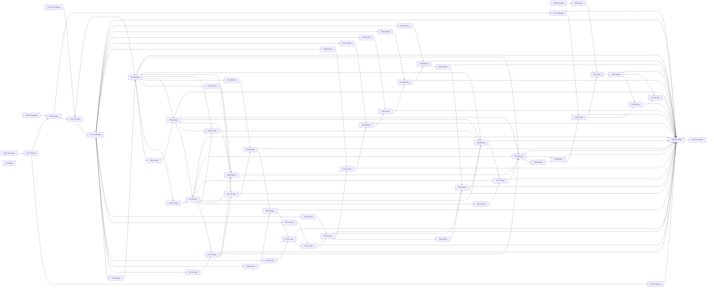
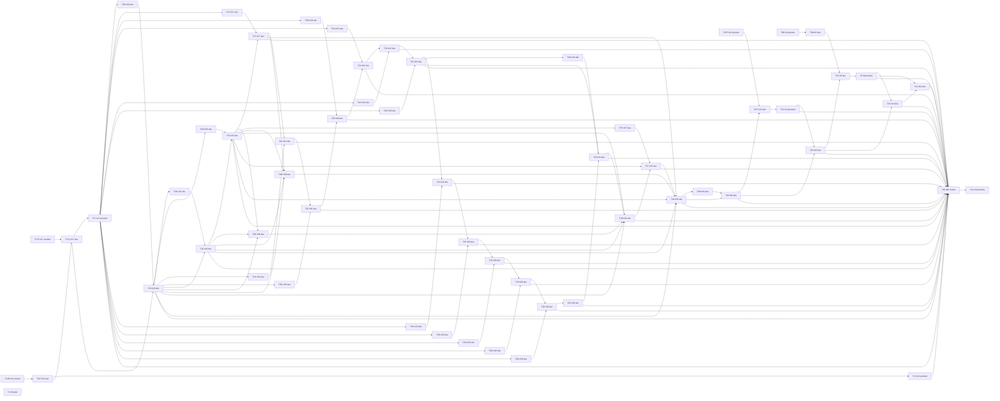

# Windows 全量路线拓扑与执行顺序 v3 Implementation Plan

> **For agentic workers:** 本路线 awaiting_approval。仅 Product 记录用户选择的单一完整变体及固定文档SHA后切换全局DAG；单票执行者沿共享合同使用 superpowers:executing-plans。不同时派发两变体，不启动 Dev、实验或发布。

**Goal：** 移除中断#6对#11的默认阻塞，给accepted #13 A一个可选择的提前安全槽位，保持真实共享写域与原生门槛。
**Architecture：** 保留v2独立实现I/公共集成T，不新增注册框架。#6只最小拆出材料恢复M；#13分离A技术集成许可P、技术集成T与原人工闭环，两个固定DAG供批准，不靠运行时删边。
**Tech Stack：** 既有C++20、Qt6 Core/Widgets、Windows、CMake≥3.21；路线校验仅Python标准库。
**Spec：** 本任务plan-1-contract.md、AGENTS.md、共享README、v2、三票批准v1/#13批准v1及当前OPEN正文/原生依赖；报告给出固定SHA与来源。

- run=parallel-plan-20261029-6-11-17；task=master-topology-v3；attempt=1；role=plan；project_root=E:/Git/TMOG-Public。
- 状态 **awaiting_approval**。用户选择“修订顺序”只授权规划；尚未选择A/B，未批准路线、#13集成或发布。基点main=2eb4b9dc466cd41d3379a405d0ebe2c4ad3221d3（合同记录）。
- v2 SHA=00d0676bd1f762423ed7504f78ab05992e3c05d45b4729b5fdf25cde13dd036f及全部旧计划保留不改，不将v2 awaiting_approval称为批准版。

## Global Constraints

- 计划在doc/plans，报告在.workflow。路线批准不代替未来单票计划/准确接口、命令、路径及人工授权。
- 所有路径交集必须有可达边；独立worktree/顺序合并不替代依赖。各公共链写者完成所需集成/验收后才解锁后继；Review期间Dev冻结，head变化旧PASS失效。
- 不新增服务/驱动/插件框架/自动提权；不连接厂商服务、不复用原件/补丁/厂商品牌资产，不安装工具或改全局环境。
- 原生OPEN后继保留完整前置关闭门槛；#11/#17不原生依赖#6/#13。已批准技术切片T11T→T17U不要求#11人工闭环；#17后续新页仍等T17完整AC。
- Max_Dev=5/Review=3/IssueWriter=2/Plan=3只是上限；报告/ops/已登记独立产物由各单票合同授权，不使用共享doc/plans/**通配授权。
- 本次不构建/运行应用/真实实验/提交/发布；所有技术合并仍需独立Review、Product固定SHA放行及原权限。#6干净机/合规、#13 B与第四人工、各新票实机/环境门槛不降低。

## Review Focus

1. 仅删除T6T→T11T会产生根CMake及三票副本并写：反向链T11T→…→T18→T6T必须真实可达，M不写公共文件。
2. 提前#13若只“等许可”会挡#17：A必须另取得P许可后才启用；未授权选B，P/#13人工不能是B性能前沿祖先。
3. accepted不等于关票：T13人工只约束原生#18/#40，A中T17U不依赖T13完整关闭；T6/T11人工不挡已批准技术主线。
4. 表/图或变体漂移：两个完整表及图分别解析、分别正负例校验；不能两表混作120节点DAG。
5. 许可材料已授权静态提取不等于所有源码路径可提交：核原output_boundary与中断文件归属，不由路线追认新增license-sources.json/licenses。

## 1. 来源、变化与影响

| 来源 | 事实/问题 | 本版处理/受影响任务 |
|---|---|---|
| Product合同、state相关局部 | #11 review_running固定0627ab4e1db5734162377ffba1b11e09b2ed1ca6；已有范围内MainWindow.cpp陈旧回调修复 | T11R继续现有最终复审；T11T含该实际共享写域，不重复实现 |
| v2及原三票v1 §2备选 | T6T→T11T把中断材料恢复绑到无原生前置的I/O；原方案已允许#11从fresh main独立 | 删除该边，#6M可独立静态恢复；#6T置最终公共集成槽位 |
| state license_source_approval | direct-user“允许”；2026-10-29T14:03:44.791560Z；仅官方对应版本静态提取/原6T材料/同范围检查，output为WT6/build/issue6-license-source | 不是缺用户许可；剩余是中断归属/已提取材料核对和跟踪写域合同。T6R无业务写，不重跑intent；T6M只列原批准路径，不追认未跟踪许可目录 |
| #17模块state | accepted30eec4db54bf7bd57ad19a14d00e06ddf9088227 | 仅Product交接已有Review，不新增“为核证而核证”Review |
| #13 state/合同 | A accepted8eea083521e2a0c3f114b916567869cc091da090；部分发布/B/第四人工未授权 | A槽位提前到#11后；B固定延后到T39后。T13P许可单独决定，T13人工不挡A中#17/性能 |
| 当前只读gh | 31 OPEN集合未变；逐票原生blocked_by重新获取，时间与正文在附件 | 无新增Issue；原生边两变体分别校验，后续派发仍重查 |

所有任务表是路线精确路径上限，不能直接当未来新票开发合同；新增接口/测试必须单票Plan。I复用既有生产来源，局部同源检查+独立Review；T迁入固定模块、生产注册、安全回归/新SHA Review，含完整票的T<number>还须实际UI/实机/原AC闭环。表内product节点只做决策/旧证据交接不修改业务。

## 2. 可批准变体与选择门槛

**A：提前A技术集成（推荐，需额外许可）。** 公共链T11T→T13T→T17U→性能/页面链→T39→T18→T6T→T15→T12。T13P独立许可先取得，之后才允许用户启用A；T13T只必要安全集成，A-only技术部分是否可合并单独获用户明确许可。B/第四人工不作为T13T前置、不作为T17U前置，#13保持OPEN。T13完整AC仍阻塞#18原生后继与最终#40。成本：一次提前新基点回归；若拒绝P，不能启用A再让整链等许可，应选择B。

**B：不受未授权#13阻塞的延后路线。** 公共链T11T→T17U→性能/页面链→T39→T13T→T18→T6T→T15→T12。#13 A不重复开发，固定槽位是T39交付之后、T18之前；此前P/B/第四人工均不在#17/性能祖先集。成本：#13 accepted A较晚入main，跨更多页面须扩大集成回归；#18/#6最终包/#15/#12仍会等#13后置槽位和#18原生完整前置，不能称全链无等待。材料M可先推进，但完整#6打包仍在最终公共槽位。

A/B均是待批准的完整DAG，不得“暂选A等许可、运行时跳过#13”，不得合并两图。用户选择与P授权分别记账；选择B不授P，选择A也不默认授P。日后从B中途提前#13须Plan新版本及SHA批准；已完成任务可复用事实/证据，不重做已验收模块。#13真实人工在自己的节点等待，不占用本Plan终端。

## 3A. 完整任务拓扑表（变体A）

| task_id | Issue | 角色 | depends_on | allowed_paths | 验收摘要 |
|---|---|---|---|---|---|
| T6R | #6 | product | - | - | 读取既有中断intent/归属与许可授权记录后发精确恢复合同，不另设技术Review，不重跑未知副作用 |
| T11R | #11 | review | - | - | 固定0627ab4最终技术复审，旧批准可继续 |
| T17S | #17 | product | - | - | 核既有accepted30eec4模块与Review引用后交接，不新增核证Review、不重开发 |
| T2 | #2 | plan | - | - | 明确macOS/Linux暂缓，无实施 |
| T6M | #6 | dev | T6R | scripts/package-portable.ps1;scripts/check-package.ps1;packaging/README-PACKAGE.md;packaging/THIRD-PARTY-NOTICES.md;tests/package_checks.ps1;doc/plans/2026-10-29-issue-6-integration-acceptance.md | 按已批准材料恢复合同核来源/版权/完整许可文本并修复现有材料与脚本，同范围检查后独立Review交付；不写根CMake/共享三票副本，不启动包应用；未知license-sources.json/licenses不由本路线授权跟踪 |
| T13P | #13 | product | - | - | 取得单独A-only技术集成/部分合并许可，保留B/第四人工/公网发布未授权；用户拒绝时不得启用提前变体 |
| T6T | #6 | dev | T6M,T18 | CMakeLists.txt;scripts/package-portable.ps1;scripts/check-package.ps1;packaging/README-PACKAGE.md;packaging/THIRD-PARTY-NOTICES.md;tests/package_checks.ps1;doc/plans/2026-10-29-issue-6-integration-acceptance.md;doc/plans/2026-10-29-issues-6-11-17-parallel-plan-v1.md | 最终公共CMake/包集成与全量安全回归、新SHA复审；材料仅核定原批准范围，新增许可源跟踪路径先独立澄清合同 |
| T6 | #6 | product | T6T | - | 干净Win11普通用户与第三方材料签字，完整AC后关闭 |
| T11T | #11 | dev | T11R | src/ProcessSnapshot.h;src/ProcessSampler.h;src/ProcessSampler.cpp;src/platform/WindowsProcesses.cpp;src/ProcessTableModel.h;src/ProcessTableModel.cpp;tests/process_checks.cpp;CMakeLists.txt;tests/io_table_checks.cpp;tests/io_activity_checks.cpp;doc/plans/2026-10-29-issue-11-acceptance.md;doc/plans/2026-10-29-issues-6-11-17-parallel-plan-v1.md;src/MainWindow.cpp | 固定0627ab4最终复审后仅必要fresh main集成/安全回归及新SHA复审；包含已批准陈旧回调修复MainWindow.cpp，不重做I/O |
| T11 | #11 | product | T11T | - | 受控I/O、原安全实机及UI门槛，完整AC后关闭 |
| T17U | #17 | dev | T13T,T17S | src/MainWindow.h;src/MainWindow.cpp;src/main.cpp;CMakeLists.txt;src/DisplaySettings.h;src/DisplaySettings.cpp;tests/settings/settings_checks.cpp;tests/settings/CMakeLists.txt;tests/navigation_settings_checks.cpp;tests/stale_persistence_checks.cpp;doc/plans/2026-10-29-issue-17-acceptance.md;doc/plans/2026-10-29-issues-6-11-17-parallel-plan-v1.md | 按原批准迁入模块，真实导航设置/单worker/关闭路径安全检查 |
| T17 | #17 | product | T17U | - | 实际桌面鼠标键盘缩放重启验收，全部AC后关闭 |
| T19I | #19 | dev | T17 | src/SystemPerformance.h;src/SystemPerformance.cpp;src/PerformancePage.h;src/PerformancePage.cpp;tests/issue19/CMakeLists.txt;tests/issue19/performance_checks.cpp | 系统CPU/内存独立来源与五分钟有界历史/缺样检查 |
| T19 | #19 | dev | T19I,T17U | CMakeLists.txt;src/MainWindow.h;src/MainWindow.cpp;src/SamplingWorker.h;src/SamplingWorker.cpp;tests/issue19/performance_integration_checks.cpp;doc/plans/2026-10-30-issue-19-acceptance.md | 调度集成不重入，与任务管理器同口径趋势及实际UI |
| T32I | #32 | dev | T19 | src/DiskPerformance.h;src/DiskPerformance.cpp;src/DiskPerformanceView.h;src/DiskPerformanceView.cpp;tests/issue32/CMakeLists.txt;tests/issue32/disk_checks.cpp | 设备身份/计数复位/插拔/失败，无吞吐猜活动率 |
| T33I | #33 | dev | T19 | src/NetworkPerformance.h;src/NetworkPerformance.cpp;src/NetworkPerformanceView.h;src/NetworkPerformanceView.cpp;tests/issue33/CMakeLists.txt;tests/issue33/network_checks.cpp | 接口身份/重连复位/缺样有界，不抓载荷 |
| T27I | #27 | dev | T17 | src/PowerPage.h;src/PowerPage.cpp;src/PowerSnapshot.h;src/PowerSnapshot.cpp;tests/issue27/CMakeLists.txt;tests/issue27/power_checks.cpp | 沿#9可信来源，功耗温度无来源明确不可用 |
| T31I | #31 | dev | T19 | src/ProcessorTopologyView.h;src/ProcessorTopologyView.cpp;src/ProcessorTopology.h;src/ProcessorTopology.cpp;tests/issue31/CMakeLists.txt;tests/issue31/topology_checks.cpp | 多组NUMA/未知P-E模型不猜测，特殊硬件证据分层 |
| T35I | #35 | dev | T19 | src/SelfMonitorView.h;src/SelfMonitorView.cpp;tests/issue35/CMakeLists.txt;tests/issue35/self_monitor_checks.cpp | 真实自身身份、非递归测量与开关/开销对照 |
| T20I | #20 | dev | T17 | src/SystemInfoPage.h;src/SystemInfoPage.cpp;tests/issue20/CMakeLists.txt;tests/issue20/system_info_checks.cpp | 系统字段逐项来源与失败、后台查询 |
| T21I | #21 | dev | T17 | src/StartupAppsPage.h;src/StartupAppsPage.cpp;tests/issue21/CMakeLists.txt;tests/issue21/startup_checks.cpp | Run/启动目录只读解析去重，不执行命令 |
| T22I | #22 | dev | T17 | src/UsersPage.h;src/UsersPage.cpp;tests/issue22/CMakeLists.txt;tests/issue22/users_checks.cpp | 会话可信关联/权限与退出，敏感信息本地 |
| T23I | #23 | dev | T17 | src/ServicesPage.h;src/ServicesPage.cpp;tests/issue23/CMakeLists.txt;tests/issue23/services_checks.cpp | SCM只读、部分配置失败和取消资源释放 |
| T24I | #24 | dev | T17 | src/InstalledAppsPage.h;src/InstalledAppsPage.cpp;tests/issue24/CMakeLists.txt;tests/issue24/apps_checks.cpp | 来源/视图/去重与坏记录，不执行卸载 |
| T25I | #25 | dev | T17 | src/DiskSpacePage.h;src/DiskSpacePage.cpp;tests/issue25/CMakeLists.txt;tests/issue25/space_checks.cpp | 卷身份容量与慢卷取消，不扫描/写用户文件 |
| T26I | #26 | dev | T17 | src/ConnectionsPage.h;src/ConnectionsPage.cpp;tests/issue26/CMakeLists.txt;tests/issue26/connections_checks.cpp | 沿#8 v2本机只读合同，退出/PID复用不可误认 |
| T28I | #28 | dev | T17 | src/BenchmarksPage.h;src/BenchmarksPage.cpp;tests/issue28/CMakeLists.txt;tests/issue28/benchmark_checks.cpp | 沿#10有界算法，小输入取消超时检查，不默认负载 |
| T30I | #30 | dev | T17 | src/DriversPage.h;src/DriversPage.cpp;tests/issue30/CMakeLists.txt;tests/issue30/drivers_checks.cpp | 已加载视角，元数据逐项不可用，不加载驱动 |
| T32 | #32 | dev | T32I,T19 | CMakeLists.txt;src/MainWindow.h;src/MainWindow.cpp;src/PerformancePage.h;src/PerformancePage.cpp;src/SamplingWorker.h;src/SamplingWorker.cpp;tests/issue32/disk_integration_checks.cpp;doc/plans/2026-10-30-issue-32-acceptance.md | 磁盘性能注册与受控趋势实机/实际UI，完整AC |
| T33 | #33 | dev | T33I,T32 | CMakeLists.txt;src/MainWindow.h;src/MainWindow.cpp;src/PerformancePage.h;src/PerformancePage.cpp;src/SamplingWorker.h;src/SamplingWorker.cpp;tests/issue33/network_integration_checks.cpp;doc/plans/2026-10-30-issue-33-acceptance.md | 网络性能注册与受控本机流量对照、完整AC |
| T27 | #27 | dev | T27I,T33 | CMakeLists.txt;src/MainWindow.h;src/MainWindow.cpp;src/SamplingWorker.h;src/SamplingWorker.cpp;tests/issue27/power_integration_checks.cpp;doc/plans/2026-10-30-issue-27-acceptance.md | 来源支持矩阵/机型实测、历史缺样及UI，完整AC |
| T31 | #31 | dev | T31I,T27 | CMakeLists.txt;src/MainWindow.h;src/MainWindow.cpp;src/PerformancePage.h;src/PerformancePage.cpp;src/SamplingWorker.h;src/SamplingWorker.cpp;tests/issue31/topology_integration_checks.cpp;doc/plans/2026-10-30-issue-31-acceptance.md | 多组模型及普通实机，特殊机器未测明确标限制 |
| T35 | #35 | dev | T35I,T31 | CMakeLists.txt;src/MainWindow.h;src/MainWindow.cpp;src/SamplingWorker.h;src/SamplingWorker.cpp;tests/issue35/self_monitor_integration_checks.cpp;doc/plans/2026-10-30-issue-35-acceptance.md | 开关实际测量/环境对照记录，完整AC |
| T20 | #20 | dev | T20I,T35 | CMakeLists.txt;src/MainWindow.h;src/MainWindow.cpp;tests/issue20/system_info_integration_checks.cpp;doc/plans/2026-10-30-issue-20-acceptance.md | 普通用户系统字段对照/键盘缩放与失败恢复 |
| T21 | #21 | dev | T21I,T20 | CMakeLists.txt;src/MainWindow.h;src/MainWindow.cpp;tests/issue21/startup_integration_checks.cpp;doc/plans/2026-10-30-issue-21-acceptance.md | 本机只读来源对照与UI，不修改启动项 |
| T22 | #22 | dev | T22I,T21 | CMakeLists.txt;src/MainWindow.h;src/MainWindow.cpp;tests/issue22/users_integration_checks.cpp;doc/plans/2026-10-30-issue-22-acceptance.md | 当前会话对照，多用户缺证据不宣称覆盖 |
| T23 | #23 | dev | T23I,T22 | CMakeLists.txt;src/MainWindow.h;src/MainWindow.cpp;tests/issue23/services_integration_checks.cpp;doc/plans/2026-10-30-issue-23-acceptance.md | 普通用户只读服务实测/搜索刷新完整AC |
| T24 | #24 | dev | T24I,T23 | CMakeLists.txt;src/MainWindow.h;src/MainWindow.cpp;tests/issue24/apps_integration_checks.cpp;doc/plans/2026-10-30-issue-24-acceptance.md | 系统应用按覆盖范围对照/Unicode缺字段UI |
| T25 | #25 | dev | T25I,T24 | CMakeLists.txt;src/MainWindow.h;src/MainWindow.cpp;tests/issue25/space_integration_checks.cpp;doc/plans/2026-10-30-issue-25-acceptance.md | 容量同口径/慢卷不冻结与实际UI |
| T26 | #26 | dev | T26I,T25 | CMakeLists.txt;src/MainWindow.h;src/MainWindow.cpp;tests/issue26/connections_integration_checks.cpp;doc/plans/2026-10-30-issue-26-acceptance.md | 获授权受控本机端点可见及进程关联完整AC |
| T28 | #28 | dev | T28I,T26 | CMakeLists.txt;src/MainWindow.h;src/MainWindow.cpp;tests/issue28/benchmark_integration_checks.cpp;doc/plans/2026-10-30-issue-28-acceptance.md | 用户主动实机有界运行/取消/关闭，完整AC |
| T30 | #30 | dev | T30I,T28 | CMakeLists.txt;src/MainWindow.h;src/MainWindow.cpp;tests/issue30/drivers_integration_checks.cpp;doc/plans/2026-10-30-issue-30-acceptance.md | 普通用户已加载清单对照与权限边界完整AC |
| T34I | #34 | dev | T23 | src/ServiceControl.h;src/ServiceControl.cpp;tests/issue34/CMakeLists.txt;tests/issue34/service_control_checks.cpp | fake策略确认/取消/未知依赖拒绝，不操作真实服务 |
| T36I | #36 | dev | T19,T32,T33 | src/SummaryPage.h;src/SummaryPage.cpp;tests/issue36/CMakeLists.txt;tests/issue36/summary_checks.cpp | 复用同快照、不重复采样、区域失败隔离 |
| T37I | #37 | dev | T33 | src/ProcessNetwork.h;src/ProcessNetwork.cpp;tests/issue37/CMakeLists.txt;tests/issue37/process_network_checks.cpp | 严格#7事件/身份/丢失/权限合同，不按接口分摊 |
| T38I | #38 | dev | T19,T32,T33,T27 | src/RecordingFormat.h;src/RecordingFormat.cpp;src/FlightRecorder.h;src/FlightRecorder.cpp;tests/issue38/CMakeLists.txt;tests/issue38/recording_checks.cpp | 独立格式30分钟/100MiB上限，取消写不损旧文件 |
| T29 | #29 | dev | T30 | CMakeLists.txt;src/MainWindow.h;src/MainWindow.cpp;src/DisplaySettings.h;src/DisplaySettings.cpp;src/Theme.h;src/Theme.cpp;tests/issue29/theme_checks.cpp;doc/plans/2026-10-30-issue-29-acceptance.md | 系统跟随加六主题恢复，语义/焦点/对比非只靠颜色 |
| T34 | #34 | dev | T34I,T29,T23 | CMakeLists.txt;src/MainWindow.h;src/MainWindow.cpp;src/ServicesPage.h;src/ServicesPage.cpp;tests/issue34/service_control_integration_checks.cpp;doc/plans/2026-10-30-issue-34-acceptance.md | 单独授权受控服务启动停止/等待失败，完整AC |
| T36 | #36 | dev | T36I,T34,T19,T32,T33 | CMakeLists.txt;src/MainWindow.h;src/MainWindow.cpp;tests/issue36/summary_integration_checks.cpp;doc/plans/2026-10-30-issue-36-acceptance.md | 已完成页导航、同快照、实际负载UI完整AC |
| T37 | #37 | dev | T37I,T36,T33 | CMakeLists.txt;src/MainWindow.h;src/MainWindow.cpp;src/ProcessTableModel.h;src/ProcessTableModel.cpp;src/SamplingWorker.h;src/SamplingWorker.cpp;tests/issue37/process_network_integration_checks.cpp;doc/plans/2026-10-30-issue-37-acceptance.md | 获授权本机受控网络/权限丢失与安全操作回归 |
| T38 | #38 | dev | T38I,T37,T19,T32,T33,T27 | CMakeLists.txt;src/MainWindow.h;src/MainWindow.cpp;tests/issue38/recording_integration_checks.cpp;doc/plans/2026-10-30-issue-38-acceptance.md | 实际短录制安全保存/限额/缺样，完整AC |
| T39I | #39 | dev | T38 | src/Playback.h;src/Playback.cpp;tests/issue39/CMakeLists.txt;tests/issue39/playback_checks.cpp | 独立格式不可信输入/版本/大小/顺序/取消检查 |
| T39 | #39 | dev | T39I,T38 | CMakeLists.txt;src/MainWindow.h;src/MainWindow.cpp;tests/issue39/playback_integration_checks.cpp;doc/plans/2026-10-30-issue-39-acceptance.md | 实际回放/实时基线分离与坏输入UI，完整AC |
| T13T | #13 | dev | T11T,T13P | CMakeLists.txt;src/MainWindow.h;src/MainWindow.cpp;tests/end_confirm_checks.cpp;doc/plans/2026-10-28-issue-13-manual-verification-v4.md;doc/plans/2026-10-28-issue-13-recovery-acceptance.md;doc/plans/2026-10-28-issue-13-recovery-plan-v1.md | 复用accepted8eea083 A，获单独A-only技术集成及部分合并许可后必要新基点安全集成/新SHA复审；不运行B/第四人工，不关闭#13 |
| T13 | #13 | product | T13T | - | B真实自建helper/第四人工确认另授权，完整AC后关闭 |
| T18 | #18 | dev | T13,T39 | CMakeLists.txt;src/MainWindow.h;src/MainWindow.cpp;src/ProcessTableModel.h;src/ProcessTableModel.cpp;src/ProcessTree.h;src/ProcessTree.cpp;src/ProcessDetails.h;src/ProcessDetails.cpp;tests/issue18/process_tree_checks.cpp;doc/plans/2026-10-30-issue-18-acceptance.md | 搜索/树循环孤儿/PID复用/过滤身份安全与实际UI完整AC |
| T15 | #15 | dev | T6,T18 | CMakeLists.txt;scripts/package-portable.ps1;scripts/check-package.ps1;packaging/README-PACKAGE.md;packaging/THIRD-PARTY-NOTICES.md;tests/package_checks.ps1;doc/plans/2026-10-30-issue-15-acceptance.md | MSVC匹配Qt Debug/Release GUI/包与MinGW回归，安装另授权 |
| T12 | #12 | dev | T6,T15 | CMakeLists.txt;scripts/package-portable.ps1;scripts/check-package.ps1;packaging/README-PACKAGE.md;packaging/THIRD-PARTY-NOTICES.md;tests/package_checks.ps1;doc/plans/2026-10-30-issue-12-acceptance.md | 原生ARM64构建/实机安全/干净包，缺设备保持阻塞 |
| T40 | #40 | review | T6,T11,T12,T13,T15,T17,T18,T19,T20,T21,T22,T23,T24,T25,T26,T27,T28,T29,T30,T31,T32,T33,T34,T35,T36,T37,T38,T39 | - | 全页逐架构矩阵/干净包/安全与隐私整体回归，维护者签字；整改另合同 |
| T41 | #41 | product | T40 | - | 全Windows闭环后总览回写/关闭，不关闭暂缓#2 |

## 4A. 对应 Mermaid DAG（变体A）



## 3B. 完整任务拓扑表（变体B）

| task_id | Issue | 角色 | depends_on | allowed_paths | 验收摘要 |
|---|---|---|---|---|---|
| T6R | #6 | product | - | - | 读取既有中断intent/归属与许可授权记录后发精确恢复合同，不另设技术Review，不重跑未知副作用 |
| T11R | #11 | review | - | - | 固定0627ab4最终技术复审，旧批准可继续 |
| T17S | #17 | product | - | - | 核既有accepted30eec4模块与Review引用后交接，不新增核证Review、不重开发 |
| T2 | #2 | plan | - | - | 明确macOS/Linux暂缓，无实施 |
| T6M | #6 | dev | T6R | scripts/package-portable.ps1;scripts/check-package.ps1;packaging/README-PACKAGE.md;packaging/THIRD-PARTY-NOTICES.md;tests/package_checks.ps1;doc/plans/2026-10-29-issue-6-integration-acceptance.md | 按已批准材料恢复合同核来源/版权/完整许可文本并修复现有材料与脚本，同范围检查后独立Review交付；不写根CMake/共享三票副本，不启动包应用；未知license-sources.json/licenses不由本路线授权跟踪 |
| T13P | #13 | product | - | - | 取得单独A-only技术集成/部分合并许可，保留B/第四人工/公网发布未授权；用户拒绝时不得启用提前变体 |
| T6T | #6 | dev | T6M,T18 | CMakeLists.txt;scripts/package-portable.ps1;scripts/check-package.ps1;packaging/README-PACKAGE.md;packaging/THIRD-PARTY-NOTICES.md;tests/package_checks.ps1;doc/plans/2026-10-29-issue-6-integration-acceptance.md;doc/plans/2026-10-29-issues-6-11-17-parallel-plan-v1.md | 最终公共CMake/包集成与全量安全回归、新SHA复审；材料仅核定原批准范围，新增许可源跟踪路径先独立澄清合同 |
| T6 | #6 | product | T6T | - | 干净Win11普通用户与第三方材料签字，完整AC后关闭 |
| T11T | #11 | dev | T11R | src/ProcessSnapshot.h;src/ProcessSampler.h;src/ProcessSampler.cpp;src/platform/WindowsProcesses.cpp;src/ProcessTableModel.h;src/ProcessTableModel.cpp;tests/process_checks.cpp;CMakeLists.txt;tests/io_table_checks.cpp;tests/io_activity_checks.cpp;doc/plans/2026-10-29-issue-11-acceptance.md;doc/plans/2026-10-29-issues-6-11-17-parallel-plan-v1.md;src/MainWindow.cpp | 固定0627ab4最终复审后仅必要fresh main集成/安全回归及新SHA复审；包含已批准陈旧回调修复MainWindow.cpp，不重做I/O |
| T11 | #11 | product | T11T | - | 受控I/O、原安全实机及UI门槛，完整AC后关闭 |
| T17U | #17 | dev | T11T,T17S | src/MainWindow.h;src/MainWindow.cpp;src/main.cpp;CMakeLists.txt;src/DisplaySettings.h;src/DisplaySettings.cpp;tests/settings/settings_checks.cpp;tests/settings/CMakeLists.txt;tests/navigation_settings_checks.cpp;tests/stale_persistence_checks.cpp;doc/plans/2026-10-29-issue-17-acceptance.md;doc/plans/2026-10-29-issues-6-11-17-parallel-plan-v1.md | 按原批准迁入模块，真实导航设置/单worker/关闭路径安全检查 |
| T17 | #17 | product | T17U | - | 实际桌面鼠标键盘缩放重启验收，全部AC后关闭 |
| T19I | #19 | dev | T17 | src/SystemPerformance.h;src/SystemPerformance.cpp;src/PerformancePage.h;src/PerformancePage.cpp;tests/issue19/CMakeLists.txt;tests/issue19/performance_checks.cpp | 系统CPU/内存独立来源与五分钟有界历史/缺样检查 |
| T19 | #19 | dev | T19I,T17U | CMakeLists.txt;src/MainWindow.h;src/MainWindow.cpp;src/SamplingWorker.h;src/SamplingWorker.cpp;tests/issue19/performance_integration_checks.cpp;doc/plans/2026-10-30-issue-19-acceptance.md | 调度集成不重入，与任务管理器同口径趋势及实际UI |
| T32I | #32 | dev | T19 | src/DiskPerformance.h;src/DiskPerformance.cpp;src/DiskPerformanceView.h;src/DiskPerformanceView.cpp;tests/issue32/CMakeLists.txt;tests/issue32/disk_checks.cpp | 设备身份/计数复位/插拔/失败，无吞吐猜活动率 |
| T33I | #33 | dev | T19 | src/NetworkPerformance.h;src/NetworkPerformance.cpp;src/NetworkPerformanceView.h;src/NetworkPerformanceView.cpp;tests/issue33/CMakeLists.txt;tests/issue33/network_checks.cpp | 接口身份/重连复位/缺样有界，不抓载荷 |
| T27I | #27 | dev | T17 | src/PowerPage.h;src/PowerPage.cpp;src/PowerSnapshot.h;src/PowerSnapshot.cpp;tests/issue27/CMakeLists.txt;tests/issue27/power_checks.cpp | 沿#9可信来源，功耗温度无来源明确不可用 |
| T31I | #31 | dev | T19 | src/ProcessorTopologyView.h;src/ProcessorTopologyView.cpp;src/ProcessorTopology.h;src/ProcessorTopology.cpp;tests/issue31/CMakeLists.txt;tests/issue31/topology_checks.cpp | 多组NUMA/未知P-E模型不猜测，特殊硬件证据分层 |
| T35I | #35 | dev | T19 | src/SelfMonitorView.h;src/SelfMonitorView.cpp;tests/issue35/CMakeLists.txt;tests/issue35/self_monitor_checks.cpp | 真实自身身份、非递归测量与开关/开销对照 |
| T20I | #20 | dev | T17 | src/SystemInfoPage.h;src/SystemInfoPage.cpp;tests/issue20/CMakeLists.txt;tests/issue20/system_info_checks.cpp | 系统字段逐项来源与失败、后台查询 |
| T21I | #21 | dev | T17 | src/StartupAppsPage.h;src/StartupAppsPage.cpp;tests/issue21/CMakeLists.txt;tests/issue21/startup_checks.cpp | Run/启动目录只读解析去重，不执行命令 |
| T22I | #22 | dev | T17 | src/UsersPage.h;src/UsersPage.cpp;tests/issue22/CMakeLists.txt;tests/issue22/users_checks.cpp | 会话可信关联/权限与退出，敏感信息本地 |
| T23I | #23 | dev | T17 | src/ServicesPage.h;src/ServicesPage.cpp;tests/issue23/CMakeLists.txt;tests/issue23/services_checks.cpp | SCM只读、部分配置失败和取消资源释放 |
| T24I | #24 | dev | T17 | src/InstalledAppsPage.h;src/InstalledAppsPage.cpp;tests/issue24/CMakeLists.txt;tests/issue24/apps_checks.cpp | 来源/视图/去重与坏记录，不执行卸载 |
| T25I | #25 | dev | T17 | src/DiskSpacePage.h;src/DiskSpacePage.cpp;tests/issue25/CMakeLists.txt;tests/issue25/space_checks.cpp | 卷身份容量与慢卷取消，不扫描/写用户文件 |
| T26I | #26 | dev | T17 | src/ConnectionsPage.h;src/ConnectionsPage.cpp;tests/issue26/CMakeLists.txt;tests/issue26/connections_checks.cpp | 沿#8 v2本机只读合同，退出/PID复用不可误认 |
| T28I | #28 | dev | T17 | src/BenchmarksPage.h;src/BenchmarksPage.cpp;tests/issue28/CMakeLists.txt;tests/issue28/benchmark_checks.cpp | 沿#10有界算法，小输入取消超时检查，不默认负载 |
| T30I | #30 | dev | T17 | src/DriversPage.h;src/DriversPage.cpp;tests/issue30/CMakeLists.txt;tests/issue30/drivers_checks.cpp | 已加载视角，元数据逐项不可用，不加载驱动 |
| T32 | #32 | dev | T32I,T19 | CMakeLists.txt;src/MainWindow.h;src/MainWindow.cpp;src/PerformancePage.h;src/PerformancePage.cpp;src/SamplingWorker.h;src/SamplingWorker.cpp;tests/issue32/disk_integration_checks.cpp;doc/plans/2026-10-30-issue-32-acceptance.md | 磁盘性能注册与受控趋势实机/实际UI，完整AC |
| T33 | #33 | dev | T33I,T32 | CMakeLists.txt;src/MainWindow.h;src/MainWindow.cpp;src/PerformancePage.h;src/PerformancePage.cpp;src/SamplingWorker.h;src/SamplingWorker.cpp;tests/issue33/network_integration_checks.cpp;doc/plans/2026-10-30-issue-33-acceptance.md | 网络性能注册与受控本机流量对照、完整AC |
| T27 | #27 | dev | T27I,T33 | CMakeLists.txt;src/MainWindow.h;src/MainWindow.cpp;src/SamplingWorker.h;src/SamplingWorker.cpp;tests/issue27/power_integration_checks.cpp;doc/plans/2026-10-30-issue-27-acceptance.md | 来源支持矩阵/机型实测、历史缺样及UI，完整AC |
| T31 | #31 | dev | T31I,T27 | CMakeLists.txt;src/MainWindow.h;src/MainWindow.cpp;src/PerformancePage.h;src/PerformancePage.cpp;src/SamplingWorker.h;src/SamplingWorker.cpp;tests/issue31/topology_integration_checks.cpp;doc/plans/2026-10-30-issue-31-acceptance.md | 多组模型及普通实机，特殊机器未测明确标限制 |
| T35 | #35 | dev | T35I,T31 | CMakeLists.txt;src/MainWindow.h;src/MainWindow.cpp;src/SamplingWorker.h;src/SamplingWorker.cpp;tests/issue35/self_monitor_integration_checks.cpp;doc/plans/2026-10-30-issue-35-acceptance.md | 开关实际测量/环境对照记录，完整AC |
| T20 | #20 | dev | T20I,T35 | CMakeLists.txt;src/MainWindow.h;src/MainWindow.cpp;tests/issue20/system_info_integration_checks.cpp;doc/plans/2026-10-30-issue-20-acceptance.md | 普通用户系统字段对照/键盘缩放与失败恢复 |
| T21 | #21 | dev | T21I,T20 | CMakeLists.txt;src/MainWindow.h;src/MainWindow.cpp;tests/issue21/startup_integration_checks.cpp;doc/plans/2026-10-30-issue-21-acceptance.md | 本机只读来源对照与UI，不修改启动项 |
| T22 | #22 | dev | T22I,T21 | CMakeLists.txt;src/MainWindow.h;src/MainWindow.cpp;tests/issue22/users_integration_checks.cpp;doc/plans/2026-10-30-issue-22-acceptance.md | 当前会话对照，多用户缺证据不宣称覆盖 |
| T23 | #23 | dev | T23I,T22 | CMakeLists.txt;src/MainWindow.h;src/MainWindow.cpp;tests/issue23/services_integration_checks.cpp;doc/plans/2026-10-30-issue-23-acceptance.md | 普通用户只读服务实测/搜索刷新完整AC |
| T24 | #24 | dev | T24I,T23 | CMakeLists.txt;src/MainWindow.h;src/MainWindow.cpp;tests/issue24/apps_integration_checks.cpp;doc/plans/2026-10-30-issue-24-acceptance.md | 系统应用按覆盖范围对照/Unicode缺字段UI |
| T25 | #25 | dev | T25I,T24 | CMakeLists.txt;src/MainWindow.h;src/MainWindow.cpp;tests/issue25/space_integration_checks.cpp;doc/plans/2026-10-30-issue-25-acceptance.md | 容量同口径/慢卷不冻结与实际UI |
| T26 | #26 | dev | T26I,T25 | CMakeLists.txt;src/MainWindow.h;src/MainWindow.cpp;tests/issue26/connections_integration_checks.cpp;doc/plans/2026-10-30-issue-26-acceptance.md | 获授权受控本机端点可见及进程关联完整AC |
| T28 | #28 | dev | T28I,T26 | CMakeLists.txt;src/MainWindow.h;src/MainWindow.cpp;tests/issue28/benchmark_integration_checks.cpp;doc/plans/2026-10-30-issue-28-acceptance.md | 用户主动实机有界运行/取消/关闭，完整AC |
| T30 | #30 | dev | T30I,T28 | CMakeLists.txt;src/MainWindow.h;src/MainWindow.cpp;tests/issue30/drivers_integration_checks.cpp;doc/plans/2026-10-30-issue-30-acceptance.md | 普通用户已加载清单对照与权限边界完整AC |
| T34I | #34 | dev | T23 | src/ServiceControl.h;src/ServiceControl.cpp;tests/issue34/CMakeLists.txt;tests/issue34/service_control_checks.cpp | fake策略确认/取消/未知依赖拒绝，不操作真实服务 |
| T36I | #36 | dev | T19,T32,T33 | src/SummaryPage.h;src/SummaryPage.cpp;tests/issue36/CMakeLists.txt;tests/issue36/summary_checks.cpp | 复用同快照、不重复采样、区域失败隔离 |
| T37I | #37 | dev | T33 | src/ProcessNetwork.h;src/ProcessNetwork.cpp;tests/issue37/CMakeLists.txt;tests/issue37/process_network_checks.cpp | 严格#7事件/身份/丢失/权限合同，不按接口分摊 |
| T38I | #38 | dev | T19,T32,T33,T27 | src/RecordingFormat.h;src/RecordingFormat.cpp;src/FlightRecorder.h;src/FlightRecorder.cpp;tests/issue38/CMakeLists.txt;tests/issue38/recording_checks.cpp | 独立格式30分钟/100MiB上限，取消写不损旧文件 |
| T29 | #29 | dev | T30 | CMakeLists.txt;src/MainWindow.h;src/MainWindow.cpp;src/DisplaySettings.h;src/DisplaySettings.cpp;src/Theme.h;src/Theme.cpp;tests/issue29/theme_checks.cpp;doc/plans/2026-10-30-issue-29-acceptance.md | 系统跟随加六主题恢复，语义/焦点/对比非只靠颜色 |
| T34 | #34 | dev | T34I,T29,T23 | CMakeLists.txt;src/MainWindow.h;src/MainWindow.cpp;src/ServicesPage.h;src/ServicesPage.cpp;tests/issue34/service_control_integration_checks.cpp;doc/plans/2026-10-30-issue-34-acceptance.md | 单独授权受控服务启动停止/等待失败，完整AC |
| T36 | #36 | dev | T36I,T34,T19,T32,T33 | CMakeLists.txt;src/MainWindow.h;src/MainWindow.cpp;tests/issue36/summary_integration_checks.cpp;doc/plans/2026-10-30-issue-36-acceptance.md | 已完成页导航、同快照、实际负载UI完整AC |
| T37 | #37 | dev | T37I,T36,T33 | CMakeLists.txt;src/MainWindow.h;src/MainWindow.cpp;src/ProcessTableModel.h;src/ProcessTableModel.cpp;src/SamplingWorker.h;src/SamplingWorker.cpp;tests/issue37/process_network_integration_checks.cpp;doc/plans/2026-10-30-issue-37-acceptance.md | 获授权本机受控网络/权限丢失与安全操作回归 |
| T38 | #38 | dev | T38I,T37,T19,T32,T33,T27 | CMakeLists.txt;src/MainWindow.h;src/MainWindow.cpp;tests/issue38/recording_integration_checks.cpp;doc/plans/2026-10-30-issue-38-acceptance.md | 实际短录制安全保存/限额/缺样，完整AC |
| T39I | #39 | dev | T38 | src/Playback.h;src/Playback.cpp;tests/issue39/CMakeLists.txt;tests/issue39/playback_checks.cpp | 独立格式不可信输入/版本/大小/顺序/取消检查 |
| T39 | #39 | dev | T39I,T38 | CMakeLists.txt;src/MainWindow.h;src/MainWindow.cpp;tests/issue39/playback_integration_checks.cpp;doc/plans/2026-10-30-issue-39-acceptance.md | 实际回放/实时基线分离与坏输入UI，完整AC |
| T13T | #13 | dev | T39,T13P | CMakeLists.txt;src/MainWindow.h;src/MainWindow.cpp;tests/end_confirm_checks.cpp;doc/plans/2026-10-28-issue-13-manual-verification-v4.md;doc/plans/2026-10-28-issue-13-recovery-acceptance.md;doc/plans/2026-10-28-issue-13-recovery-plan-v1.md | 复用accepted8eea083 A，获单独A-only技术集成及部分合并许可后必要新基点安全集成/新SHA复审；不运行B/第四人工，不关闭#13 |
| T13 | #13 | product | T13T | - | B真实自建helper/第四人工确认另授权，完整AC后关闭 |
| T18 | #18 | dev | T13,T39 | CMakeLists.txt;src/MainWindow.h;src/MainWindow.cpp;src/ProcessTableModel.h;src/ProcessTableModel.cpp;src/ProcessTree.h;src/ProcessTree.cpp;src/ProcessDetails.h;src/ProcessDetails.cpp;tests/issue18/process_tree_checks.cpp;doc/plans/2026-10-30-issue-18-acceptance.md | 搜索/树循环孤儿/PID复用/过滤身份安全与实际UI完整AC |
| T15 | #15 | dev | T6,T18 | CMakeLists.txt;scripts/package-portable.ps1;scripts/check-package.ps1;packaging/README-PACKAGE.md;packaging/THIRD-PARTY-NOTICES.md;tests/package_checks.ps1;doc/plans/2026-10-30-issue-15-acceptance.md | MSVC匹配Qt Debug/Release GUI/包与MinGW回归，安装另授权 |
| T12 | #12 | dev | T6,T15 | CMakeLists.txt;scripts/package-portable.ps1;scripts/check-package.ps1;packaging/README-PACKAGE.md;packaging/THIRD-PARTY-NOTICES.md;tests/package_checks.ps1;doc/plans/2026-10-30-issue-12-acceptance.md | 原生ARM64构建/实机安全/干净包，缺设备保持阻塞 |
| T40 | #40 | review | T6,T11,T12,T13,T15,T17,T18,T19,T20,T21,T22,T23,T24,T25,T26,T27,T28,T29,T30,T31,T32,T33,T34,T35,T36,T37,T38,T39 | - | 全页逐架构矩阵/干净包/安全与隐私整体回归，维护者签字；整改另合同 |
| T41 | #41 | product | T40 | - | 全Windows闭环后总览回写/关闭，不关闭暂缓#2 |

## 4B. 对应 Mermaid DAG（变体B）



## 5. 实施顺序、空闲派发与人工门槛

- [ ] W0：当前旧批准#11最终Review继续；Product基于既有报告完成T6R/T17S交接（不另派核证Review）。T6M在精确恢复合同/归属已核后，可与#11安全技术集成并行，不写root CMake或三票共享副本。
- [ ] W1：用户批准v3固定SHA及选择A或B；A另明确P许可，B不等该许可启动已批准技术前沿。T11T使用fresh main，不从中断#6分支创建。
- [ ] W2：A按T11T→T13T→T17U，B按T11T→T17U。T6/T11/#13完整人工门槛不挡此技术路径；T17实际桌面完整验收保持，未授权不得以fake代替。
- [ ] W3：T17后优先性能T19I；其他独立I按空位并行，原生依赖T19解锁T32I/T33I/T31I/T35I。公共链固定T19→T32→T33→T27→T31→T35→T20→T21→T22→T23→T24→T25→T26→T28→T30→T29→T34→T36→T37→T38→T39。每新票先单票Plan/批准，再Dev；未批准真实服务/负载等属于该票必需门槛，非本次扩大切片范围，不冒称整链只技术即可前进。
- [ ] W4：A中T39与T13完整前置满足后T18；B中T39→T13T且T13完整前置满足后T18。之后T6M+T18→T6T→T6人工闭环，T6+T18→T15→T12→T40→T41。工具/特殊设备缺口只读准备可提前，但公共文件修改不得越边。
- [ ] 每次turn前Product按角色额度取所选DAG已批准就绪前沿，记空位N/就绪M/派发K/未派原因；阻塞用户门槛不占本Plan会话。所有合并顺序执行，main变化由Dev正常更新/定向回归，独立Review新SHA。

共享三票副本同步顺序改为T11T→T17U→…→T6T，不在T6M中修改。#13提前后的17U须把end_confirm同源目标纳入设置/导航注册和冻结身份/模态/关闭安全回归，不能覆盖三参ops注入；B中#13后迁入则在自身合同重新Review与导航/设置/多页/档位集成回归，不接管别票目录。#6M不能脱离原恢复合同自行下载/跟踪未知文件；已有静态提取许可保留，原output_boundary未变。

人工/权限分层：#6干净普通用户和维护者合规、#11受控I/O及真实安全/UI、#17桌面、#13真实helper/B/第四人工、#15匹配Qt工具安装、#12ARM64实机、#34受控服务、#40全架构干净包全部保留。T13P仅A技术集成/部分合并，不授权任何真实终止/公网分发；技术部分合入不能关闭#13。原生#18/#40依赖#13完整关闭必须保留。

## 6. 可观察验收与准确验证命令

### 6.1 本次路线校验

附件目录 `.workflow/parallel-plan-20261029-6-11-17/master-topology-v3/`。复用v2校验函数内容（来源SHA见baseline），分别解析本文件3A/3B六列表和4A/4B图，不生成第二份可漂移拓扑JSON。两变体分别检查无环/依赖存在、31OPEN精确覆盖/原生OPEN边、精确路径交集可达、表图节点与边一致，以及排程断言：T6T不是T11T/T17U/T19祖先；T13完整人工不是T17U/T19祖先；B中T13P/T13T不是性能链祖先；A中T13T在T11T后/T17U前；两者T6M→T6T、所有公共写者有序。

```powershell
$V='E:/Git/TMOG-Public/.workflow/parallel-plan-20261029-6-11-17/master-topology-v3/plan-1-validate.py'
$P='E:/Git/TMOG-Public/doc/plans/2026-10-30-windows-master-topology-v3.md'
$R='E:/Git/TMOG-Public/.workflow/parallel-plan-20261029-6-11-17/master-topology-v3/plan-1-remote.json'
python -I $V $P $R --variant A
python -I $V $P $R --variant B
# 两正例各预期0；以下每变体各负例预期1，逐条核退出码
foreach ($variant in 'A','B') {
  foreach ($negative in 'cycle','missing','overlap','coverage','native','diagram','schedule') {
    python -I $V $P $R --variant $variant --negative $negative
    if ($LASTEXITCODE -ne 1) { throw "negative oracle failed: $variant/$negative" }
  }
}
```

运行结果见plan-1-validation.json/报告；验证只证明结构与明确排程断言，不证明用户选择/权限、业务功能或视觉布局。图用完整文字/默认单色和对应表，不依靠颜色；未渲染，不声称图视觉通过。31OPEN快照时间见附件，派发前重核新增项/状态。

### 6.2 后续单票（未执行）

#6/#11/#17沿批准三票v1 §5与范围内修复合同的准确命令；#13沿批准恢复v1 §6及当前A守卫合同。必须Debug/Release、安全库存非0、Qt目标确实存在及故意失败非零。禁止不加过滤全量CTEST运行真实process_ops；#13 P不等于B运行许可。

未来I/T单票在批准前固化实际接口/安全测试名、Qt/编译器/Ninja绝对路径和产物边界，再给准确configure/build/`ctest --no-tests=error --output-on-failure --timeout 120 -j 1 -R '<批准安全精确表达式>'`。本路线不凭空给未来未存在测试做假可执行命令。

- 性能#19/#31/#32/#33/#35：身份、真实dt、首帧/倒退/缺样、五分钟有界/硬样本上限；自动检查不代实机趋势/开销。
- 只读#20–#26/#30：来源/权限/坏记录/Unicode/消失/慢查询/取消释放，本机UI逐项对照。
- #27/#28/#37复用已关闭#9/#10/#7确定合同，真实运行/负载/权限另授；#29/#34/#36七主题可用性、服务安全、同快照无新worker。
- #38/#39独立格式30分钟/100MiB、schema/计数上限、安全保存旧文件不变、截断/超限/版本/时间倒退拒绝、实时与回放基线分离。
- #18/#40跨刷新冻结身份、过滤代理映射、取消零操作/慢关闭/陈旧恢复，逐架构/干净环境整体真实回归，不移用旧签字。

## 7. 计划覆盖、入库与风险

31OPEN每票唯一T<number>闭环；#2只暂缓、#41总览。CLOSED #1/#5/#7/#8/#9/#10/#14/#16不重开发；研究合同仍约束后续票。v2 §6列的历史Windows索引/manifest/W01–W36草稿、研究/安全验收、交接/团队文档分类保持，不运行publish脚本、不自动TeamReview。所有旧计划字节hash保留，未入库三票/#13由任务PR承载固定相同副本；#8澄清/优先级/旧#13澄清/v1/v2/v3无业务承载部分经独立docs PR入库，Product单独固定文件/SHA合同，本Plan不提交。workflow证据不入库，跨机器附件迁移需另合同。

风险与代价：公共链依然保守串行，其他必须人工的未来票可能挡其后公共写者，本版仅解决#6中断及#13许可对技术主线的无关等待，不扩大所有票技术切片。A需P且新集成Review，B明确接受#13延迟；#6最终包延后，材料可先恢复而完整分发仍未完成。现有许可目录跟踪范围与归属未定，只核已批准静态提取输出；不得重跑未知intent。所有新票候选路径需单票细化，不把路线当功能批准。

## 8. 批准待办与自查

- [ ] Product让用户批准本v3固定SHA并明确A/B；未选前旧批准独立技术工作可继续，新DAG不可派发。
- [ ] 单独记录T13P的A-only技术集成及部分合并许可；仅选A不等于该许可。拒绝或暂不提供时推荐用户选B，不能启用A让#17等。B中到后置槽位前仍需P，不默认发布。
- [ ] 接受#6材料M/最终公共集成T拆分与根CMake槽位及A/B共同尾链；Product按既有原授权/归属发精确材料恢复合同，不重新问已批准静态提取、不追认新增跟踪写域。
- [ ] 原人工/外部/环境门槛另行记录；未来单票接口/测试/路径另批准，所有SHA与main集成状态重新核验。
- [ ] 交付验收后Product记账并关闭本Plan单终端，不保留等批准；后续修订另会话、新文件/SHA，旧计划保留。

自查：两个完整DAG/表图分别校验；v2问题边明确移除并用真实反向公共链替代，材料M不写公共源；accepted模块不重开发、不新增纯核证Review；A中#13原人工不挡#17，B中未批准#13 P/T均不挡性能；原生完整前置及所有路径交集可达保持。实际验收/技能证据/命令退出码与未测限制在报告。
