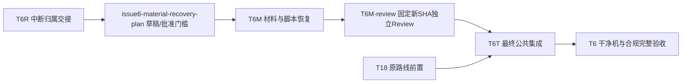

# Issue #6 材料精确恢复与写域澄清 v1 Implementation Plan

> **For agentic workers:** 状态 **awaiting_approval**。仅 Product 取得本文件固定 SHA、准确写域和所需全局路线新版批准后，派独立 Dev/Review；执行方法为 `superpowers:executing-plans`，不使用技能内部子代理替代团队独立 Review。本 Plan 不实施、不生成全局 v4。

**Goal：** 复用现存可静态核验的 #6 材料，修复来源清单与脚本消费接口，留下不可恢复的历史缺口，不重放中断操作。
**Architecture：** 保留现有打包器、检查器及占位包检查。来源清单保留组件归属，新增供两消费者使用的唯一文件列表，逐文件与独立允许列表双向核对；材料恢复 M 不写根 CMake，完整包集成留到 T6T。
**Tech Stack：** PowerShell、Python 标准库只读 tar/hash、现有 Qt 6.12.0 / MinGW / CMake / Ninja；不安装依赖。
**Spec：** `.workflow/parallel-plan-20261029-6-11-17/issue6-material-recovery-plan-contract.md`、批准三票 v1、全局 v3-A 及共享 README。

- run=`parallel-plan-20261029-6-11-17`；task=`issue6-material-recovery-plan`；attempt=1；role=plan；主工程 `E:/Git/TMOG-Public`。
- 固定材料树 W=`E:/Git/TMOG-Public-WorkTree/issue6-integration-20261029`；H=`940c5fbaad333a7416a6b50753edaab15d4a7b7c`。
- 原三票 v1 SHA=`d776056e1f579c195be14b37b113c72dd8e9ffebfe7cdb10194a63cdc19899e5`；全局 v3-A SHA=`ac8f189d42c207249b17af356262cc3fe09815e28ce2697f1129eb6f208cd69c`；本次只读实测均一致。
- Product 恢复证据中的 fetch 后 main=`2eb4b9dc466cd41d3379a405d0ebe2c4ad3221d3`，仅是恢复快照，不更新业务分支或宣称当前集成通过。

## Global Constraints

- 本次仅规划及静态读取；不下载源码包、不提取落盘、不构建/运行测试/应用/实验、不提交/发布/清理/关闭 Issue；不改 #11、DAG、state/events/BOARD 或历史报告/ops。
- 原许可获取授权 `tasks.issue6-technical.license_source_approval`：2026-10-29T14:03:44.791560Z，官方对应版本来源/静态安全提取/原材料及同范围检查；output 为 `W/build/issue6-license-source`。不能据此追认 `packaging/` 新增跟踪路径。
- 不运行下载、提取或许可内容；不从其目录运行解释器。Python 使用 `-I`，脚本与不可信下载/提取目录分离；不把归档成员交给通用 extractall。
- 跟踪写域无通配符；根 `CMakeLists.txt`、共享三票 v1 副本、C++、其他票与 `.gitignore` 均禁止 M 修改。
- 技术材料/占位检查/安全回归/真实应用/干净机/维护者合规分别验收；当前无完整 #6 关票、真实进程实验或外部分发许可。

## Review Focus

1. 合法 hash 清单可被整体改写：独立允许文件名必须仍拒绝新增路径，不能以自生成清单自证来源。
2. 新版来源清单只含 components：消费者要求顶层 files，当前不能工作；修复后正例必须实际通过。
3. 负例基包缺新版许可：N1–N15可因无关错误假绿；每个负例从已通过的完整占位基包开始，只改目标条件。
4. 路径含绝对/UNC/盘符/ADS/点段/大小写重复/链接：在任何读取、复制或删除之前拒绝，外部哨兵不得改变。
5. 28 文件与旧 22 receipt：22 个归档材料+6 个工具链材料只解释现状，不证明历史复制时刻、操作顺序或历史测试通过。

## 1. 查证事实与历史未知

证据基线：主工程 `.workflow/parallel-plan-20261029-6-11-17/recovery-20261031-evidence.json`，优先其 ops/manifest/files，不展开全部562文件。

| 来源 | 当前查证及影响 | 建议/受影响任务 |
|---|---|---|
| `issue6-technical/dev-3.ops.jsonl`（16行，SHA `81833ae7cea2825faa209024b0e1141216ff77ed18b7c43644c08ca9e12e3adb`） | 未配对 intent：a3-download-01、a3-negred-01、a3-sbom-read-01；孤立 receipt：a3-build-01b、a3-build-02、a3-extract-01b；dev-3.md不存在 | 标历史未知，不追加旧 receipt，不重放；T6R/M |
| 当前 Git HEAD/status | H未变；仅3脚本修改，license-sources.json及licenses未跟踪 | 原字节保留，后续新 attempt 接管前固定 hash；M |
| `packaging/license-sources.json`，SHA `69fd28520b2f9341a7347ca0b0060166df52403cac8298c2fc32a8a0a9bec3d9` | 顶层仅 schema/provenance/components；12组件（11内嵌+工具链汇总），29组件文件引用、28唯一文件（Unicode共享） | 当前22+6与28相符是静态解释；保留共享关系，新增唯一 files，非重获材料；M |
| `scripts/package-portable.ps1:43–45,97–115`、`scripts/check-package.ps1:69–98` | 均硬性要求 sources.files 非空，但当前JSON不存在该字段；制作器只判≥22，来源路径未先严格约束 | self_report根因：接口不一致；修复精确文件集合/路径预检，不执行现状脚本；M |
| `tests/package_checks.ps1:80–95,107–235,266–294,333–348` | N1–N15未调用Add-BundledLicenses，而检查器要求22文本+来源JSON；仅末尾正例完整；Run-Negative接受任意非零 | 用有效基包与目标诊断排除无关错误/解析异常；M |
| `packaging/THIRD-PARTY-NOTICES.md:31,95–105,137` | 仍写全文未随附pending，并将链接直接称满足offer；版本/修改断言不等于法律审核 | 同步真实材料交付状态，移除自动合规结论，不将来源URL等价签字；M、最终T6 |

当前3脚本 hash：
- check-package.ps1：`331e1af96f4f8ea16a81aaeddee7c5e4121c89e888a23978d1c8fdbef3ae26df`。
- package-portable.ps1：`28cd94f99a87481819bd0e5f6fa433edff51fd989410dac276265056d7c85a32`。
- package_checks.ps1：`07fb8b1426fe9e14e54fa02f569a5476d05a65bdecfcf391434076ebf4d779f6`。

本次静态来源核对（新操作，非历史重放）：读取现存 `W/build/issue6-license-source/downloads/qtbase-everywhere-src-6.12.0.tar.xz`，51220268 bytes；当前 SHA=`a951bd163c7b80fc6b8c88d7668fb56abf91c152373e13c10666763238131307`。按清单 source_member 唯一后缀找普通成员，只读最多2MiB单成员并算 hash；22文本与成员/清单 hash 全相同，未解压落盘。其余6文本与本机准确合法源相同：
- `E:/InstallApplication/Qt/Licenses/LICENSE`、`COPYING.txt`；
- `E:/InstallApplication/Qt/Tools/mingw1310_64/licenses/gcc/COPYING3`、`COPYING.RUNTIME`；
- 同工具链 `licenses/winpthreads/COPYING`、`licenses/mingw-w64/COPYING.MinGW-w64-runtime.txt`。

来源 hash 说明：当前WebFetch只读官方 `.sha256` 返回与上述相同hash，未落盘下载、未获取源码包；不再追加网络读取。该结果不证明旧下载网络跳转、TLS历史、签名或供应链认证。官方签名/GPG unknown；历史源码读取结果 unknown；各构件与SBOM版本对应/上游修改状态和完整对应源码交付仍须新证据与维护者确认；wintab版本unknown，NOASSERTION不得升级为确定许可。已有归档和文本可复用，不重复获取。

## 2. 准确写域选择与批准门槛

### A（推荐）：明确批准现存29条新增跟踪路径

原6条 M 写域 P6（相对W）：
1. `scripts/package-portable.ps1`
2. `scripts/check-package.ps1`
3. `packaging/README-PACKAGE.md`
4. `packaging/THIRD-PARTY-NOTICES.md`
5. `tests/package_checks.ps1`
6. `doc/plans/2026-10-29-issue-6-integration-acceptance.md`

新增精确集合 L29：`packaging/license-sources.json`，及以下每行加前缀 `packaging/licenses/` 的28文件，禁止使用整个目录通配授权：

```text
double-conversion-LICENSE.txt
freetype-BDF-LICENSE.txt
freetype-FTL.txt
freetype-GPL-2.0-only.txt
freetype-LICENSE.txt
freetype-PCF-LICENSE.txt
freetype-ZLIB-LICENSE.txt
gcc-COPYING.RUNTIME.txt
gcc-COPYING3.txt
harfbuzz-COPYING.txt
libjpeg-turbo-COPYRIGHT.txt
libjpeg-turbo-ijg-license.txt
libjpeg-turbo-LICENSE.txt
libpng-libpng-2.0-LICENSE.txt
libpng-LICENSE.txt
mingw-w64-runtime-COPYING.txt
pcre2-BSD-3-Clause-PCRE2-exception.txt
pcre2-LICENCE.md
pcre2-LICENSE-SLJIT.txt
Qt-COPYING.txt
Qt-LICENSE.txt
tinycbor-LICENSE.txt
unicode-Unicode-3.0.txt
winpthreads-COPYING.txt
wintab-Lcs-Telegraphics-LICENSE.txt
wintab-pktdef.h
wintab-wintab.h
zlib-LICENSE.txt
```

A实际修订P6及license-sources.json；28文本原则上只复用并跟踪，不改版权字节。需纠正文本来源/增加文件时先BLOCKED，再出新版本批准，不能删通知。本恢复计划副本也仅在后续发布合同明确列出 `doc/plans/2026-10-31-issue-6-material-recovery-plan-v1.md` 才可纳入任务提交。

**A不在当前v3-A路径上限内。选A必须独立批准L29，并另派Plan生成/批准全局v4，覆盖T6M及后继T6T对L29的携带和本计划副本；保持T6R→T6M→T6T及T18→T6T，不自行写DAG。** 新全局路线还须按其合同发现/并入本新增计划。未完成这两项不得派Dev；批准本草稿不自动批准v4。

### B：不扩大跟踪写域

仅P6范围内澄清现状/未知和修复可独立验证的脚本；已提取材料保留在原位置且不跟踪，不能提交现状中硬性依赖未跟踪JSON的“完整材料恢复”。本版不设计新外部材料参数/另一个打包器。T6M完整交付保持blocked，待用户选择A或另发缩范围设计合同；不会以B静默删除未跟踪材料或回退旧脚本。代价是完整#6材料仍未交付，但不影响v3-A无关就绪前沿。

## 3. 局部任务拓扑、路线映射与看板

下表为**候选单票细化**，不是当前派发授权。P6/L29定义见§2；D为主工程本任务报告目录，角色只写各自报告/ops。Review只读业务。路径重叠均通过依赖串行。

| task_id | Issue | 角色 | depends_on | allowed_paths | 验收摘要 |
|---|---|---|---|---|---|
| T6R | #6 | product | - | 无业务写域 | 读取历史缺口/释放旧Dev/固定H及批准记录；本请求属于其规划交接 |
| issue6-material-recovery-plan | #6 | plan | T6R | 本合同指定新计划、D/plan-1.md与本人ops/已登记附件 | 固定SHA草稿、批准问题和历史未知；不以交付等价用户批准 |
| T6M | #6 | dev | issue6-material-recovery-plan | A：P6+L29+单独列出的本计划副本；B：仅P6，完整交付blocked | 用户批准及v4门槛满足后最小接口修复/同范围新检查，不写公共根文件 |
| T6M-review | #6 | review | T6M | 无业务写域；仅本人报告/ops | 独立审查固定新head及批准计划/来源/负例证据；不是T6R额外核证Review |
| T6T | #6 | dev | T6M-review,T18 | 仅未来全局批准路径/单票集成合同；本版不授权 | 在原最终槽位完整公共集成/制作/回归，新SHA复审 |
| T6 | #6 | product | T6T | 无业务写域 | 干净Win11普通用户/维护者签字/原全部AC后方可关票 |



图是文字标注的单色结构草稿，表为等价可访问视图，未渲染，不声称视觉通过；无新增调度节点写入全局DAG。本局部Review属于原T6M完成门槛，不能以Dev自报解锁T6T。选A需v4路径覆盖，B不改旧依赖/前沿。Product按批准全局拓扑/额度派发、同步看板；本Plan不写state或BOARD。M不占root CMake/共享三票写域，可与无交集就绪任务并行；测试单进程串行，合并仍逐个。

## 4. 批准后实施顺序（本次未执行）

### M1：新 attempt 接管与证据固定

- [ ] Product记录本计划批准SHA、选择A/B、L29许可和所需全局v4；旧Dev确已退出后，只派一个新的M Dev，不恢复旧会话或重发旧intent。
- [ ] Dev按共享README在正确W核head/status/来源/3脚本hash与未跟踪清单；有额外差异先BLOCKED。不reset/stash/clean、不覆盖未知字节。按共享合同核自己的CodeGraph，不由本Plan写索引。
- [ ] 每次新操作有当前UTC、新operation_id及自己的intent/receipt，报告引用当前基线与来源hash。历史receipt只引用为self_report；不补日期、不认历史PASS。
- [ ] 独立记录28文件filename/size/hash/source_member或本机源、当前官方hash来源和unknown；只读复用，不再下载/提取。对Qt Network PSL/MPL等是否实际嵌入及qtsvg对应源码须新静态证据；缺项pending，不以“11组件”当完整清单覆盖上限。

### M2：最小来源模型、文档及路径修复

**文件：** §2 P6及（A获批时）license-sources.json；28许可文本不改。
**接口：** 保留 `schema="issue6-license-sources v1"`、provenance、components/license_files。新增顶层 `files`，28唯一条目每项 `{file,sha256}`；按相对路径排序，hash为64位小写hex。components允许Unicode共享同路径但必须同hash；冲突、缺项、未被组件引用或files重复（忽略大小写）拒绝。清单不是来源认证服务。

- [ ] 两消费者在任何复制/读取前验证上述结构、固定28允许路径及精确双向集合；拒绝空/未知schema、缺字段/非字符串hash、大小写重复、absolute/UNC/drive/ADS/反斜杠/`.`/`..`/空段、链接/非普通文件。先验证完整输入，再复制；不仅用`Count>=22`。
- [ ] 制作器复制28精确条目一次，工具链6文本若现场hash与已核定列表不一致先失败，不能先从本机覆盖再将失配隐藏。没有新Qt/工具链版本自动泛化，新增组件须澄清审批。
- [ ] 检查器维持独立文件白名单、MANIFEST hash+size双向，拒绝任意清单新增许可/未知组件。更新来源JSON路径校验，不能允许读取包外文件；包/source/build已存在祖先、重解析点和下级检查目录全部核真实路径。
- [ ] tests WorkDir要求恰好W/build下已登记新叶；首次非空或链接拒绝；内部case删除仅在本次登记且确认普通目录时允许，不以字符串前缀代替归属。制作器也须拒绝不明portable/链接输出。
- [ ] README/NOTICES写现存材料已核的来源与hash、未知/待审核；不再写未经证明“全文全未随附”，也不称“来源链接即满足offer”“全部上游未修改”或“已完整合规”。GCC全文/例外分开，winpthreads保留完整含所有版权条款；Qt内嵌第三方不被LGPL总标签覆盖。

### M3：有效基包与准确新检查

**接口不变：** `tests/package_checks.ps1 -SourceDir W -WorkDir B -QtDir QT -MinGWDir MINGW -CMakeExe CMAKE -NinjaExe NINJA`；checker `-PackageDir`，通过exit0、检测失败exit1。检查只构造无害占位文件，不执行其EXE/DLL。

- [ ] New-BasePackage构造完整占位许可/顶层files/组件映射，让每个未变异基包先exit0；N1–N15在此基础仅变异目标，移除重复Add-BundledLicenses造成的覆盖。N4只篡改清单数字size且保留正确hash，以准确命中size；N16仅删一个必要许可并保持其正确声明；N17仅改内容，N18仅删声明/文件目标，N19仅加入未知许可。
- [ ] 保留N1–N19各编号和P-good；各负例必须checker exit1及明确目标FAIL诊断，不接受PowerShell解析/崩溃任意非零。有效正例先、后都通过，checker故意忽略目标失败时相应case必须报告检查失效。
- [ ] 新增清单schema缺失、components/files冲突、大小写重复、整体重写JSON+MANIFEST加入未知许可、来源路径逃逸/ADS、nested license子目录及输出链接/已有未知目录拒绝的最小case。外部哨兵hash不变；环境不允许建链接则该项未验证并BLOCKED，不改ACL/提权。无新的公共测试框架或helper。
- [ ] 一次安全子集新检查结束后写准确总case数、逐case目标诊断/退出码和自检失败数；不是历史a3-negred receipt。旧构建/测试日志只参考，本次不声称通过。

## 5. 准确未来命令与产物边界

所有以下命令是**批准后**执行，本Plan没有运行。复用已安装绝对工具，执行前重新只读核存在/版本；不持久改PATH。W固定如上，若Product另派fresh worktree，须把路径/材料迁移边界写进新合同，不默用此旧树。

```powershell
$W='E:/Git/TMOG-Public-WorkTree/issue6-integration-20261029'
$QT='E:/InstallApplication/Qt/6.12.0/mingw_64'
$MINGW='E:/InstallApplication/Qt/Tools/mingw1310_64'
$CMAKE='D:/InstallApplication/CMake/bin/cmake.exe'
$CTEST='D:/InstallApplication/CMake/bin/ctest.exe'
$NINJA='E:/InstallApplication/Qt/Tools/Ninja/ninja.exe'
$GXX="$MINGW/bin/g++.exe"
git -C $W rev-parse HEAD
if ($LASTEXITCODE -ne 0) { throw 'head query failed' }
git -C $W status --porcelain
if ($LASTEXITCODE -ne 0) { throw 'status query failed' }
# 只静态解析三个脚本，不执行脚本
foreach ($f in 'scripts/package-portable.ps1','scripts/check-package.ps1','tests/package_checks.ps1') {
  $tokens=$null; $errors=$null
  [System.Management.Automation.Language.Parser]::ParseFile("$W/$f",[ref]$tokens,[ref]$errors) | Out-Null
  if ($errors.Count) { throw "parse failed: $f" }
}
# 在首建前核祖先真实路径/链接及不存在，登记本次归属；旧检查目录不复用
$B="$W/build/issue6-m-recovery-checks"
if (Test-Path -LiteralPath $B) { throw 'new checks boundary already exists' }
& pwsh -NoProfile -File "$W/tests/package_checks.ps1" -SourceDir $W -WorkDir $B -QtDir $QT -MinGWDir $MINGW -CMakeExe $CMAKE -NinjaExe $NINJA
if ($LASTEXITCODE -ne 0) { throw 'new material checks failed' }
& pwsh -NoProfile -File "$W/scripts/check-package.ps1" -PackageDir "$B/case-P-good"
if ($LASTEXITCODE -ne 0) { throw 'positive fixture failed' }
```

M仅需要上面占位/材料检查，不为材料恢复重建整应用。下面仅在Product另授权所需安全回归时使用，非M必须先行完整打包；两个输出首建前各核不存在/祖先链接/归属，禁止复用旧build。现H原库存要求恰好4安全test；main/来源变化则由新集成合同重新固定库存，不能用过滤偷偷漏掉新增必需检查。

```powershell
$env:PATH="$QT/bin;$MINGW/bin;$env:PATH"
$env:QT_QPA_PLATFORM='offscreen'
$env:QT_QPA_PLATFORM_PLUGIN_PATH="$QT/plugins/platforms"
foreach ($cfg in 'Debug','Release') {
  $B="$W/build/issue6-m-recovery-$($cfg.ToLower())"
  if (Test-Path -LiteralPath $B) { throw 'new build boundary already exists' }
  & $CMAKE -S $W -B $B -G Ninja "-DCMAKE_BUILD_TYPE=$cfg" "-DCMAKE_PREFIX_PATH=$QT" "-DCMAKE_CXX_COMPILER=$GXX" "-DCMAKE_MAKE_PROGRAM=$NINJA"
  if ($LASTEXITCODE -ne 0) { throw "configure failed: $cfg" }
  & $CMAKE --build $B --parallel 2
  if ($LASTEXITCODE -ne 0) { throw "build failed: $cfg" }
  & $CTEST --test-dir $B -N -R '^(process_checks|close_lifecycle_checks|sampling_recovery_checks|stale_persistence_checks)$'
  if ($LASTEXITCODE -ne 0) { throw 'inventory failed' }
  # 记录且核实恰好4个名称后才执行；Qt缺失/0 tests必须BLOCKED
  & $CTEST --test-dir $B --no-tests=error --output-on-failure --timeout 120 -j 1 -R '^(process_checks|close_lifecycle_checks|sampling_recovery_checks|stale_persistence_checks)$'
  if ($LASTEXITCODE -ne 0) { throw "safe checks failed: $cfg" }
}
```

原始提取目录只读保留，无新source output。新checks≤128MiB/5分钟；获批Debug/Release各≤2GiB/15分钟、单构建器parallel2、test串行。超时/不足记录失败，不能自动清理旧目录/杀未知进程。日志仅新checks/build边界及角色私有报告目录。恢复计划/材料同范围确认不授权默认package-portable完整制作；T6T在T18后以其准确新集成合同运行现有制作命令与两次重建核对，绑定最终main新SHA，禁止拿H旧包作为最终包。全量ctest、process_ops_checks、应用启动和真实受控终止均不运行。

## 6. 独立 Review、发布和人工门槛

- [ ] Dev完成新固定head，正常限定提交由未来开发合同授权；报告列base/H/newhead、批准本计划及全局版SHA、准确changed/untracked列表、来源hash、新检查命令/退出/诊断、历史未知和未验证项。不得自动git add整树。
- [ ] 独立Review只读固定新head，核P6/L29许可、文本版权字节、来源对应及清单接口、正例/每个负例目标、路径/输出归属和无默认启动器。Dev审查期间停写。M技术PASS不等于原#6完整验收；不另开纯核证Review复核T6R。
- [ ] H或任意新head改变后，旧Technical PASS和旧build不用于放行新SHA；新基点回归、新固定SHA独立复审。根CMake/UI问题超出M则BLOCKED交Product，不能顺手修#11/公共注册。
- [ ] 最终T6T按全局槽位完成公共包制作/安全回归/新SHA Review，技术部分合并仍需Product固定SHA发布放行及原明确部分合并许可；本Plan不启动IssueWriter。新材料跟踪不等于对外分发许可。
- [ ] 干净未装Qt/开发工具Win11x64普通用户、真实页面运行/两帧采样/排序/暂停恢复/关闭、维护者完整第三方材料/准确对应源码/修改信息/替换与调试权利签字仍由原T6人工门槛独立完成。开发机清PATH不等价干净机器，技术Review不代法律结论。缺门槛Issue #6保持OPEN。

## 7. 批准待办、风险与自查

- [ ] 用户经Product批准本v1固定SHA，选择A（推荐）或B；A明确批准L29跟踪及限定计划副本，不追认旧“contract-authorized”自报。
- [ ] A另派新Plan制定全局v4并获独立批准，覆盖新增路径在M/T及后继携带；本新增计划的全局覆盖亦由Product处理。当前v3-A保持不改，不按草稿派发。
- [ ] 接受历史三个未配对intent/三个孤立receipt及缺报告为永久历史缺口；新结果只建立新证据，不作为历史修复。
- [ ] 原获取授权保持，不重复问已准官方静态获取，也不为补证重复下载。遇到新版本/组件/来源/许可缺项扩大范围另出计划及SHA。
- [ ] 选择后由Product发新Dev attempt完整合同/归属及必要新检查权限；原人工环境、真实实验、外部分发、安装/系统修改门槛不降低。

风险：当前hash仅证明现存字节与特定来源相等，不认证上游供应链/完整法律义务；Qt Network PSL等覆盖未定时不能称完整材料；无链接权限会留路径安全case未测；B停在材料未交付；A需要v4多一个批准门槛但不应阻塞无关前沿。不可用/unknown明确保留，不新增下载器/框架。

自查已完成（self_report）：合同目标与每条验收映射到§1–7；P6/L29逐文件，公共写域禁改；局部表图边一致，重叠M/T串行；实际根因与诊断引用当前源码；新操作不回填旧receipt；材料可复用不再获取；新检查、Review、新SHA与人工层明确。未执行功能测试/构建/应用，未生成v4、未批准实施。
