# Windows 全量路线拓扑与执行顺序 v4-A Implementation Plan

> **For agentic workers:** 本文件 **awaiting_approval**，仅有一个完整 A DAG。Product 取得本文件固定 SHA 的独立用户批准后切换；不沿用 v3 的批准冒称 v4 获批。实施仍由团队独立 Dev/Review，使用 `superpowers:executing-plans`，本 Plan 不启动成员。

**Goal：** 将已批准 #6 材料恢复 v1-A 的精确写域及局部映射并入全局路线，保持其余公共槽位、原生依赖与人工门。
**Architecture：** 从固定 v3-A 表继承，新增 T6P 规划交接节点；T6R→T6P→T6M→T6T，T18→T6T 保留。M 的独立 Review 是其完成门槛，不新增纯核证 Review；最终公共链和其他票写域不变。
**Tech Stack：** 既有 C++20、Qt6 Core/Widgets、Windows、CMake≥3.21；本次仅 Python 标准库结构校验，不构建应用。
**Spec：** `.workflow/parallel-plan-20261029-6-11-17/master-topology-v4-contract.md`、共享 README/AGENTS、固定 v3-A 与 #6 恢复 v1-A。

- run=`parallel-plan-20261029-6-11-17`；task=`master-topology-v4`；attempt=1；role=plan；root=`E:/Git/TMOG-Public`。
- 当前批准全局 v3-A SHA=`ac8f189d42c207249b17af356262cc3fe09815e28ce2697f1129eb6f208cd69c`，原文件保留。
- 恢复 v1-A SHA=`97157b9673365a3d0b5ca3cee768cd86c59a5c88fbb751517ef6c834447fab04`；用户经 Product 选择“批准A并规划v4（推荐）”，批准时间 `2026-10-31T07:45:43.450216+00:00`。来源是 state 中 implementation_approval/master-topology-v4.approval，不是旧 Plan 自报批准。
- 只读 Git 当前主工程 HEAD=`2eb4b9dc466cd41d3379a405d0ebe2c4ad3221d3`；只是观察，不是未来 Dev 的 base。

## Global Constraints

- 所有计划只在 doc/plans；私有证据不入 Git。v4 批准不代替未来单票具体接口、测试命令、产物边界和人工/发布授权。
- 精确路径以工程相对文件列出，不使用通配符；路径交集必须依赖可达，worktree 独立与顺序合并不能代替边。Review 期间 Dev 停写，head 变化旧 PASS 失效。
- 仅增加恢复 v1-A §2 的 P6+L29+限定恢复计划副本；28文本复用跟踪，原则上不改版权字节。缺项/新增来源/新版本/改文本先 BLOCKED，经新计划批准。
- M 不写根 CMake、共享三票副本或 C++；T6T保留原最终公共槽位与原写域，仅携带本次新增精确文件。T15/T12的现有树继承材料不授权主动改写L29或恢复计划。
- 不取包/构建应用/运行业务或真实实验/修改历史/state/events/BOARD/config/提交发布清理；不新增框架、提权、安装或全局环境改动。
- #11 当前证据/授权 blocked，不使用旧0627ab4 PASS，不自动增加预算或规划修复；#17 accepted 模块不重做。技术交付不等于 Issue 关闭。

## Review Focus

1. 遗漏 M/T 的任一许可路径或限定副本：精确集合正例及材料/副本缺项负例必须拒绝。
2. 删除 M→T 或材料规划门：材料链与共享文件交集可达检查必须拒绝；M的独立Review不能被Dev自报替代。
3. 表图漂移或混入旧 B：单表/单图/节点边一致及变体标记负例必须拒绝。
4. 原生依赖/公共槽位断裂：逐票原生OPEN边及A公共链断言必须拒绝；不使用Issue编号猜前置。
5. 把历史PASS/已授权当就绪：状态与授权来源单列；结构校验不证明权限、业务、GUI、实机或合规。

## 1. 差异、来源、问题与覆盖

| 来源 | 影响 | 本版处理/受影响任务 |
|---|---|---|
| 恢复v1-A §2 + 当前用户批准 | 新增29条材料跟踪路径与一个限定恢复计划副本，旧v3-A未覆盖 | T6M/T6T逐文件扩展；新增T6P映射，不改变其余槽位 |
| state当前任务与v4合同 | #6 H940c5fba中断静态核定，历史未配对intent/孤立receipt/缺报告仍unknown | T6R只交接；T6P已交付批准，M等v4独立批准和新attempt合同，不重放未知操作 |
| state global_dag与当前#11合同 | global_dag保留旧0627ab4描述，不是当前可放行状态 | T11R/T11T验收文字改成暂停，当前978b1d8证据/授权blocked；不改原业务写域/顺序 |
| 既有accepted与许可登记 | #17模块30eec4d accepted；#13 A-only许可已登记但技术前置不满足 | T17S保持交接不重做；T13P不再当未授权，T13T仍等T11T；B/第四人工门不降低 |
| 本次逐票只读gh新快照 | 31 OPEN及32次只读调用，逐票blocked_by含状态 | 单一完整表精确覆盖；快照不是派发时永久状态，Product每次恢复/完成/看板前重查 |
| doc/plans现有计划清单 | #6恢复v1新增；#11 helper/hb/segment/guard coverage/evidence/disposition计划是同票返工历史，不是独立新功能 | #6映射T6P/M/T；#11全部映射T11R/T11T暂停节点，不自行扩范围或重启；其他研究/历史与v1–v3保持原分类 |

完整计划文件清单与逐文件SHA在本任务 `plan-1-remote.json` 的 plan_inventory。v3 §7 历史Windows索引/manifest/W01–W36、#7/#8/#9/#10研究合同及已关闭票检查分类继续沿用，不运行publish脚本、不自动TeamReview。CLOSED #1/#5/#7/#8/#9/#10/#14/#16不重做；#2继续暂缓；#41只是Windows总览。新票仍须独立单票Plan/批准，路线不是所有功能一次性批准。

## 2. 局部映射、状态与派发门槛

- 恢复v1局部 `issue6-material-recovery-plan` → 全局 **T6P**，文件是已批准v1，不重写历史。该节点的allowed_paths描述已授权/已交付计划，不授权本Plan或Dev修改它；Dev只携带固定相同副本。
- 局部 `T6M-review` → 全局 **T6M完成门槛**：固定新head、来源/路径/正负例的独立Review交付验收；无新增全局Review节点，Product不能把Dev完成当T6M完成。
- 局部 T6R/M/T/最终T6 分别映射同名全局节点；T6R→T6P是必要规划交接，T6P→T6M是新增批准计划前置。T6M→T6T及T18→T6T保留；新路径与计划副本在T6P/M/T之间交集均有可达边。
- 状态文字是快照而非自动转换：T6R=静态核定交接、历史unknown且Product旧DAG仍blocked；T6P=交付accepted且v1-A获批；T6M=等本v4批准/新Dev合同；T6T=未开始/等M与T18；T6=干净机与合规未闭环。
- T11R/T11T=blocked；T17S=accepted30eec4db54bf7bd57ad19a14d00e06ddf9088227，不等于导航集成完成；T13P=许可completed，T13T=技术前置未满足；T2=暂缓。其余槽位沿原路线依赖等待，未宣称本次功能验收。

## 3A. 唯一完整任务拓扑表（v4-A）

所有任务路径是路线上限；后续单票合同需准确子集，角色私有报告/ops与新产物由该单票另列，不通配授权。product/review的“-”表示无业务写域；Review只写自己的报告。每个dev节点的完成含批准范围、新检查、固定新SHA独立Review、必要集成/发布验收；含完整票T<number>须原AC/实机门满足才解锁原生后继。

| task_id | Issue | 角色 | depends_on | allowed_paths | 验收摘要 |
|---|---|---|---|---|---|
| T6R | #6 | product | - | - | 固定H940c5fba与现存归属、历史未知及当前批准；静态核定不补历史receipt，不新增核证Review；Product完成交接门槛后解锁T6P |
| T11R | #11 | review | - | - | 当前978b1d8证据/授权blocked，保持暂停；旧0627ab4 PASS不放行；Product取得范围/预算决策及必要新计划批准后，才另发固定新SHA审查合同；本版不授权修复 |
| T17S | #17 | product | - | - | 核既有accepted30eec4模块与Review引用后交接，不新增核证Review、不重开发 |
| T2 | #2 | plan | - | - | 明确macOS/Linux暂缓，无实施 |
| T6P | #6 | plan | T6R | doc/plans/2026-10-31-issue-6-material-recovery-plan-v1.md | 映射已交付并获2026-10-31T07:45:43.450216+00:00用户批准的issue6-material-recovery-plan v1-A；本节点不重写该文件；仍须本v4另批准后才派M |
| T6M | #6 | dev | T6P | scripts/package-portable.ps1;scripts/check-package.ps1;packaging/README-PACKAGE.md;packaging/THIRD-PARTY-NOTICES.md;tests/package_checks.ps1;doc/plans/2026-10-29-issue-6-integration-acceptance.md;packaging/license-sources.json;packaging/licenses/double-conversion-LICENSE.txt;packaging/licenses/freetype-BDF-LICENSE.txt;packaging/licenses/freetype-FTL.txt;packaging/licenses/freetype-GPL-2.0-only.txt;packaging/licenses/freetype-LICENSE.txt;packaging/licenses/freetype-PCF-LICENSE.txt;packaging/licenses/freetype-ZLIB-LICENSE.txt;packaging/licenses/gcc-COPYING.RUNTIME.txt;packaging/licenses/gcc-COPYING3.txt;packaging/licenses/harfbuzz-COPYING.txt;packaging/licenses/libjpeg-turbo-COPYRIGHT.txt;packaging/licenses/libjpeg-turbo-ijg-license.txt;packaging/licenses/libjpeg-turbo-LICENSE.txt;packaging/licenses/libpng-libpng-2.0-LICENSE.txt;packaging/licenses/libpng-LICENSE.txt;packaging/licenses/mingw-w64-runtime-COPYING.txt;packaging/licenses/pcre2-BSD-3-Clause-PCRE2-exception.txt;packaging/licenses/pcre2-LICENCE.md;packaging/licenses/pcre2-LICENSE-SLJIT.txt;packaging/licenses/Qt-COPYING.txt;packaging/licenses/Qt-LICENSE.txt;packaging/licenses/tinycbor-LICENSE.txt;packaging/licenses/unicode-Unicode-3.0.txt;packaging/licenses/winpthreads-COPYING.txt;packaging/licenses/wintab-Lcs-Telegraphics-LICENSE.txt;packaging/licenses/wintab-pktdef.h;packaging/licenses/wintab-wintab.h;packaging/licenses/zlib-LICENSE.txt;doc/plans/2026-10-31-issue-6-material-recovery-plan-v1.md | 恢复v1-A与本v4固定SHA均获批后，新attempt复用28文本，修复components/files与有效基包负例；新检查及固定新head独立Review；不写根CMake/共享三票副本，不重取包/启动应用/制作完整包 |
| T13P | #13 | product | - | - | 已有A-only技术集成/条件部分合并许可登记；不是技术PASS；保留B/helper/第四人工/公网发布未授权，T13T仍等T11T |
| T6T | #6 | dev | T6M,T18 | CMakeLists.txt;scripts/package-portable.ps1;scripts/check-package.ps1;packaging/README-PACKAGE.md;packaging/THIRD-PARTY-NOTICES.md;tests/package_checks.ps1;doc/plans/2026-10-29-issue-6-integration-acceptance.md;doc/plans/2026-10-29-issues-6-11-17-parallel-plan-v1.md;packaging/license-sources.json;packaging/licenses/double-conversion-LICENSE.txt;packaging/licenses/freetype-BDF-LICENSE.txt;packaging/licenses/freetype-FTL.txt;packaging/licenses/freetype-GPL-2.0-only.txt;packaging/licenses/freetype-LICENSE.txt;packaging/licenses/freetype-PCF-LICENSE.txt;packaging/licenses/freetype-ZLIB-LICENSE.txt;packaging/licenses/gcc-COPYING.RUNTIME.txt;packaging/licenses/gcc-COPYING3.txt;packaging/licenses/harfbuzz-COPYING.txt;packaging/licenses/libjpeg-turbo-COPYRIGHT.txt;packaging/licenses/libjpeg-turbo-ijg-license.txt;packaging/licenses/libjpeg-turbo-LICENSE.txt;packaging/licenses/libpng-libpng-2.0-LICENSE.txt;packaging/licenses/libpng-LICENSE.txt;packaging/licenses/mingw-w64-runtime-COPYING.txt;packaging/licenses/pcre2-BSD-3-Clause-PCRE2-exception.txt;packaging/licenses/pcre2-LICENCE.md;packaging/licenses/pcre2-LICENSE-SLJIT.txt;packaging/licenses/Qt-COPYING.txt;packaging/licenses/Qt-LICENSE.txt;packaging/licenses/tinycbor-LICENSE.txt;packaging/licenses/unicode-Unicode-3.0.txt;packaging/licenses/winpthreads-COPYING.txt;packaging/licenses/wintab-Lcs-Telegraphics-LICENSE.txt;packaging/licenses/wintab-pktdef.h;packaging/licenses/wintab-wintab.h;packaging/licenses/zlib-LICENSE.txt;doc/plans/2026-10-31-issue-6-material-recovery-plan-v1.md | T6M固定新SHA独立Review交付及T18完整前置后，原最终公共槽位携带精确L29/恢复计划副本，按另批集成合同制作与安全回归并复审新SHA；不得沿用H旧包或擅改版权文本/新增材料 |
| T6 | #6 | product | T6T | - | 干净Win11普通用户与第三方材料签字，完整AC后关闭 |
| T11T | #11 | dev | T11R | src/ProcessSnapshot.h;src/ProcessSampler.h;src/ProcessSampler.cpp;src/platform/WindowsProcesses.cpp;src/ProcessTableModel.h;src/ProcessTableModel.cpp;tests/process_checks.cpp;CMakeLists.txt;tests/io_table_checks.cpp;tests/io_activity_checks.cpp;doc/plans/2026-10-29-issue-11-acceptance.md;doc/plans/2026-10-29-issues-6-11-17-parallel-plan-v1.md;src/MainWindow.cpp | T11R当前证据/授权及独立审查门槛未满足，暂停；未来仅按已批准精确合同fresh main必要集成/安全回归、新SHA复审，不以旧0627ab4 PASS放行或自动增加预算 |
| T11 | #11 | product | T11T | - | 受控I/O、原安全实机及UI门槛，完整AC后关闭 |
| T17U | #17 | dev | T13T,T17S | src/MainWindow.h;src/MainWindow.cpp;src/main.cpp;CMakeLists.txt;src/DisplaySettings.h;src/DisplaySettings.cpp;tests/settings/settings_checks.cpp;tests/settings/CMakeLists.txt;tests/navigation_settings_checks.cpp;tests/stale_persistence_checks.cpp;doc/plans/2026-10-29-issue-17-acceptance.md;doc/plans/2026-10-29-issues-6-11-17-parallel-plan-v1.md | 按原批准迁入模块，真实导航设置/单worker/关闭路径安全检查 |
| T17 | #17 | product | T17U | - | 实际桌面鼠标键盘缩放重启验收，全部AC后关闭 |
| T19I | #19 | dev | T17 | src/SystemPerformance.h;src/SystemPerformance.cpp;src/PerformancePage.h;src/PerformancePage.cpp;tests/issue19/CMakeLists.txt;tests/issue19/performance_checks.cpp | 系统CPU/内存独立来源与五分钟有界历史/缺样检查 |
| T19 | #19 | dev | T19I,T17U | CMakeLists.txt;src/MainWindow.h;src/MainWindow.cpp;src/SamplingWorker.h;src/SamplingWorker.cpp;tests/issue19/performance_integration_checks.cpp;doc/plans/2026-10-30-issue-19-acceptance.md | 调度集成不重入，与任务管理器同口径趋势及实际UI |
| T32I | #32 | dev | T19 | src/DiskPerformance.h;src/DiskPerformance.cpp;src/DiskPerformanceView.h;src/DiskPerformanceView.cpp;tests/issue32/CMakeLists.txt;tests/issue32/disk_checks.cpp | 设备身份/计数复位/插拔/失败，无吞吐猜活动率 |
| T33I | #33 | dev | T19 | src/NetworkPerformance.h;src/NetworkPerformance.cpp;src/NetworkPerformanceView.h;src/NetworkPerformanceView.cpp;tests/issue33/CMakeLists.txt;tests/issue33/network_checks.cpp | 接口身份/重连复位/缺样有界，不抓载荷 |
| T27I | #27 | dev | T17 | src/PowerPage.h;src/PowerPage.cpp;src/PowerSnapshot.h;src/PowerSnapshot.cpp;tests/issue27/CMakeLists.txt;tests/issue27/power_checks.cpp | 沿#9可信来源，功耗温度无来源明确不可用 |
| T31I | #31 | dev | T19 | src/ProcessorTopologyView.h;src/ProcessorTopologyView.cpp;src/ProcessorTopology.h;src/ProcessorTopology.cpp;tests/issue31/CMakeLists.txt;tests/issue31/topology_checks.cpp | 多组NUMA/未知P-E模型不猜测，特殊硬件证据分层 |
| T35I | #35 | dev | T19 | src/SelfMonitorView.h;src/SelfMonitorView.cpp;tests/issue35/CMakeLists.txt;tests/issue35/self_monitor_checks.cpp | 真实自身身份、非递归测量与开关/开销对照 |
| T20I | #20 | dev | T17 | src/SystemInfoPage.h;src/SystemInfoPage.cpp;tests/issue20/CMakeLists.txt;tests/issue20/system_info_checks.cpp | 系统字段逐项来源与失败、后台查询 |
| T21I | #21 | dev | T17 | src/StartupAppsPage.h;src/StartupAppsPage.cpp;tests/issue21/CMakeLists.txt;tests/issue21/startup_checks.cpp | Run/启动目录只读解析去重，不执行命令 |
| T22I | #22 | dev | T17 | src/UsersPage.h;src/UsersPage.cpp;tests/issue22/CMakeLists.txt;tests/issue22/users_checks.cpp | 会话可信关联/权限与退出，敏感信息本地 |
| T23I | #23 | dev | T17 | src/ServicesPage.h;src/ServicesPage.cpp;tests/issue23/CMakeLists.txt;tests/issue23/services_checks.cpp | SCM只读、部分配置失败和取消资源释放 |
| T24I | #24 | dev | T17 | src/InstalledAppsPage.h;src/InstalledAppsPage.cpp;tests/issue24/CMakeLists.txt;tests/issue24/apps_checks.cpp | 来源/视图/去重与坏记录，不执行卸载 |
| T25I | #25 | dev | T17 | src/DiskSpacePage.h;src/DiskSpacePage.cpp;tests/issue25/CMakeLists.txt;tests/issue25/space_checks.cpp | 卷身份容量与慢卷取消，不扫描/写用户文件 |
| T26I | #26 | dev | T17 | src/ConnectionsPage.h;src/ConnectionsPage.cpp;tests/issue26/CMakeLists.txt;tests/issue26/connections_checks.cpp | 沿#8 v2本机只读合同，退出/PID复用不可误认 |
| T28I | #28 | dev | T17 | src/BenchmarksPage.h;src/BenchmarksPage.cpp;tests/issue28/CMakeLists.txt;tests/issue28/benchmark_checks.cpp | 沿#10有界算法，小输入取消超时检查，不默认负载 |
| T30I | #30 | dev | T17 | src/DriversPage.h;src/DriversPage.cpp;tests/issue30/CMakeLists.txt;tests/issue30/drivers_checks.cpp | 已加载视角，元数据逐项不可用，不加载驱动 |
| T32 | #32 | dev | T32I,T19 | CMakeLists.txt;src/MainWindow.h;src/MainWindow.cpp;src/PerformancePage.h;src/PerformancePage.cpp;src/SamplingWorker.h;src/SamplingWorker.cpp;tests/issue32/disk_integration_checks.cpp;doc/plans/2026-10-30-issue-32-acceptance.md | 磁盘性能注册与受控趋势实机/实际UI，完整AC |
| T33 | #33 | dev | T33I,T32 | CMakeLists.txt;src/MainWindow.h;src/MainWindow.cpp;src/PerformancePage.h;src/PerformancePage.cpp;src/SamplingWorker.h;src/SamplingWorker.cpp;tests/issue33/network_integration_checks.cpp;doc/plans/2026-10-30-issue-33-acceptance.md | 网络性能注册与受控本机流量对照、完整AC |
| T27 | #27 | dev | T27I,T33 | CMakeLists.txt;src/MainWindow.h;src/MainWindow.cpp;src/SamplingWorker.h;src/SamplingWorker.cpp;tests/issue27/power_integration_checks.cpp;doc/plans/2026-10-30-issue-27-acceptance.md | 来源支持矩阵/机型实测、历史缺样及UI，完整AC |
| T31 | #31 | dev | T31I,T27 | CMakeLists.txt;src/MainWindow.h;src/MainWindow.cpp;src/PerformancePage.h;src/PerformancePage.cpp;src/SamplingWorker.h;src/SamplingWorker.cpp;tests/issue31/topology_integration_checks.cpp;doc/plans/2026-10-30-issue-31-acceptance.md | 多组模型及普通实机，特殊机器未测明确标限制 |
| T35 | #35 | dev | T35I,T31 | CMakeLists.txt;src/MainWindow.h;src/MainWindow.cpp;src/SamplingWorker.h;src/SamplingWorker.cpp;tests/issue35/self_monitor_integration_checks.cpp;doc/plans/2026-10-30-issue-35-acceptance.md | 开关实际测量/环境对照记录，完整AC |
| T20 | #20 | dev | T20I,T35 | CMakeLists.txt;src/MainWindow.h;src/MainWindow.cpp;tests/issue20/system_info_integration_checks.cpp;doc/plans/2026-10-30-issue-20-acceptance.md | 普通用户系统字段对照/键盘缩放与失败恢复 |
| T21 | #21 | dev | T21I,T20 | CMakeLists.txt;src/MainWindow.h;src/MainWindow.cpp;tests/issue21/startup_integration_checks.cpp;doc/plans/2026-10-30-issue-21-acceptance.md | 本机只读来源对照与UI，不修改启动项 |
| T22 | #22 | dev | T22I,T21 | CMakeLists.txt;src/MainWindow.h;src/MainWindow.cpp;tests/issue22/users_integration_checks.cpp;doc/plans/2026-10-30-issue-22-acceptance.md | 当前会话对照，多用户缺证据不宣称覆盖 |
| T23 | #23 | dev | T23I,T22 | CMakeLists.txt;src/MainWindow.h;src/MainWindow.cpp;tests/issue23/services_integration_checks.cpp;doc/plans/2026-10-30-issue-23-acceptance.md | 普通用户只读服务实测/搜索刷新完整AC |
| T24 | #24 | dev | T24I,T23 | CMakeLists.txt;src/MainWindow.h;src/MainWindow.cpp;tests/issue24/apps_integration_checks.cpp;doc/plans/2026-10-30-issue-24-acceptance.md | 系统应用按覆盖范围对照/Unicode缺字段UI |
| T25 | #25 | dev | T25I,T24 | CMakeLists.txt;src/MainWindow.h;src/MainWindow.cpp;tests/issue25/space_integration_checks.cpp;doc/plans/2026-10-30-issue-25-acceptance.md | 容量同口径/慢卷不冻结与实际UI |
| T26 | #26 | dev | T26I,T25 | CMakeLists.txt;src/MainWindow.h;src/MainWindow.cpp;tests/issue26/connections_integration_checks.cpp;doc/plans/2026-10-30-issue-26-acceptance.md | 获授权受控本机端点可见及进程关联完整AC |
| T28 | #28 | dev | T28I,T26 | CMakeLists.txt;src/MainWindow.h;src/MainWindow.cpp;tests/issue28/benchmark_integration_checks.cpp;doc/plans/2026-10-30-issue-28-acceptance.md | 用户主动实机有界运行/取消/关闭，完整AC |
| T30 | #30 | dev | T30I,T28 | CMakeLists.txt;src/MainWindow.h;src/MainWindow.cpp;tests/issue30/drivers_integration_checks.cpp;doc/plans/2026-10-30-issue-30-acceptance.md | 普通用户已加载清单对照与权限边界完整AC |
| T34I | #34 | dev | T23 | src/ServiceControl.h;src/ServiceControl.cpp;tests/issue34/CMakeLists.txt;tests/issue34/service_control_checks.cpp | fake策略确认/取消/未知依赖拒绝，不操作真实服务 |
| T36I | #36 | dev | T19,T32,T33 | src/SummaryPage.h;src/SummaryPage.cpp;tests/issue36/CMakeLists.txt;tests/issue36/summary_checks.cpp | 复用同快照、不重复采样、区域失败隔离 |
| T37I | #37 | dev | T33 | src/ProcessNetwork.h;src/ProcessNetwork.cpp;tests/issue37/CMakeLists.txt;tests/issue37/process_network_checks.cpp | 严格#7事件/身份/丢失/权限合同，不按接口分摊 |
| T38I | #38 | dev | T19,T32,T33,T27 | src/RecordingFormat.h;src/RecordingFormat.cpp;src/FlightRecorder.h;src/FlightRecorder.cpp;tests/issue38/CMakeLists.txt;tests/issue38/recording_checks.cpp | 独立格式30分钟/100MiB上限，取消写不损旧文件 |
| T29 | #29 | dev | T30 | CMakeLists.txt;src/MainWindow.h;src/MainWindow.cpp;src/DisplaySettings.h;src/DisplaySettings.cpp;src/Theme.h;src/Theme.cpp;tests/issue29/theme_checks.cpp;doc/plans/2026-10-30-issue-29-acceptance.md | 系统跟随加六主题恢复，语义/焦点/对比非只靠颜色 |
| T34 | #34 | dev | T34I,T29,T23 | CMakeLists.txt;src/MainWindow.h;src/MainWindow.cpp;src/ServicesPage.h;src/ServicesPage.cpp;tests/issue34/service_control_integration_checks.cpp;doc/plans/2026-10-30-issue-34-acceptance.md | 单独授权受控服务启动停止/等待失败，完整AC |
| T36 | #36 | dev | T36I,T34,T19,T32,T33 | CMakeLists.txt;src/MainWindow.h;src/MainWindow.cpp;tests/issue36/summary_integration_checks.cpp;doc/plans/2026-10-30-issue-36-acceptance.md | 已完成页导航、同快照、实际负载UI完整AC |
| T37 | #37 | dev | T37I,T36,T33 | CMakeLists.txt;src/MainWindow.h;src/MainWindow.cpp;src/ProcessTableModel.h;src/ProcessTableModel.cpp;src/SamplingWorker.h;src/SamplingWorker.cpp;tests/issue37/process_network_integration_checks.cpp;doc/plans/2026-10-30-issue-37-acceptance.md | 获授权本机受控网络/权限丢失与安全操作回归 |
| T38 | #38 | dev | T38I,T37,T19,T32,T33,T27 | CMakeLists.txt;src/MainWindow.h;src/MainWindow.cpp;tests/issue38/recording_integration_checks.cpp;doc/plans/2026-10-30-issue-38-acceptance.md | 实际短录制安全保存/限额/缺样，完整AC |
| T39I | #39 | dev | T38 | src/Playback.h;src/Playback.cpp;tests/issue39/CMakeLists.txt;tests/issue39/playback_checks.cpp | 独立格式不可信输入/版本/大小/顺序/取消检查 |
| T39 | #39 | dev | T39I,T38 | CMakeLists.txt;src/MainWindow.h;src/MainWindow.cpp;tests/issue39/playback_integration_checks.cpp;doc/plans/2026-10-30-issue-39-acceptance.md | 实际回放/实时基线分离与坏输入UI，完整AC |
| T13T | #13 | dev | T11T,T13P | CMakeLists.txt;src/MainWindow.h;src/MainWindow.cpp;tests/end_confirm_checks.cpp;doc/plans/2026-10-28-issue-13-manual-verification-v4.md;doc/plans/2026-10-28-issue-13-recovery-acceptance.md;doc/plans/2026-10-28-issue-13-recovery-plan-v1.md | 复用accepted8eea083 A，获单独A-only技术集成及部分合并许可后必要新基点安全集成/新SHA复审；不运行B/第四人工，不关闭#13 |
| T13 | #13 | product | T13T | - | B真实自建helper/第四人工确认另授权，完整AC后关闭 |
| T18 | #18 | dev | T13,T39 | CMakeLists.txt;src/MainWindow.h;src/MainWindow.cpp;src/ProcessTableModel.h;src/ProcessTableModel.cpp;src/ProcessTree.h;src/ProcessTree.cpp;src/ProcessDetails.h;src/ProcessDetails.cpp;tests/issue18/process_tree_checks.cpp;doc/plans/2026-10-30-issue-18-acceptance.md | 搜索/树循环孤儿/PID复用/过滤身份安全与实际UI完整AC |
| T15 | #15 | dev | T6,T18 | CMakeLists.txt;scripts/package-portable.ps1;scripts/check-package.ps1;packaging/README-PACKAGE.md;packaging/THIRD-PARTY-NOTICES.md;tests/package_checks.ps1;doc/plans/2026-10-30-issue-15-acceptance.md | MSVC匹配Qt Debug/Release GUI/包与MinGW回归，安装另授权 |
| T12 | #12 | dev | T6,T15 | CMakeLists.txt;scripts/package-portable.ps1;scripts/check-package.ps1;packaging/README-PACKAGE.md;packaging/THIRD-PARTY-NOTICES.md;tests/package_checks.ps1;doc/plans/2026-10-30-issue-12-acceptance.md | 原生ARM64构建/实机安全/干净包，缺设备保持阻塞 |
| T40 | #40 | review | T6,T11,T12,T13,T15,T17,T18,T19,T20,T21,T22,T23,T24,T25,T26,T27,T28,T29,T30,T31,T32,T33,T34,T35,T36,T37,T38,T39 | - | 全页逐架构矩阵/干净包/安全与隐私整体回归，维护者签字；整改另合同 |
| T41 | #41 | product | T40 | - | 全Windows闭环后总览回写/关闭，不关闭暂缓#2 |

## 4A. 唯一对应 Mermaid DAG（v4-A）

图例以节点文字表示状态，非颜色编码；完整表为可访问等价视图。箭头是前置→后继，不是业务调用。以下为默认单色文字结构草稿，未渲染、未检查布局/hover/深色主题，不声称视觉通过；未选分类配色，palette validator不适用。

```mermaid
graph LR
  T6R["T6R #6 product 静态交接 历史unknown"]
  T11R["T11R #11 review blocked 暂停"]
  T17S["T17S #17 product accepted模块"]
  T2["T2 #2 plan 暂缓"]
  T6P["T6P #6 plan v1-A已批准 v4待批准"]
  T6M["T6M #6 dev 待v4批准"]
  T13P["T13P #13 product 许可已登记"]
  T6T["T6T #6 dev 依赖等待"]
  T6["T6 #6 product 依赖等待"]
  T11T["T11T #11 dev blocked 暂停"]
  T11["T11 #11 product 依赖等待"]
  T17U["T17U #17 dev 依赖等待"]
  T17["T17 #17 product 依赖等待"]
  T19I["T19I #19 dev 依赖等待"]
  T19["T19 #19 dev 依赖等待"]
  T32I["T32I #32 dev 依赖等待"]
  T33I["T33I #33 dev 依赖等待"]
  T27I["T27I #27 dev 依赖等待"]
  T31I["T31I #31 dev 依赖等待"]
  T35I["T35I #35 dev 依赖等待"]
  T20I["T20I #20 dev 依赖等待"]
  T21I["T21I #21 dev 依赖等待"]
  T22I["T22I #22 dev 依赖等待"]
  T23I["T23I #23 dev 依赖等待"]
  T24I["T24I #24 dev 依赖等待"]
  T25I["T25I #25 dev 依赖等待"]
  T26I["T26I #26 dev 依赖等待"]
  T28I["T28I #28 dev 依赖等待"]
  T30I["T30I #30 dev 依赖等待"]
  T32["T32 #32 dev 依赖等待"]
  T33["T33 #33 dev 依赖等待"]
  T27["T27 #27 dev 依赖等待"]
  T31["T31 #31 dev 依赖等待"]
  T35["T35 #35 dev 依赖等待"]
  T20["T20 #20 dev 依赖等待"]
  T21["T21 #21 dev 依赖等待"]
  T22["T22 #22 dev 依赖等待"]
  T23["T23 #23 dev 依赖等待"]
  T24["T24 #24 dev 依赖等待"]
  T25["T25 #25 dev 依赖等待"]
  T26["T26 #26 dev 依赖等待"]
  T28["T28 #28 dev 依赖等待"]
  T30["T30 #30 dev 依赖等待"]
  T34I["T34I #34 dev 依赖等待"]
  T36I["T36I #36 dev 依赖等待"]
  T37I["T37I #37 dev 依赖等待"]
  T38I["T38I #38 dev 依赖等待"]
  T29["T29 #29 dev 依赖等待"]
  T34["T34 #34 dev 依赖等待"]
  T36["T36 #36 dev 依赖等待"]
  T37["T37 #37 dev 依赖等待"]
  T38["T38 #38 dev 依赖等待"]
  T39I["T39I #39 dev 依赖等待"]
  T39["T39 #39 dev 依赖等待"]
  T13T["T13T #13 dev 依赖等待"]
  T13["T13 #13 product 依赖等待"]
  T18["T18 #18 dev 依赖等待"]
  T15["T15 #15 dev 依赖等待"]
  T12["T12 #12 dev 依赖等待"]
  T40["T40 #40 review 依赖等待"]
  T41["T41 #41 product 依赖等待"]
  T6R --> T6P
  T6P --> T6M
  T6M --> T6T
  T18 --> T6T
  T6T --> T6
  T11R --> T11T
  T11T --> T11
  T13T --> T17U
  T17S --> T17U
  T17U --> T17
  T17 --> T19I
  T19I --> T19
  T17U --> T19
  T19 --> T32I
  T19 --> T33I
  T17 --> T27I
  T19 --> T31I
  T19 --> T35I
  T17 --> T20I
  T17 --> T21I
  T17 --> T22I
  T17 --> T23I
  T17 --> T24I
  T17 --> T25I
  T17 --> T26I
  T17 --> T28I
  T17 --> T30I
  T32I --> T32
  T19 --> T32
  T33I --> T33
  T32 --> T33
  T27I --> T27
  T33 --> T27
  T31I --> T31
  T27 --> T31
  T35I --> T35
  T31 --> T35
  T20I --> T20
  T35 --> T20
  T21I --> T21
  T20 --> T21
  T22I --> T22
  T21 --> T22
  T23I --> T23
  T22 --> T23
  T24I --> T24
  T23 --> T24
  T25I --> T25
  T24 --> T25
  T26I --> T26
  T25 --> T26
  T28I --> T28
  T26 --> T28
  T30I --> T30
  T28 --> T30
  T23 --> T34I
  T19 --> T36I
  T32 --> T36I
  T33 --> T36I
  T33 --> T37I
  T19 --> T38I
  T32 --> T38I
  T33 --> T38I
  T27 --> T38I
  T30 --> T29
  T34I --> T34
  T29 --> T34
  T23 --> T34
  T36I --> T36
  T34 --> T36
  T19 --> T36
  T32 --> T36
  T33 --> T36
  T37I --> T37
  T36 --> T37
  T33 --> T37
  T38I --> T38
  T37 --> T38
  T19 --> T38
  T32 --> T38
  T33 --> T38
  T27 --> T38
  T38 --> T39I
  T39I --> T39
  T38 --> T39
  T11T --> T13T
  T13P --> T13T
  T13T --> T13
  T13 --> T18
  T39 --> T18
  T6 --> T15
  T18 --> T15
  T6 --> T12
  T15 --> T12
  T6 --> T40
  T11 --> T40
  T12 --> T40
  T13 --> T40
  T15 --> T40
  T17 --> T40
  T18 --> T40
  T19 --> T40
  T20 --> T40
  T21 --> T40
  T22 --> T40
  T23 --> T40
  T24 --> T40
  T25 --> T40
  T26 --> T40
  T27 --> T40
  T28 --> T40
  T29 --> T40
  T30 --> T40
  T31 --> T40
  T32 --> T40
  T33 --> T40
  T34 --> T40
  T35 --> T40
  T36 --> T40
  T37 --> T40
  T38 --> T40
  T39 --> T40
  T40 --> T41
```



## 5. 实施顺序、空闲派发与人工门

- [ ] W0：Product核本v4固定SHA与结构证据，请用户单独批准v4-A；等待期间旧v3中独立已批准就绪前沿仍可推进，但#6扩大写域Dev不能绕v4门。
- [ ] W1：批准后Product原样登记本表depends_on/allowed_paths，不临时补边；完成T6R静态交接/T6P批准记账后按恢复v1-A新Dev attempt合同实施T6M，不复用旧会话/重放旧intent。M仅占位材料安全检查，新head独立Review，完整包留T6T。
- [ ] W2：#11维持暂停，等待Product转达必要用户证据/授权/预算决定；不能因路线批准而解锁。许可已登记的#13 A路径仍T11T→T13T→T17U，不以旧PASS或取消边绕过；T17S模块复用不重做。
- [ ] W3：T17完整桌面AC满足后性能/独立I按就绪前沿与空位并行；公共写链固定 T19→T32→T33→T27→T31→T35→T20→T21→T22→T23→T24→T25→T26→T28→T30→T29→T34→T36→T37→T38→T39。
- [ ] W4：T13完整AC与T39后T18；T6M+T18后T6T最终公共集成、新SHA复审；T6干净机/合规完整AC后T15→T12→T40→T41。T15/T12写域不扩大，携带既有材料只是不丢其已合入文件，不授权修改它们。
- [ ] Product每次结束turn前统计Max角色额度、就绪前沿与运行路径交集，记空位N/就绪M/派发K/未派原因；按本DAG就绪规则取任务。#6/#11/#13各自人工门不阻塞非祖先的独立批准前沿，公共链真实前置仍不可跳过。所有合并逐个，新main变化重新集成验证/独立Review新SHA。

关键路径（依赖链，不是工期预测）：T11R→T11T→T13T→T17U→T17→T19I→T19→上述公共页面链→T39→T18→T6T→T6→T15→T12→T40→T41。T13完整人工是T18另一前置；材料支链T6R→T6P→T6M→T6T可独立准备，#11暂停不是M祖先。未来票人工/工具缺口仍可能使公共链等待，本版不承诺全链无阻塞。

原人工门全部保留：#6干净未装Qt/开发工具的Win11普通用户与维护者完整第三方/对应源码合规签字；#11受控I/O与真实安全/UI；#17鼠标键盘缩放重启；#13 B/helper/第四人工另授且完整关票门不降低；#15匹配Qt工具安装、#12ARM64实机、#34受控服务、#40全架构干净包。来源URL/hash不等于法律签字；开发机清PATH不等于干净机。A-only条件部分合并许可不授权真实终止/公网分发，不关闭#13。

## 6. 可观察验收与准确命令

### 6.1 本次路线结构检查（可执行，非业务测试）

新附件仅 `.workflow/parallel-plan-20261029-6-11-17/master-topology-v4/`。从本文件六列表与图独立解析，不新增可漂移业务DAG JSON。复用固定v2校验函数内容哈希并加入单A、精确材料/副本、原A保留槽位与状态检查；正例exit0，各有意变异负例exit1且诊断类别必须准确。结果落盘 `plan-1-validation.json`。

```powershell
$D='E:/Git/TMOG-Public/.workflow/parallel-plan-20261029-6-11-17/master-topology-v4'
$P='E:/Git/TMOG-Public/doc/plans/2026-10-31-windows-master-topology-v4.md'
python -I "$D/plan-1-validate.py" $P "$D/plan-1-remote.json"
if ($LASTEXITCODE -ne 0) { throw 'v4 positive structure failed' }
foreach ($n in 'cycle','missing','overlap','coverage','native','diagram','schedule','material','copy','mapping','variant','status') {
  python -I "$D/plan-1-validate.py" $P "$D/plan-1-remote.json" --negative $n
  if ($LASTEXITCODE -ne 1) { throw "negative oracle failed: $n" }
}
```

观察：31 OPEN精确覆盖、每票唯一T<number>闭环、表图节点/边一致、DAG无环、逐票原生OPEN依赖闭环可达、所有精确路径交集可达；T6M/MReview门及T18到T6T，T13人工/T6T非T17U与性能祖先，原A槽位不变。负例只在内存变异，不改计划或历史。快照读取时间与命令exit在附件；结构PASS不证明用户批准、权限、业务/GUI/实机/法律、Mermaid视觉或未来github状态。

### 6.2 批准后单票准确验证来源（本次未执行）

#6 M沿固定恢复v1-A §3–6，准确命令为其§5：`pwsh -NoProfile -File "$W/tests/package_checks.ps1" -SourceDir $W -WorkDir "$W/build/issue6-m-recovery-checks" -QtDir $QT -MinGWDir $MINGW -CMakeExe $CMAKE -NinjaExe $NINJA`，再 `pwsh -NoProfile -File "$W/scripts/check-package.ps1" -PackageDir "$W/build/issue6-m-recovery-checks/case-P-good"`；W与所有绝对工具路径、有效基包先后exit0及各case目标exit1、≤128MiB/5分钟、祖先链接/不存在/归属首建门均以v1 §5原文为准。新Dev合同须明确正确worktree/base/材料接管边界；改fresh树不得默改命令路径。M不默认构建整应用/制作完整包，不重下载/提取。额外安全回归须Product另授，原v1有准确Debug/Release安全4test命令，不能把可选命令变必跑。

T6T在T18后另批单票集成合同固定最终main、新工具/输出与现有制作/重建比对命令，不将H940c5fba旧包当最终包。#11现暂停，旧三票/repair计划仅来源，不作为当前执行授权；#17沿原批准三票及自身合同，#13沿恢复及A-only精确合同。未来I/T必须单票固化真实接口/安全test名、Qt/编译器/Ninja绝对路径、有效库存与产物边界后批准，不凭空写未存在test的假运行命令。不得不加过滤全量ctest运行真实process_ops。

## 7. 批准待办、风险与交付

- [ ] Product请用户独立批准本v4固定SHA及单一A路线；已批准恢复v1-A不再重复问L29，未批准v4前M不Dev。
- [ ] Product完成T6R交接/T6P映射、发新M精确合同；历史三个未配对intent/三个孤立receipt/缺报告继续unknown，新证据不回填历史。
- [ ] #11证据/授权及预算问题由Product处理，本Plan不扩大/自动修复；#13已授权A仍等真实技术门。
- [ ] 未来单票/实机/法律/安装/发布门分别取得；任何新范围出新文件/SHA批准，原版保留。
- [ ] 交付验收后Product关闭本Plan终端；纯路线计划由后续独立docs PR入库，本Plan不提交；私有证据不入库。

风险：材料hash只证明现存字节等于所核来源，不证明完整供应链/许可义务；PSL/qtsvg/版本/修改状态等v1已列未知继续pending。当前DAG状态与历史技术描述可能落后，以最新任务+固定SHA证据为准，不自动解锁。未授权硬件/服务/实机仍阻塞所属节点，不减人工门。公共链保守串行不改造；新路径仅M/T携带不扩大其他票权限。

自查（self_report）：本合同各验收映射§1–7；仅新增T6P及M/T精确材料写域，旧文件/其他槽位未改；单A表图完整，原生/交集/公共链与正负检查有工具证据，状态/权限/历史未知分层；Mermaid未渲染，业务构建/测试/实验未执行。技能证据与具体检查exit在本人报告中，不升级成员自报。
