# 授权 PR 交付 v1 Implementation Plan

> **For agentic workers:** 本版为 **awaiting_approval（待 Product 审阅批准）**，不是批准书或开发派发。执行由 Product 按团队合同分阶段创建独立 Dev / local Review / IssueWriter / pr Review 会话；需要实施时使用 `superpowers:executing-plans`，不得用技能内部审查替代团队独立 Review。步骤以复选框跟踪。

**Goal：** 将授权 B1 原18份计划原样历史入库，将已 accepted 的 #17 17S 固定模块交付独立 PR，并将本新计划通过另一个纯 docs PR 入库，不恢复其他历史业务。
**Architecture：** 三个可独立验收 PR：B1历史18文件批次、C本计划单文件、B2仅17S。B1与B2有同名旧计划交集，明确 B1 合并后才发布 B2；保留17S固定 head，不因缓存 main 仅有流程变更而重开发。所有实际发布/合并均以联网后真实 main / PR / CI 查证为门槛。
**Tech Stack：** 现有 Git、gh、PowerShell 7、Python标准库 `-I`；17S既有 C++20 / Qt Core / 局部CMake；不加依赖、不安装、不生成索引、不在本Plan构建。
**Spec：** `.workflow/backlog.md` B1/B2、`.workflow/authorized-pr-loop-20261102/events.jsonl` decision-1/2、Product 完整合同（task `authorized-delivery-plan` attempt1）、`.claude/agent-team/README.md`、AGENTS.md。

- 身份：run=`authorized-pr-loop-20261102`；task=`authorized-delivery-plan`；attempt=1；role=plan；project_root=`E:/Git/TMOG-Public`。
- 版本v1；SHA-256在本任务报告/DONE记录，避免自引用。当前只有规划输出获授权，后续节点须 Product 绑定本版批准SHA和真实base/head。

## Global Constraints

- B1严格为§1的原18文件；**不得使用“全部未跟踪计划”重新扫描扩批**。本新计划只在C节点。原18及其他旧文件不改字节/状态/历史批准文字。
- #6已封存、#11暂停；#13及17U不授权；六历史分支不删除，不新增功能Issue，不开展TeamReview，不接管无关PR。
- 计划路径仅工程 `doc/plans/`；`.workflow/`私有报告、inventory、ops不得入Git。Plan本轮只新增指定四路径，不改state/events/BOARD/config、代码、分支或索引。
- 决策均由Product选推荐项并记decision；计划交付后仍待批准。旧草稿字样与旧人工前置作为历史保留，当前执行以本合同/新共享规则为准。
- accepted必须发PR；partial写 `Part of #N`，不用Closes/Fixes。本计划纯docs PR不需要新功能票。不能合入main的中间成果仍开标题 `[不可合并]` 的Draft并审查，不能长期“已验收不发PR”。
- local Review与pr Review必须不同会话，且非作者自审；新head使旧PASS失效。merge逐个，主工程同步不reset/stash/clean。
- 当前网络失败为Product已测试的技术错误：fetch exit128 Connection closed UNKNOWN port65535；gh经proxy7890 forcibly closed。**本轮不重试、不改代理/settings**。本地origin/main不能当实时远程，当前OPEN/PR/CI未知。

## Review Focus

1. 批次扩张：B1只能18固定路径+hash，C只本新文件；§4清单断言不相等就失败。
2. 历史文档被当授权：B1正文旧awaiting_approval、旧人工前置、历史PASS不转成恢复#6/#11/#13/17U；两次Review审核PR摘要的历史定位。
3. 两点diff误作PR删除：必须区分base..cached-main与base..head、三点PR增量；不得把流程旧版当本次撤回。
4. 同名计划add/add：B1与B2旧计划hash相同也有写域交集，B1-M→B2-I/B2-P显式边；联网后核同内容、冲突状态与实际PR增量。
5. 错误SHA/遗留遗漏：17S验收文档的0131ca自引用与真实30eec4不符；PR明确事实纠正并原样列四项遗留，由新pr Review裁定，不悄悄修固定head。

## 1. B1逐份读取结果与唯一18文件清单

每行均已用Read完整读取；SHA对当前原始bytes计算。**18份均推荐原样历史入库，不建议改正文以追认/美化旧状态**。原样适合保存历史，不等于内容全部适合当前执行、旧验证已经复现或旧授权合格。独立local/pr Review仍可拒收；需要修订历史时另交Product决定，不由Dev覆盖已固定版本。

全路径固定前缀 `doc/plans/`，下表“文件”均以该前缀拼接形成精确 allowed_paths（P18）；不是通配符。Issue列为主要归属/关联，路线票 #41 承载全局Windows历史；其他正文提及票见inventory。

| 序号 | 文件（加固定前缀） | SHA-256（原始bytes） | Issue | 文档问题 / 原样入库判断 |
|---|---|---|---|---|
| 1 | 2026-10-28-issue-13-recovery-plan-v1.md | 2fcf58af3227267b6d72fa3ac7e913122bb3c016f3bff28cff3db5201db8f142 | #13 | 旧A/B许可/人工门、草稿字样及历史head；A覆盖缺口未因入库解决。是，历史 |
| 2 | 2026-10-28-issue-8-validation-clarification-v1.md | df155ca1a029ccf9d98281354b58798e7e5a9bfd49e1fd35fcb580f0a9a6df5f | #8 | 暂存8文件/专用扫描CRLF例外与blocked历史；不扩例外至B1。是，历史 |
| 3 | 2026-10-28-windows-priority-recovery-plan-v1.md | 7688718f06a8230198f634e89cdd956fda4fcc96c90b5f8c3b8b13b7eb3db67b | #6 #8 #11 #13 #17 #41 | 早期顺序/Max_Plan=1/未创建候选/旧许可不是当前派发。是，历史 |
| 4 | 2026-10-29-issue-13-resolution-clarification-v1.md | 2b963fd339d9cf70c19876c787bf4a50ff0205259f20241709c6c7fb604595f3 | #13 | 保留seq/Y选择/心跳疑问及旧证据矛盾，不是当前终审。是，历史 |
| 5 | 2026-10-29-issues-6-11-17-parallel-plan-v1.md | d776056e1f579c195be14b37b113c72dd8e9ffebfe7cdb10194a63cdc19899e5 | #6 #11 #17 | 旧17S不独立PR/accepted保留安排已由新合同覆盖；与B2同名且字节相同。是，历史 |
| 6 | 2026-10-30-issue-11-hb-coverage-repair-plan-v1.md | b2614b353cca24151a3dc597b5f64f2656980e695183be1ae34edad767828fb9 | #11 | HBC同源/段协议风险与1D1R0旧预算，不重开。是，历史 |
| 7 | 2026-10-30-issue-11-helper-binding-repair-plan-v1.md | afd0a9a3d97dadccaf5617f3269bd99ad1ee5b4f5299c3c722f88e213f8a1990 | #11 | 宽链/旧审查偏离保留；0627ab4不能放行当前head。是，历史 |
| 8 | 2026-10-30-issue-11-segment-protocol-repair-plan-v1.md | c820732680dbe6b2d04a70bcaf582433413aac6dd4423f7ea06179b0d87ae086 | #11 | SG历史基线，fake不证明实机/硬超时/ACK。是，历史 |
| 9 | 2026-10-30-windows-master-topology-v1.md | 59abbc8cd9a98ff858b67bd4f8729ecd1ec4a9b77c0e8ac8abb8bb1923c8c117 | #41（全局） | 未批准且被取代；冲突仅靠merge串行、表缺角色/精确路径、旧AskUserQuestion门。是，历史，不派发 |
| 10 | 2026-10-30-windows-master-topology-v2.md | 00d0676bd1f762423ed7504f78ab05992e3c05d45b4729b5fdf25cde13dd036f | #41（全局） | 被取代；31OPEN/6草稿/人工前置快照、私有校验附件不随PR。是，历史 |
| 11 | 2026-10-30-windows-master-topology-v3.md | ac8f189d42c207249b17af356262cc3fe09815e28ce2697f1129eb6f208cd69c | #41（全局） | A/B不能混派，批准A来自运行记录；v4取代。是，历史 |
| 12 | 2026-10-31-issue-11-guard-coverage-repair-plan-v1.md | 4a7d3fefda168c27baa3a67f53cbb9289775c397a5204ba2e654c8b7e6d6f208 | #11 | GC独占oracle阶段与预算历史，后续证据问题保留。是，历史 |
| 13 | 2026-10-31-issue-11-guard-disposition-plan-v1.md | 28172e8e20a3c441871d8ea0c272bddac6bd2cbbd429818df3810f92e6bd95b8 | #11 | 旧stdout/meta覆盖、晚补、唯一ID放宽不可恢复，B旧推荐不是新预算。是，历史 |
| 14 | 2026-10-31-issue-11-guard-evidence-repair-plan-v1.md | 5baa1716d59b936d4b79ef8587d34d47c42f77a2828879bf4f6a2238c9f92f59 | #11 | GE原计划保留；未来措辞不证明后续执行合格。是，历史 |
| 15 | 2026-10-31-issue-6-evidence-disposition-plan-v1.md | e6be98bfca23a4f751efbd2a548aefb9d38503e35acb7eb39716294fa47f98e6 | #6 | 55/22/23行、ACL偏离/恢复unknown及封存参考；v4后新增。是，历史 |
| 16 | 2026-10-31-issue-6-material-recovery-plan-v1.md | 97157b9673365a3d0b5ca3cee768cd86c59a5c88fbb751517ef6c834447fab04 | #6 | 已批v1-A写域/来源历史，后续not accepted，#6封存，不恢复M/T。是，历史 |
| 17 | 2026-10-31-windows-master-topology-v4.md | 5e89e65c8d002bde9ee01127ee53530afac0914c8dbe699cfcc5285eec3d3e7b | #41（全局） | 批准v4-A记录可核、正文草稿字样保留；覆盖/状态/人工依赖落后当前合同。是，历史，不擅改 |
| 18 | 2026-11-02-pr-review-loop-workflow-v1.md | 4d93dcc4c43787e731d7970c765d35ced180a7fb2e6aaffd28b2f0f299332af7 | 无专属票；历史#6 #11 #13 #17 | §1–8阶段建议由§9取代；17历史+该流程=18，流程实施不是历史成果交付。是，带版本解释 |

B1 PR主要关联票：#6、#8、#11、#13、#17、#41；列逐文件对应，不关闭任何票。流程文档无新增票，不为入库新建Issue。README已规定旧 `.claude/workflow/...` 按 `.workflow/...` 解析，因此原字节保留而非遍历替换。

## 2. B2固定17S的真实内容与集成建议

### 2.1 当前工具查证（不等于动态复测）

- 17S worktree=`E:/Git/TMOG-Public-WorkTree/issue17-settings-slice-20261029`，branch=`feat/issue17-settings-slice-20261029`。
- head=`30eec4db54bf7bd57ad19a14d00e06ddf9088227`；base=`0fcd051e8e62ccc4f17f990f0825a19d85e2355f`；主工程HEAD与本地origin/main均为缓存 `c577979566eed1d163ef6fc6fb21a07b5624d689`，**不是fresh远程main证明**。
- WT `status --porcelain=v1`空；六文件固定blob与工作树bytes均相同。merge-base(cached-main,head)=base。
- `base..head` 和 `cached-main...head` 都恰6新增文件（P17S）：
  1. `src/DisplaySettings.h`
  2. `src/DisplaySettings.cpp`
  3. `tests/settings/settings_checks.cpp`
  4. `tests/settings/CMakeLists.txt`
  5. `doc/plans/2026-10-29-issue-17-settings-acceptance.md`
  6. `doc/plans/2026-10-29-issues-6-11-17-parallel-plan-v1.md`
- `base..cached-main` 恰12路径，限团队README/角色/check/branches/team-review、AGENTS、.gitignore、workflow README迁移；无17S生产/局部CMake交集。`cached-main..head`显示旧合同删除/回退是两个快照差异，不是三点PR提交增量，不能据此要求把旧合同覆盖main。
- CodeGraph显式 projectPath 为17S WT，status v1.6.2 complete、pending0、mismatch=null，未init/sync。查询获得DisplaySettings源/接口；settings测试未覆盖段才用Read补齐。首次泛query混入无关benchmark片段未用于结论。
- API确为调用方显式path、Qt Core JSON默认/schema/四档/尺寸/列白名单、QSaveFile fallback(false)+write/commit；局部CMake链接自身DisplaySettings.cpp，不改根CMake/应用。MainWindow/17U尚未交付，不能宣称业务设置已可用。

### 2.2 推荐选择

**推荐：针对目前缓存内容，不需要Dev更新分支或重开发；保留 accepted@30eec4，先完成B1，联网后经新的PR审查评估fresh main。**

理由：cached-main只有流程改动，17S局部目标不消费根业务注册；B1同名parallel-plan字节与head blob均为 `d776056e…899e5`，合并B1不需再编辑旧计划。相同add/add并不免除串行依赖或Git冲突核验，B2 PR的三点diff仍可能列同名新增文件，pr Review须核最终整合树中只一份相同内容，不能把它称为又修改三票方案。

只有满足以下任一条件，才由Product签 **新Dev attempt** 更新原分支、正常追加提交（不amend/rebase/force），然后新local Review→同PR publish→新pr Review：
- fresh main新增/更改P17S文件造成真实冲突或接口/Qt/toolchain/构建规则影响；
- 新pr Review认为四项遗留或下述SHA文档问题必须修复；
- 更新/删去重复计划或纠正文档导致head发生变化。

main前进而内容无影响时，按合同**只需新pr Review绑定新main**，无需重复Dev/local Review；若head变化则两层PASS全部失效。fresh main身份未知时不发布/合并，本建议不是越过联网门。

### 2.3 PR必须原样列入的review-2四项遗留

来自 `.workflow/parallel-plan-20261029-6-11-17/issue17-settings/review-2.md` 摘要与§3，原四项如下，不改其历史“非阻塞”裁定，但**当前pr Review独立决定是否阻塞**：

1. 验收文档"19 个用例函数"实为 20（文档计数错误）。
2. `test_cancel_writing_keeps_old` 末行 `read_bytes_q(path)==read_bytes_q(d.file("cancel.json"))` 为同一文件自比较恒真（本轮重写引入，检查名"unrelated old file kept"退化为空跑；该检查不在裁定三项必需清单内，不阻塞）。
3. `is_within` 空 base fail-open（低概率真实缺陷）。
4. `detect_stray` 注释 stub 字样陈旧。

本次静态Read确证第1项main调用20函数、第2项同文件自比较；第3项空base函数无显式拒绝，保留原Review最小程序动态证据为历史self_report，不在本轮重新运行。第4项旧stub描述与最终实现不相符。不得为保持固定head默改。

**另发现文档SHA问题（不是擅加第五项历史遗留）：** acceptance第8行记head=`0131ca397eb3e4a74c33078bb1831b5676f4450c`，但实际固定提交及review-2均为30eec4。PR摘要必须明确“验收文档历史自引用不准确；本PR/local Review绑定真实30eec4”，让pr Review裁定仅PR解释是否足够；要求修正文档时按新head重审，不把0131ca当当前验收SHA。

历史review-2限定17S PASS、71/0双配置及运行日志仅为已存在报告自报，本Plan未构建/跑测试，不宣布本轮动态PASS。

## 3. 全局v4与全部本地计划覆盖比较

- v4原始SHA与历史state `global_dag.approval` 一致：`5e89e65c…3d3e7b`；批准原文“批准v4-A（推荐）”，UTC `2026-10-31T07:57:17.791430+00:00`。这是只读核对历史Product记录，非本Plan亲见用户批准。
- v4附件 `master-topology-v4/plan-1-remote.json` 的plan_inventory=87份MD；本轮新计划前本地90份MD：87全部仍在且hash相同，0改变/0删除。已跟踪研究/安全/Windows索引/W01–W36和旧交接由v4§1及v3§7分类继续承载；本轮比较全部摘要，不重审87份全部正文。
- 清单新增3项：v4本体（清单生成后的自产出，非新增业务遗漏）、`2026-10-31-issue-6-evidence-disposition-plan-v1.md`、`2026-11-02-pr-review-loop-workflow-v1.md`。后两项未显式覆盖；本新授权计划交付后为第91份，亦需后续记录。
- v4 T17S只有Product核旧accepted交接，没有独立17S PR节点；旧T11T→T13T→T17U链不授权本次恢复#11/#13/17U，也不能阻止用户新授权独立模块交付。v4 T6M旧快照“等待开发”须与已封存现状区分。
- **需要后续独立全局Plan请求**：一次性新版本登记上述处置/PR规则/本局部交付及封存暂停状态，把实际B1/C/B2关联纳入全局进度，采用新合同“merged即解锁、不等用户验收”语义；不自动增加任何业务任务授权。本轮不写v5、不改v4/旧state。旧全局已批准就绪前沿是否运行由Product按授权限定，本请求仅B1/B2/C。
- 此需求在报告单列Product后续待办，不把新全局计划作为本批交付前置，避免“计划为了交付计划而无限生成计划”。C交付本文件即终止本请求的docs递归；独立全局请求若发生，应在其自己的一个docs PR中交付，不回混B1。
- 当前GitHub OPEN集合无法联网，不能声称仍31OPEN或无新Issue；联网后真实列表/原生依赖核对再判断全局覆盖变化。

## 4. 任务拓扑、允许路径与准确检查

### 4.1 精确路径集合

- **P18**=§1每行`doc/plans/`+文件的18路径，原始bytes/hash固定。
- **PC**仅 `doc/plans/2026-11-02-authorized-pr-delivery-plan-v1.md`。
- **P17S**=§2.1六精确路径，固定head；可能更新时也仅该六路径，额外代码/根注册/17U禁止，超界先BLOCKED由Product另合同。
- **PPlan**=PC及 `.workflow/authorized-pr-loop-20261102/authorized-delivery-plan/{plan-1.md,plan-1.ops.jsonl,plan-1-inventory.json}`，四个精确文件；花括号只枚举这三文件，非通配授权。
- 下表“-”=无工作树文件修改；角色自己的报告/ops由Product后续各任务独占路径指定，Review tracked只读，IssueWriter只写本人报告并对固定SHA做远程操作。

| task_id | Issue | 角色 | depends_on | 允许修改路径 | 验收摘要 |
|---|---|---|---|---|---|
| AP-P | 无（B1/B2授权） | plan | [] | PPlan | 本次清单/方案/报告交付，v1待批准 |
| AP-G | 无 | product | AP-P | - | 批准v1固定SHA、推荐不因缓存更新Dev、历史原样PR安排 |
| AP-N | 无 | product | AP-G | - | 网络恢复后fetch/远程身份、OPEN/PR/CI查重成功，冻结fresh main；失败blocked不重试循环 |
| B1-D | #6 #8 #11 #13 #17 #41历史 | dev（docs准备） | AP-G,AP-N | P18 | fresh main新docs/plans-20261102分支/任务树，精确18 bytes入正常提交，无业务恢复 |
| B1-L | 同B1-D | review local | B1-D | - | 独立审固定docs head、18原字节/历史定位/无私有记录 |
| B1-P | 同B1-D | issue-writer publish | B1-L | - | 固定PASS SHA正常push/ready PR，列关联票，无Closes/Fixes |
| B1-R | 同B1-D | review pr | B1-P | - | 新会话审整体PR/current-main，PR_PASS@head/main或CHANGES |
| B1-M | 同B1-D | issue-writer merge | B1-R | - | Product放行、门槛齐全后合并证实；同内容未跟踪副本由Product安全同步；纯docs完成 |
| C-D | 无专属票 | dev（docs准备） | AP-G,AP-N,B1-M | PC | 新docs/plans-20261102-delivery分支，仅本v1相同批准bytes正常提交 |
| C-L | 无 | review local | C-D | - | 固定head单文件方案/18清单/边界、待批准历史状态保真 |
| C-P | 无 | issue-writer publish | C-L | - | 独立ready docs PR，不新建Issue、不含B1/P17S |
| C-R | 无 | review pr | C-P | - | 新会话整体PR/current-main门槛 |
| C-M | 无 | issue-writer merge | C-R | - | 按固定head门槛合并验证，纯计划完成，不生成下一份交付计划 |
| B2-I | #17（17S） | product | AP-G,AP-N,B1-M,C-M | - | 重核固定30eec4/旧local PASS/fresh-main影响/同名计划字节；默认保留accepted、不重开发 |
| B2-P | #17（17S） | issue-writer publish | B2-I,B1-M | - | 固定30eec4发布Part of #17独立ready PR，四遗留+SHA解释齐全 |
| B2-R | #17（17S） | review pr | B2-P | - | 不同于旧local会话，审整体PR/fresh-main/非阻塞取舍/无17U，PR评论绑定head/main |
| B2-M | #17（17S） | issue-writer merge | B2-R | - | 三方SHA一致及意见/冲突/CI门满足，确认merged；#17 open，不整票用户验收 |

```mermaid
graph LR
  AP-P["AP-P 规划交付 待批准"] --> AP-G["AP-G Product批准v1"]
  AP-G --> AP-N["AP-N fresh远程查证门"]
  AP-G --> B1-D["B1-D 原18历史docs提交"]
  AP-N --> B1-D
  B1-D --> B1-L["B1-L 独立local Review"]
  B1-L --> B1-P["B1-P publish PR"]
  B1-P --> B1-R["B1-R 新pr Review"]
  B1-R --> B1-M["B1-M merge及安全同步"]
  AP-G --> C-D["C-D 仅本计划docs提交"]
  AP-N --> C-D
  B1-M --> C-D
  C-D --> C-L["C-L local Review"]
  C-L --> C-P["C-P 独立docs PR"]
  C-P --> C-R["C-R 新pr Review"]
  C-R --> C-M["C-M merge 终止docs递归"]
  AP-G --> B2-I["B2-I 固定17S集成评估"]
  AP-N --> B2-I
  B1-M --> B2-I
  C-M --> B2-I
  B2-I --> B2-P["B2-P Part of #17 PR"]
  B1-M --> B2-P
  B2-P --> B2-R["B2-R 新pr Review"]
  B2-R --> B2-M["B2-M merge 仅模块 #17 open"]
```



图为前置→后继、完整文字标签；表为等价视图，默认单色，不选择类别/状态色。本轮未渲染、不声称视觉/布局验收，调色验证不适用。

**路径重叠**：AP-P→C-D经AP-G/AP-N/B1链可达；P18和P17S交集恰`doc/plans/2026-10-29-issues-6-11-17-parallel-plan-v1.md`，B1-M→B2-I/B2-P直接边明确，不以不同worktree免除冲突。P18/PC不交集，仍推荐三PR顺序合并以减少main前进重审。B2保留固定head时不写工作树，未来返工也必须等B1-M。

**条件返工不是可直接派发隐形节点**：B2-I判断必须更新或B2-R给CHANGES时，Product先在Issue受控区块writeback，签新attempt合同明确P17S、head/base及失败项；Dev追加提交→新local Review→同PR publish→新pr Review。本表固定主线不自行增加并行Dev。范围外/拓扑变化由另独立Plan请求，原批准版保留。两轮本地与两轮PR返工上限独立计数，超限推荐blocked，不无限重试。

### 4.2 只读状态与固定SHA检查（本Plan已用这些形态）

```powershell
$R='E:/Git/TMOG-Public'
$W='E:/Git/TMOG-Public-WorkTree/issue17-settings-slice-20261029'
$BASE='0fcd051e8e62ccc4f17f990f0825a19d85e2355f'
$HEAD='30eec4db54bf7bd57ad19a14d00e06ddf9088227'
$CACHE='c577979566eed1d163ef6fc6fb21a07b5624d689'
git -C $R status --short
git -C $R worktree list --porcelain
git -C $R rev-parse HEAD origin/main
git -C $W rev-parse HEAD
git -C $W status --porcelain=v1
git -C $R merge-base $CACHE $HEAD
git -C $R diff --name-status $BASE $CACHE
git -C $R diff --name-status $BASE $HEAD
git -C $R diff --name-status "$CACHE...$HEAD"
git -C $R diff --check $BASE $HEAD
codegraph status --json $W
```

逐条native exit须核，不以最后exit代表全组；固定WT=head、clean，merge-base=BASE；cached两点变化与三点6新增分别保留。CodeGraph失败不生成索引绕过；MCP要明确projectPath=$W，不用当前主工程索引代替。

### 4.3 B1精确文件原字节门及Review最终blob门

本任务inventory为私有快照，未来执行者从本报告取得其固定SHA。以下从受信工程发起，解释器 `-I`、不运行任何历史业务脚本、不落外部文件：

```powershell
python -I -c "import pathlib,json,hashlib,sys; r=pathlib.Path('E:/Git/TMOG-Public'); p=r/'.workflow/authorized-pr-loop-20261102/authorized-delivery-plan/plan-1-inventory.json'; expected='ec84d500aea8f88a6fda3874bc444f0361e28de2636b63a0a72b72db7169df40'; assert hashlib.sha256(p.read_bytes()).hexdigest()==expected; rows=json.loads(p.read_text(encoding='utf-8'))['files']; assert len(rows)==18 and len({x['path'] for x in rows})==18; assert all(hashlib.sha256((r/x['path']).read_bytes()).hexdigest()==x['sha256'] for x in rows); print('18 original bytes match');"
Get-FileHash -Algorithm SHA256 -LiteralPath 'E:/Git/TMOG-Public/doc/plans/2026-11-02-authorized-pr-delivery-plan-v1.md'
```

预期exit0、18相符、PC摘要等Product批准值。B1-D先从fresh origin/main建唯一任务树，专用工具原bytes复制P18，Git精确add P18，`git diff --cached --name-only`恰18、default `git diff --cached --check` exit0再正常提交；不得 `git add .` / add全doc/plans，不把AP-P本文件算第19。如Git行尾转换造成提交blob摘要不同，**停止交Product**，不能改config/attributes或宽泛豁免“只是行尾”。

B1-L把实际docs任务树W、baseB、冻结headH放进任务合同；验证命令（以下3值必须由真实合同填入，未提供不得执行）：

```powershell
# W / B / H 为该docs合同的真实任务树、fresh base、冻结commit。
git -C $W status --porcelain=v1
git -C $W rev-parse HEAD
git -C $W diff --check $B $H
python -I -c "import pathlib,json,hashlib,subprocess,sys; w,b,h=sys.argv[1:]; p=pathlib.Path('E:/Git/TMOG-Public/.workflow/authorized-pr-loop-20261102/authorized-delivery-plan/plan-1-inventory.json'); assert hashlib.sha256(p.read_bytes()).hexdigest()=='ec84d500aea8f88a6fda3874bc444f0361e28de2636b63a0a72b72db7169df40'; rows=json.loads(p.read_text(encoding='utf-8'))['files']; names=subprocess.run(['git','-C',w,'diff','--name-only',b,h],capture_output=True,check=True,text=True).stdout.splitlines(); assert set(names)=={x['path'] for x in rows} and len(names)==18; assert all(hashlib.sha256(subprocess.run(['git','-C',w,'show',h+':'+x['path']],capture_output=True,check=True).stdout).hexdigest()==x['sha256'] for x in rows); print('18 commit blobs match');" $W $B $H
```

C-L用相同原bytes→commit blob门，只替换清单为PC单文件及批准本计划SHA，diff恰PC、无其他文件。本计划SHA不写进自身正文，来自Product固定合同和报告。

### 4.4 联网后核对门（仅未来Product / IssueWriter合同执行，本Plan不重试）

```powershell
git -C 'E:/Git/TMOG-Public' remote get-url origin
git -C 'E:/Git/TMOG-Public' fetch origin
# 仅fetch成功后
git -C 'E:/Git/TMOG-Public' rev-parse origin/main
git -C 'E:/Git/TMOG-Public' ls-remote origin refs/heads/main
gh issue list --repo wanggan768q/TMOG-Public --state open --limit 200 --json number,title,url
gh issue view 17 --repo wanggan768q/TMOG-Public --json number,state,body,comments,url
gh api repos/wanggan768q/TMOG-Public/issues/17/dependencies/blocked_by
gh pr list --repo wanggan768q/TMOG-Public --state all --head feat/issue17-settings-slice-20261029 --base main --json number,state,isDraft,headRefOid,url
```

每个docs分支也按其真实head/base查重。remote必须为本仓库；fetch成功且ls-remote实查值与记录一致（main竞态前进则再次评估，非缓存绿）；OPEN/原生依赖/body/comments/PR状态完整核对后AP-N才通过。网络仍失败保存错误、blocked远程节点，不改代理/安装或固定sleep循环。

对每个已发布PR，Product/新pr Review使用真实PR编号N，不执行占位符：

```powershell
gh pr view $N --repo wanggan768q/TMOG-Public --json number,state,isDraft,headRefOid,baseRefOid,mergeable,statusCheckRollup,reviews,comments,body,url,mergedAt,mergeCommit
gh pr diff $N --repo wanggan768q/TMOG-Public
```

核head=local PASS=有效PR_PASS绑定head；PR_PASS绑定main=fresh origin/main；无未处理意见/冲突、required CI通过（当前历史称无CI，联网实核无检查才如实“无CI检查”）、不是不可合并Draft。Product按实际Merge_Method放行，merge默认`gh pr merge $N --repo wanggan768q/TMOG-Public --merge --match-head-commit $APPROVED_SHA`；不admin/force/绕保护，成功调用后重新view确认merged/mergeCommit/head/mergedAt。当前没有PR编号，不能提前声称发布/合并成功。

### 4.5 仅当新Dev/Review合同要求重新验证17S

本Plan不执行，现固定head且cached无影响不要求重跑；若head更新或审查要求复测，新报告绑定新H/批准计划/本交付版本并在新登记产物目录内执行，不复用旧cache：

```powershell
$WT='E:/Git/TMOG-Public-WorkTree/issue17-settings-slice-20261029'
$CMAKE='D:/InstallApplication/CMake/bin/cmake.exe'
$CTEST='D:/InstallApplication/CMake/bin/ctest.exe'
$QT='E:/InstallApplication/Qt/6.12.0/mingw_64'
$GXX='E:/InstallApplication/Qt/Tools/mingw1310_64/bin/g++.exe'
$NINJA='E:/InstallApplication/Qt/Tools/Ninja/ninja.exe'
# BROOT由新角色合同给全新任务树内build叶，先确认/登记归属，不写主工程build。
$env:PATH="$QT/bin;$(Split-Path $GXX);$env:PATH"
foreach ($cfg in 'Debug','Release') {
  $B="$BROOT/$($cfg.ToLower())"
  & $CMAKE -S "$WT/tests/settings" -B $B -G Ninja "-DCMAKE_BUILD_TYPE=$cfg" "-DCMAKE_PREFIX_PATH=$QT" "-DCMAKE_CXX_COMPILER=$GXX" "-DCMAKE_MAKE_PROGRAM=$NINJA"
  if ($LASTEXITCODE -ne 0) { throw 'configure failed' }
  & $CMAKE --build $B --parallel 2
  if ($LASTEXITCODE -ne 0) { throw 'build failed' }
  & $CTEST --test-dir $B -N -R '^settings_checks$'
  if ($LASTEXITCODE -ne 0) { throw 'inventory failed' }
  & $CTEST --test-dir $B --no-tests=error --output-on-failure --timeout 60 -j 1 -R '^settings_checks$'
  if ($LASTEXITCODE -ne 0) { throw 'settings checks failed' }
  & "$B/settings_checks.exe" $B
  if ($LASTEXITCODE -ne 0) { throw 'direct check failed' }
}
```

预期每配置恰settings_checks 1项；固定实现71/0且0SKIP，更新新增用例按新合同逐条核对而不机械只认71；根约束无参/系统TEMP/用户home/不存在路径预期exit2，不得落真实用户配置。只用局部测试，不跑17U/全量CTest/真实终止。原Review可失败探针如需复验只在新合同登记副本，不改tracked原件。工具不存在/版本改变/锁定未真实触发则如实blocked或未验证，不能安装/跳过造PASS。

## 5. 实施顺序、PR交付与用户验收清单

- [ ] AP-P交付→Product审阅并按推荐项批准本v1固定SHA；本Plan结束不等待审批占会话。
- [ ] AP-N网络恢复后查远程身份、fresh main、OPEN/PR/CI；可离线审文本但无联网不推送合并。本表推荐fresh任务树提交在AP-N后，避免从旧缓存新造开发基点。
- [ ] B1-D/L/P/R/M：分支`docs/plans-20261102`只原18；两层不同Review，正常ready docs PR。PR历史定位+逐文件票清单+未覆盖问题，merge即纯docs完成。
- [ ] C-D/L/P/R/M：分支`docs/plans-20261102-delivery`仅本文件，新独立docs PR。无需再写“C交付计划”或建Issue；本计划已是执行依据。
- [ ] B2-I：确认B1共享计划同bytes、C后的fresh main影响，默认保留accepted@30eec4，冻结旧WT；有真实影响才新Dev/local Review。
- [ ] B2-P/R/M：独立ready PR，正文`Part of #17`、only17S/not17U、历史local Review SHA/计划d776、本交付计划版本、四原遗留+0131ca纠正说明/测试为历史来源。pr Review独立裁定取舍，merge只模块。
- [ ] Product每次结束turn统计角色占用（启动/执行/待命/阻塞/关闭未确认都算）、空位N/就绪M/派发K/未派原因。按表前沿，不为开满额度并发共享写者；本方案故意串行PR减少main重审，额外空位不代表可恢复历史业务。
- [ ] main每前进逐个重评；head不变/无影响只新pr Review，head改变两层重审。发布/回写/merge各一会话，报告引用后不覆写；纯docs不用close Issue合同。
- [ ] 合并后Product核主工程同名未跟踪副本与已合入blob相同再定向处理/快进；不删不同内容、不stash/reset/clean。本次六历史分支/旧worktree保持；交付成功与同步/清理成功分别记账。

### PR安排与Draft判据

三个节点各自PR，没有“已验收不发PR”。B1与C可独立合入，不要求Draft；17S局部生产/测试无root注册，与缓存基点无影响，推荐ready部分PR。fresh main或pr Review确认会破坏main且尚不能修复时，仍发布 `[不可合并]` Draft供审查，阻止merge，问题writeback→新Dev合同→两层Review→同PR更新；不隐式扩17U以解锁。

### 用户验收清单（不阻塞开发/合并）

- B1/C纯计划文档：无用户成品验收，合并即完成；可在GitHub查看原18历史文件与本交付计划，历史入库不改变任何业务票状态。
- B2只17S模块：**#17保持open，不进入整票awaiting_user_acceptance，不请求用户现在验收或关票。** 后续17U另获授权并所有关联任务合并后，才由Product汇总#17成品清单：实际导航鼠标/键盘/缩放、四档刷新/暂停/忙碌单worker、错误反馈/旧配置保留、重启恢复/夹屏幕、安全关闭与排序选择回归；这些当前未实施/未验证，不迁签#16旧人工。
- #6/#11/#13的历史人工点验仅原文保留，本授权不生成当前用户验收请求，不恢复实验/权限/预算。

## 6. 风险、问题来源与批准待办

| 问题来源 | 影响/受影响任务 | 推荐处置 |
|---|---|---|
| Product网络失败receipt | AP-N及全部远程发布/merge | 继续完成离线计划；联网后真实核对门，不把缓存当fresh |
| 原18Read及旧审批措辞 | B1两层Review/历史解释 | 原样历史归档+PR解释，旧状态不修饰，业务不恢复 |
| B1/B2同名parallel plan | B1-M/B2-I/P/R | 显式依赖；bytes相同核证后评集成，真正冲突新Dev正常提交 |
| review-2四非阻塞项 | B2 pr Review/可能新attempt | 原样列PR，独立裁定，accepted不盲重做也不自动豁免 |
| acceptance第8行0131ca | B2 SHA证据/PR正文 | PR明确真实30eec4绑定，要求文件更正时新head两层重审 |
| v4原inventory87 vs本地90/本次91 | 后续全局Plan（非本批前置） | 一次独立新全局请求收拢处置/PR/本局部DAG；本轮不写v5、不恢复未授权业务 |

批准待办（均由Product，不问用户/不自批）：
- [ ] 本v1固定SHA、B1历史18原样/PC另PR/三PR主线、共享计划B1→B2显式依赖。
- [ ] 采用推荐“缓存无需Dev更新，fresh main门+新pr Review”；接受四遗留原样披露与SHA解释交pr Review裁定，非预先豁免。
- [ ] 保留远程unknown、#6封存/#11暂停/#13/17U不授权/六历史分支不删除；后续全局覆盖另请求而不阻塞本交付。

本次自查（self_report）：授权条款逐项映射；18唯一P18/PC分离；B1/P17S交集有边；表图节点/边应一致；旧版本/批准hash保留；只有四允许输出；准确Git/原bytes门、网络/CI/固定SHA、两层Review/返工/三PR/partial与用户验收分层；不宣布功能PASS/批准/发布。机器结构/摘要结果见本人报告与ops；Mermaid未渲染，业务构建/运行、远程PR/OPEN/CI验证均未执行。
