# Windows 全量路线拓扑与授权交付 v5 Implementation Plan

> **For agentic workers:** 状态 **awaiting_approval**，由 Product 审阅本版固定 SHA 并选推荐项批准；本文件不是业务派发。批准后实施遵循团队独立 Dev/local Review/pr Review，使用 `superpowers:executing-plans`，不以技能内部审查替代两层不同会话的 Review。

**Goal：** 完整覆盖当前31 OPEN及全部 doc/plans，继承批准v4公共槽位与原生依赖，登记B1→C→B2和本v5独立docs交付，不恢复封存、暂停或未授权业务。
**Architecture：** 唯一全局表及对应DAG；路线业务状态与当前可执行授权分列。原生依赖对应技术成果合并门，不等待最终用户验收；历史closed前置保留为已满足事实，不伪改远程依赖。
**Tech Stack：** 既有C++20、Qt6 Core/Widgets、CMake≥3.21；本次仅Markdown/JSON及Python标准库 `-I` 只读断言，不安装、不构建业务。
**Spec：** Product合同 master-topology-v5/a1、共享README/AGENTS、批准v4、批准授权交付v1、本run恢复decision、实时31OPEN原生依赖。

- project_root=`E:/Git/TMOG-Public`；run=`authorized-pr-loop-20261102`；task=`master-topology-v5`；attempt=1；role=plan。
- v4基线：`doc/plans/2026-10-31-windows-master-topology-v4.md`，SHA=`5e89e65c8d002bde9ee01127ee53530afac0914c8dbe699cfcc5285eec3d3e7b`；历史批准run=`parallel-plan-20261029-6-11-17`；旧文件保留。
- 局部交付v1：`doc/plans/2026-11-02-authorized-pr-delivery-plan-v1.md`，SHA=`6d45e23bbd233bbdf0d44fd0e8f8d1b7c01904188d1663283b2e74f6241c2112`；Product本run decision于2026-11-02T07:40:15.241020+00:00批准，正文历史awaiting_approval不修改。
- 当前只读远程快照：Product `remote-resume-1.json`，fresh main=`c577979566eed1d163ef6fc6fb21a07b5624d689`；本Plan于08:53:25Z完成31次原生依赖查询，与旧依赖一致；#17前置#16 CLOSED。快照不替代未来发布时重查。

## Global Constraints

- 本请求只新增v5及本人三个私有报告文件；不改v4/原18/C、业务、state/events/BOARD/config，不指挥成员或终端，不做Git/GitHub写入。`.workflow/`不入库。
- B1固定原18路径/hash，C固定单文件，B2只17S；不能把新增v5混入B1或C。v5发现/批准/入库不是B1/C/B2任何前置。
- #6封存、#11暂停、#13及17U当前未授权；历史批准/PASS/人工预算不自动恢复，不因路线批准获得业务授权。其余未来票仍须Product单票合同及批准。
- 每个路径精确列举，无通配授权；共享写域必须在DAG中可达。独立worktree和逐个merge不是依赖边替代品。
- accepted必须进入PR；部分交付写 `Part of #N`，不用Closes/Fixes。破坏main的中间成果开 `[不可合并]` Draft并审查，不合并。不允许本地accepted长期不发PR。
- 两层Review不同会话，非作者自审；head变化使旧PASS失效；main变化按现共享合同重评并重新pr Review。所有实际merge由Product放行，不force/admin/跳hooks/绕权限。
- 唯一人工门是Issue最终成品用户验收；历史点验转入用户验收清单，不阻塞开发/合并。需要工具安装、真实危险操作、外部凭证、运行时权限等仍不由本版授权，缺执行权限与缺验收证据必须如实记录。

## Review Focus

1. 表图节点/边漂移、环、漏票：§7一次结构断言，任一不一致即失败。
2. 路径相同却并行：全节点路径交集必须依赖可达，B1与旧业务及B2条件返工也纳入。
3. 历史归档冒充恢复授权：§2独立授权列、表中封存/暂停文字和§7断言，不把T13P历史许可当当前派发许可。
4. 新发现递归阻挡交付：B1→C→B2继承原边，V5-D不是其祖先；本v5单一docs节点终止递归。
5. 整票#17伪完成/人工关票阻挡技术链：B2仅模块，T17U另授权；T<number>代表技术合并闭环，用户验收独立留Issue open。

## 1. 文件覆盖、差异及来源

完整当前目录97旧文件=91 Markdown+6脚本/证据/JSON；本版后98文件=92 Markdown+6辅助文件。旧v4附件87 Markdown逐摘要核对0改变/0删除；新增集合为v4自产出、#6处置、PR流程、授权交付v1，以及本v5。本版inventory保留旧87清单引用/固定摘要门、原18引用、全部文件的分组精确映射；辅助文件只读参考，不运行发布或逆向脚本。

| 来源 | 影响与受影响节点 | v5处置 |
|---|---|---|
| v4完整61节点表/图、公共槽位 | 原业务写域及顺序 | 逐行完整继承；验收文字更新现行语义，不缩减材料路径 |
| run恢复decision与授权交付v1 | B1/C/B2当前明确授权，其他业务排除 | 原17节点局部DAG纳入；B1-D实际执行中，AP-P/G/N门已核，其他阶段不得假报通过 |
| #6 evidence-disposition新文件 | T6R/P/M/T/6历史状态落后 | 封存登记；B1仅历史原字节入库，不恢复材料或补历史receipt |
| #11全部返工/处置计划 | T11R/T11T/T11 | 保持暂停；978b1d8不是accepted，0627ab4旧PASS不放行；不增加预算 |
| #13历史A-only许可 | T13P/T13T/T13 | 历史许可保留来源，但本run未授权恢复；8eea083仅参考，不开展B/helper/第四人工 |
| 17S既有local PASS | T17S、B2-I/P/R/M | 固定30eec4模块交PR；未实现导航，不替代T17U或整票#17 |
| PR流程/C/v5新增发现 | B1、C、V5-D | PR流程历史经B1；C单独PR；v5自身一个docs节点，无“v5交付计划”递归 |
| gh当前31OPEN逐票依赖 | 所有T<number> | 与历史一致；不按编号推断；CLOSED前置已满足，OPEN技术合并后解锁，不等关票 |

### 全部文件的覆盖分类（精确集合定义）

1. **原87 Markdown**：集合为固定历史 `.workflow/parallel-plan-20261029-6-11-17/master-topology-v4/plan-1-remote.json` 的 `plan_inventory`。全部字节未变；保留v4/v3既有分类，不声称本轮逐份重审87正文。
   - W01–W36逐文件与 `windows-issues-published.json.tickets` 精确映射Issue，不按W数字猜Issue；OPEN映射本表T<number>及其I/R/P/M/T/U子节点；CLOSED #5/#7/#8/#9/#10/#14/#16只为已满足历史，研究#7约束T37I/T37、#8约束T26I/T26、#9约束T27I/T27、#10约束T28I/T28。
   - #1重建/行为矩阵/验收，#5安全检查、#14生命周期、#16采样恢复/审查：已关闭历史，T41整体回归参考，不重做，不新增任务。
   - #7/#8/#9/#10研究/合同/修复/审查：分别映射上述下游功能，旧#8合同由v2确定本机只读范围；旧材料保存不扩大范围。
   - #13恢复/澄清映射T13P/T13T/T13；三票parallel映射T6链/T11链/T17链；#11全部helper/hb/segment/guard coverage/evidence/disposition映射暂停T11R/T11T/T11；#6material恢复映射封存T6P/T6M/T6T。
   - Windows开发顺序/索引/roadmap、priority/v1/v2/v3、approved research汇总映射T41路线参考；v5批准后旧DAG不再派发。会话handoff、agent-team/team-review实施计划映射T41历史流程参考，不自动TeamReview或修改流程。
   - 原18中上述文件兼映射B1-D/M历史入库，不因其路径在业务表出现而授权业务。
2. **旧87之外4 Markdown**：`2026-10-31-windows-master-topology-v4.md`→B1/T41历史基线；`2026-10-31-issue-6-evidence-disposition-plan-v1.md`→B1/T6R封存处置；`2026-11-02-pr-review-loop-workflow-v1.md`→B1/T41历史流程；`2026-11-02-authorized-pr-delivery-plan-v1.md`→AP-P/G/N、C及B1/B2交付依据。
3. **6辅助文件**：`doc/plans/issue-8-pe-import-parse.py`、`issue-8-u16scan.py`、`issue-8-u16scan-output.txt`→T26I/T26的历史#8证据；`doc/plans/publish_windows_issues.py`、`windows-issues-manifest.json`、`windows-issues-published.json`→T41原路线映射。仅核字节，不运行/发布/修改。
4. **本v5**：`doc/plans/2026-11-02-windows-master-topology-v5.md`→V5-D，单文件docs交付；自身SHA来自报告/Product合同，不自引用。无需新Issue，无新增功能，无下一份交付计划。

## 2. 全局业务状态与可执行授权（分列）

| 节点/范围 | 业务/技术实际状态 | 本run可执行授权 |
|---|---|---|
| T6R/P/M/T/6 | #6封存；历史unknown、材料未整体accepted；恢复v1有历史批准但不等于当前恢复 | 无；只B1保存文档，保持封存，不补证据/包 |
| T11R/T/11 | #11暂停、978b1d8证据/授权不合格，旧0627ab4 PASS失效 | 无；不追加Dev/Review预算，B1仅历史归档 |
| T13P/T/13 | 历史A-only许可曾登记，8eea083参考，技术前置未满足 | 当前不授权；P节点不得自动completed解锁恢复；B/helper/第四人工也未授权 |
| T17S | accepted/local PASS@30eec4db54bf7bd57ad19a14d00e06ddf9088227，尚未PR/merged | 只B2模块交付，旧local Review引用重核；不重开发，必须新pr Review |
| T17U/T17 | 导航集成/整票尚未交付 | 未授权；B2-M不把T17或#17置completed |
| T2 | 非Windows暂缓 | 无实施 |
| 其余OPEN业务节点 | 原路线依赖等待，未宣称本轮功能验收 | 无新增业务授权；未来需独立Plan/批准/合同 |
| AP-P/AP-G/AP-N | C方案已交付批准；远程身份/fresh main/31OPEN已核 | 既有门已核，不重复旧Plan；仍在实际publish/merge前重查main |
| B1-D→B1-M | B1-D新独立任务树执行中，其他阶段依真实receipt | 批准原18docs；不改其文件，不重复派发 |
| C-D→C-M | C独立docs待B1-M | 原批准局部合同授权，仅C单文件 |
| B2-I→B2-M | 待B1-M/C-M，仅17S | 原批准局部合同授权，#17仍open |
| V5-D | 本v5规划交付awaiting_approval | Product批准固定SHA后单文件docs PR；批准前不可派Dev |

### merged解锁与Issue最终用户门

T6、T11、T13、T17等无业务写域的product汇总节点是**全部关联技术任务已合并的汇总门**，不是用户关闭门；T40为独立整体技术审查门，T41为全Windows技术闭环汇总。技术汇总后Issue进入awaiting_user_acceptance，用户验收通过才close。T19I等继承依赖T17含义是导航/设置全部技术交付merged，**不是B2模块单独合并**。T18继承T13也需#13全部关联技术任务，不是A-only部分交付。

原GitHubblocked_by当前仍显示open，Plan不改远程；在团队DAG执行时Product依据上游全部关联技术任务merged且无未决阻塞确定解锁并登记证据，不等用户验收/Issue关闭，不以 `blocked_by>0` 单独忽略已合并技术成果。历史CLOSED前置#1/#5/#7/#8/#9/#10/#14/#16不用新建节点；新OPEN前置均保留T<number>到下游可达。Issue tracker旧“closed才解锁”与现共享合同冲突，以现合同技术merged门为准；原生边保留、快照与门判定分别记录。

## 3. 唯一完整任务拓扑表（v5）

`-`为无工作树业务写域。所有旧业务精确路径为路线保留上限，**不是当前允许修改合同**；未来单票不得自动扩至全表。Review仅写合同指定私有报告。每个dev业务成果都须批准范围/准确测试/新固定SHA local Review/独立PR/new pr Review/确认merged；人工点验见§6，不隐含自动实验授权。

| task_id | Issue | 角色 | depends_on | allowed_paths | 验收摘要 |
|---|---|---|---|---|---|
| T6R | #6 | product | B1-M | - | 封存登记；只历史交接参考，不重放unknown或恢复 |
| T11R | #11 | review | B1-M,B2-M | - | 暂停；978b1d8未accepted，0627ab4旧PASS不放行，未授权新审查 |
| T17S | #17 | product | - | - | 固定30eec4 local PASS交接，B2承担PR；不重开发、不声称整票 |
| T2 | #2 | plan | - | - | 非Windows暂缓，无实施 |
| T6P | #6 | plan | T6R | doc/plans/2026-10-31-issue-6-material-recovery-plan-v1.md | 已有历史批准计划保留，封存、不重写 |
| T6M | #6 | dev | T6P | scripts/package-portable.ps1;scripts/check-package.ps1;packaging/README-PACKAGE.md;packaging/THIRD-PARTY-NOTICES.md;tests/package_checks.ps1;doc/plans/2026-10-29-issue-6-integration-acceptance.md;packaging/license-sources.json;packaging/licenses/double-conversion-LICENSE.txt;packaging/licenses/freetype-BDF-LICENSE.txt;packaging/licenses/freetype-FTL.txt;packaging/licenses/freetype-GPL-2.0-only.txt;packaging/licenses/freetype-LICENSE.txt;packaging/licenses/freetype-PCF-LICENSE.txt;packaging/licenses/freetype-ZLIB-LICENSE.txt;packaging/licenses/gcc-COPYING.RUNTIME.txt;packaging/licenses/gcc-COPYING3.txt;packaging/licenses/harfbuzz-COPYING.txt;packaging/licenses/libjpeg-turbo-COPYRIGHT.txt;packaging/licenses/libjpeg-turbo-ijg-license.txt;packaging/licenses/libjpeg-turbo-LICENSE.txt;packaging/licenses/libpng-libpng-2.0-LICENSE.txt;packaging/licenses/libpng-LICENSE.txt;packaging/licenses/mingw-w64-runtime-COPYING.txt;packaging/licenses/pcre2-BSD-3-Clause-PCRE2-exception.txt;packaging/licenses/pcre2-LICENCE.md;packaging/licenses/pcre2-LICENSE-SLJIT.txt;packaging/licenses/Qt-COPYING.txt;packaging/licenses/Qt-LICENSE.txt;packaging/licenses/tinycbor-LICENSE.txt;packaging/licenses/unicode-Unicode-3.0.txt;packaging/licenses/winpthreads-COPYING.txt;packaging/licenses/wintab-Lcs-Telegraphics-LICENSE.txt;packaging/licenses/wintab-pktdef.h;packaging/licenses/wintab-wintab.h;packaging/licenses/zlib-LICENSE.txt;doc/plans/2026-10-31-issue-6-material-recovery-plan-v1.md | 封存；未来另授新attempt才复用28文本修components/files及有效基包负例，M不写root CMake/共享副本，不取包运行 |
| T13P | #13 | product | B1-M | - | 历史A-only许可来源保留，本run未授权恢复，不自动解锁 |
| T6T | #6 | dev | T6M,T18 | CMakeLists.txt;scripts/package-portable.ps1;scripts/check-package.ps1;packaging/README-PACKAGE.md;packaging/THIRD-PARTY-NOTICES.md;tests/package_checks.ps1;doc/plans/2026-10-29-issue-6-integration-acceptance.md;doc/plans/2026-10-29-issues-6-11-17-parallel-plan-v1.md;packaging/license-sources.json;packaging/licenses/double-conversion-LICENSE.txt;packaging/licenses/freetype-BDF-LICENSE.txt;packaging/licenses/freetype-FTL.txt;packaging/licenses/freetype-GPL-2.0-only.txt;packaging/licenses/freetype-LICENSE.txt;packaging/licenses/freetype-PCF-LICENSE.txt;packaging/licenses/freetype-ZLIB-LICENSE.txt;packaging/licenses/gcc-COPYING.RUNTIME.txt;packaging/licenses/gcc-COPYING3.txt;packaging/licenses/harfbuzz-COPYING.txt;packaging/licenses/libjpeg-turbo-COPYRIGHT.txt;packaging/licenses/libjpeg-turbo-ijg-license.txt;packaging/licenses/libjpeg-turbo-LICENSE.txt;packaging/licenses/libpng-libpng-2.0-LICENSE.txt;packaging/licenses/libpng-LICENSE.txt;packaging/licenses/mingw-w64-runtime-COPYING.txt;packaging/licenses/pcre2-BSD-3-Clause-PCRE2-exception.txt;packaging/licenses/pcre2-LICENCE.md;packaging/licenses/pcre2-LICENSE-SLJIT.txt;packaging/licenses/Qt-COPYING.txt;packaging/licenses/Qt-LICENSE.txt;packaging/licenses/tinycbor-LICENSE.txt;packaging/licenses/unicode-Unicode-3.0.txt;packaging/licenses/winpthreads-COPYING.txt;packaging/licenses/wintab-Lcs-Telegraphics-LICENSE.txt;packaging/licenses/wintab-pktdef.h;packaging/licenses/wintab-wintab.h;packaging/licenses/zlib-LICENSE.txt;doc/plans/2026-10-31-issue-6-material-recovery-plan-v1.md | 封存；未来M merged与T18后另批准最终公共集成，精确L29/副本保留，不沿用H旧包或改版权文本 |
| T6 | #6 | product | T6T | - | 全关联技术任务merged汇总；干净机/合规点验列用户清单，Issue保持open |
| T11T | #11 | dev | T11R | src/ProcessSnapshot.h;src/ProcessSampler.h;src/ProcessSampler.cpp;src/platform/WindowsProcesses.cpp;src/ProcessTableModel.h;src/ProcessTableModel.cpp;tests/process_checks.cpp;CMakeLists.txt;tests/io_table_checks.cpp;tests/io_activity_checks.cpp;doc/plans/2026-10-29-issue-11-acceptance.md;doc/plans/2026-10-29-issues-6-11-17-parallel-plan-v1.md;src/MainWindow.cpp | 暂停；不扩预算、不沿用旧PASS；未来另授fresh main精确安全集成及两层Review |
| T11 | #11 | product | T11T | - | 全关联技术任务merged汇总；受控I/O/安全/UI最终用户点验，不直接关票 |
| T17U | #17 | dev | T13T,T17S,B2-M | src/MainWindow.h;src/MainWindow.cpp;src/main.cpp;CMakeLists.txt;src/DisplaySettings.h;src/DisplaySettings.cpp;tests/settings/settings_checks.cpp;tests/settings/CMakeLists.txt;tests/navigation_settings_checks.cpp;tests/stale_persistence_checks.cpp;doc/plans/2026-10-29-issue-17-acceptance.md;doc/plans/2026-10-29-issues-6-11-17-parallel-plan-v1.md | 未授权；未来模块merged后另批真实导航/设置/单worker/关闭集成，不能用B2替代 |
| T17 | #17 | product | T17U | - | 全关联模块及导航技术merged汇总；后续桌面点验最终用户门，B2不能完成此节点 |
| T19I | #19 | dev | T17 | src/SystemPerformance.h;src/SystemPerformance.cpp;src/PerformancePage.h;src/PerformancePage.cpp;tests/issue19/CMakeLists.txt;tests/issue19/performance_checks.cpp | 系统CPU/内存独立来源、五分钟有界历史/缺样检查 |
| T19 | #19 | dev | T19I,T17U | CMakeLists.txt;src/MainWindow.h;src/MainWindow.cpp;src/SamplingWorker.h;src/SamplingWorker.cpp;tests/issue19/performance_integration_checks.cpp;doc/plans/2026-10-30-issue-19-acceptance.md | 调度集成不重入、同口径趋势；两层Review及merged，实际UI列用户清单 |
| T32I | #32 | dev | T19 | src/DiskPerformance.h;src/DiskPerformance.cpp;src/DiskPerformanceView.h;src/DiskPerformanceView.cpp;tests/issue32/CMakeLists.txt;tests/issue32/disk_checks.cpp | 设备身份/复位/插拔/失败，不从吞吐猜活动率 |
| T33I | #33 | dev | T19 | src/NetworkPerformance.h;src/NetworkPerformance.cpp;src/NetworkPerformanceView.h;src/NetworkPerformanceView.cpp;tests/issue33/CMakeLists.txt;tests/issue33/network_checks.cpp | 接口身份/重连/缺样有界，不抓载荷 |
| T27I | #27 | dev | T17 | src/PowerPage.h;src/PowerPage.cpp;src/PowerSnapshot.h;src/PowerSnapshot.cpp;tests/issue27/CMakeLists.txt;tests/issue27/power_checks.cpp | 沿#9可信来源，无功耗温度来源明确不可用 |
| T31I | #31 | dev | T19 | src/ProcessorTopologyView.h;src/ProcessorTopologyView.cpp;src/ProcessorTopology.h;src/ProcessorTopology.cpp;tests/issue31/CMakeLists.txt;tests/issue31/topology_checks.cpp | 多组NUMA/未知P-E模型不猜测，特殊硬件分层 |
| T35I | #35 | dev | T19 | src/SelfMonitorView.h;src/SelfMonitorView.cpp;tests/issue35/CMakeLists.txt;tests/issue35/self_monitor_checks.cpp | 自身身份、非递归测量与开关/开销对照 |
| T20I | #20 | dev | T17 | src/SystemInfoPage.h;src/SystemInfoPage.cpp;tests/issue20/CMakeLists.txt;tests/issue20/system_info_checks.cpp | 系统字段来源与失败、后台查询 |
| T21I | #21 | dev | T17 | src/StartupAppsPage.h;src/StartupAppsPage.cpp;tests/issue21/CMakeLists.txt;tests/issue21/startup_checks.cpp | Run/启动目录只读去重，不执行命令 |
| T22I | #22 | dev | T17 | src/UsersPage.h;src/UsersPage.cpp;tests/issue22/CMakeLists.txt;tests/issue22/users_checks.cpp | 会话可信关联/权限/退出，敏感信息本地 |
| T23I | #23 | dev | T17 | src/ServicesPage.h;src/ServicesPage.cpp;tests/issue23/CMakeLists.txt;tests/issue23/services_checks.cpp | SCM只读、部分配置失败、取消释放资源 |
| T24I | #24 | dev | T17 | src/InstalledAppsPage.h;src/InstalledAppsPage.cpp;tests/issue24/CMakeLists.txt;tests/issue24/apps_checks.cpp | 来源/视图/去重坏记录，不执行卸载 |
| T25I | #25 | dev | T17 | src/DiskSpacePage.h;src/DiskSpacePage.cpp;tests/issue25/CMakeLists.txt;tests/issue25/space_checks.cpp | 卷身份/容量/慢卷取消，不扫描或写用户文件 |
| T26I | #26 | dev | T17 | src/ConnectionsPage.h;src/ConnectionsPage.cpp;tests/issue26/CMakeLists.txt;tests/issue26/connections_checks.cpp | 沿#8 v2本机只读，退出/PID复用不误认 |
| T28I | #28 | dev | T17 | src/BenchmarksPage.h;src/BenchmarksPage.cpp;tests/issue28/CMakeLists.txt;tests/issue28/benchmark_checks.cpp | 沿#10有界算法，小输入取消超时，不默认负载 |
| T30I | #30 | dev | T17 | src/DriversPage.h;src/DriversPage.cpp;tests/issue30/CMakeLists.txt;tests/issue30/drivers_checks.cpp | 已加载视角、逐项不可用，不加载驱动 |
| T32 | #32 | dev | T32I,T19 | CMakeLists.txt;src/MainWindow.h;src/MainWindow.cpp;src/PerformancePage.h;src/PerformancePage.cpp;src/SamplingWorker.h;src/SamplingWorker.cpp;tests/issue32/disk_integration_checks.cpp;doc/plans/2026-10-30-issue-32-acceptance.md | 磁盘性能注册/趋势检查、两层Review merged；实机UI最终点验 |
| T33 | #33 | dev | T33I,T32 | CMakeLists.txt;src/MainWindow.h;src/MainWindow.cpp;src/PerformancePage.h;src/PerformancePage.cpp;src/SamplingWorker.h;src/SamplingWorker.cpp;tests/issue33/network_integration_checks.cpp;doc/plans/2026-10-30-issue-33-acceptance.md | 网络注册/受控本机趋势、技术merged；实际对照最终点验 |
| T27 | #27 | dev | T27I,T33 | CMakeLists.txt;src/MainWindow.h;src/MainWindow.cpp;src/SamplingWorker.h;src/SamplingWorker.cpp;tests/issue27/power_integration_checks.cpp;doc/plans/2026-10-30-issue-27-acceptance.md | 支持矩阵/缺样与UI技术检查；机型实測最终点验 |
| T31 | #31 | dev | T31I,T27 | CMakeLists.txt;src/MainWindow.h;src/MainWindow.cpp;src/PerformancePage.h;src/PerformancePage.cpp;src/SamplingWorker.h;src/SamplingWorker.cpp;tests/issue31/topology_integration_checks.cpp;doc/plans/2026-10-30-issue-31-acceptance.md | 多组模型/集成；特殊机未测标限制，不伪报 |
| T35 | #35 | dev | T35I,T31 | CMakeLists.txt;src/MainWindow.h;src/MainWindow.cpp;src/SamplingWorker.h;src/SamplingWorker.cpp;tests/issue35/self_monitor_integration_checks.cpp;doc/plans/2026-10-30-issue-35-acceptance.md | 开关/测量/环境对照记录，技术merged |
| T20 | #20 | dev | T20I,T35 | CMakeLists.txt;src/MainWindow.h;src/MainWindow.cpp;tests/issue20/system_info_integration_checks.cpp;doc/plans/2026-10-30-issue-20-acceptance.md | 字段/失败恢复检查，键盘缩放最终点验 |
| T21 | #21 | dev | T21I,T20 | CMakeLists.txt;src/MainWindow.h;src/MainWindow.cpp;tests/issue21/startup_integration_checks.cpp;doc/plans/2026-10-30-issue-21-acceptance.md | 只读来源/集成，不修改启动项 |
| T22 | #22 | dev | T22I,T21 | CMakeLists.txt;src/MainWindow.h;src/MainWindow.cpp;tests/issue22/users_integration_checks.cpp;doc/plans/2026-10-30-issue-22-acceptance.md | 当前会话/集成，多用户缺证据不宣称覆盖 |
| T23 | #23 | dev | T23I,T22 | CMakeLists.txt;src/MainWindow.h;src/MainWindow.cpp;tests/issue23/services_integration_checks.cpp;doc/plans/2026-10-30-issue-23-acceptance.md | 普通用户只读/搜索刷新技术检查 |
| T24 | #24 | dev | T24I,T23 | CMakeLists.txt;src/MainWindow.h;src/MainWindow.cpp;tests/issue24/apps_integration_checks.cpp;doc/plans/2026-10-30-issue-24-acceptance.md | 覆盖范围/Unicode/缺字段集成 |
| T25 | #25 | dev | T25I,T24 | CMakeLists.txt;src/MainWindow.h;src/MainWindow.cpp;tests/issue25/space_integration_checks.cpp;doc/plans/2026-10-30-issue-25-acceptance.md | 容量口径/慢卷不冻结检查 |
| T26 | #26 | dev | T26I,T25 | CMakeLists.txt;src/MainWindow.h;src/MainWindow.cpp;tests/issue26/connections_integration_checks.cpp;doc/plans/2026-10-30-issue-26-acceptance.md | 本机端点/身份集成检查；真实受控访问须执行授权 |
| T28 | #28 | dev | T28I,T26 | CMakeLists.txt;src/MainWindow.h;src/MainWindow.cpp;tests/issue28/benchmark_integration_checks.cpp;doc/plans/2026-10-30-issue-28-acceptance.md | 有界运行/取消/关闭检查，不自动压力实验 |
| T30 | #30 | dev | T30I,T28 | CMakeLists.txt;src/MainWindow.h;src/MainWindow.cpp;tests/issue30/drivers_integration_checks.cpp;doc/plans/2026-10-30-issue-30-acceptance.md | 普通用户已加载清单/权限集成 |
| T34I | #34 | dev | T23 | src/ServiceControl.h;src/ServiceControl.cpp;tests/issue34/CMakeLists.txt;tests/issue34/service_control_checks.cpp | fake确认/取消/未知依赖拒绝，不操作真实服务 |
| T36I | #36 | dev | T19,T32,T33 | src/SummaryPage.h;src/SummaryPage.cpp;tests/issue36/CMakeLists.txt;tests/issue36/summary_checks.cpp | 同快照、不重复采样、区域失败隔离 |
| T37I | #37 | dev | T33 | src/ProcessNetwork.h;src/ProcessNetwork.cpp;tests/issue37/CMakeLists.txt;tests/issue37/process_network_checks.cpp | 严格#7事件/身份/丢失/权限，不接口分摊 |
| T38I | #38 | dev | T19,T32,T33,T27 | src/RecordingFormat.h;src/RecordingFormat.cpp;src/FlightRecorder.h;src/FlightRecorder.cpp;tests/issue38/CMakeLists.txt;tests/issue38/recording_checks.cpp | 独立格式30分钟/100MiB，取消写不损旧文件 |
| T29 | #29 | dev | T30 | CMakeLists.txt;src/MainWindow.h;src/MainWindow.cpp;src/DisplaySettings.h;src/DisplaySettings.cpp;src/Theme.h;src/Theme.cpp;tests/issue29/theme_checks.cpp;doc/plans/2026-10-30-issue-29-acceptance.md | 跟随系统+六主题恢复，语义/焦点/对比不只颜色 |
| T34 | #34 | dev | T34I,T29,T23 | CMakeLists.txt;src/MainWindow.h;src/MainWindow.cpp;src/ServicesPage.h;src/ServicesPage.cpp;tests/issue34/service_control_integration_checks.cpp;doc/plans/2026-10-30-issue-34-acceptance.md | 集成安全策略；真实受控服务另授，点验最终用户门 |
| T36 | #36 | dev | T36I,T34,T19,T32,T33 | CMakeLists.txt;src/MainWindow.h;src/MainWindow.cpp;tests/issue36/summary_integration_checks.cpp;doc/plans/2026-10-30-issue-36-acceptance.md | 页导航/同快照/负载检查，技术merged |
| T37 | #37 | dev | T37I,T36,T33 | CMakeLists.txt;src/MainWindow.h;src/MainWindow.cpp;src/ProcessTableModel.h;src/ProcessTableModel.cpp;src/SamplingWorker.h;src/SamplingWorker.cpp;tests/issue37/process_network_integration_checks.cpp;doc/plans/2026-10-30-issue-37-acceptance.md | 受控网络/权限丢失/安全回归；真实运行不自动授权 |
| T38 | #38 | dev | T38I,T37,T19,T32,T33,T27 | CMakeLists.txt;src/MainWindow.h;src/MainWindow.cpp;tests/issue38/recording_integration_checks.cpp;doc/plans/2026-10-30-issue-38-acceptance.md | 短录制保存/限额/缺样检查，技术merged |
| T39I | #39 | dev | T38 | src/Playback.h;src/Playback.cpp;tests/issue39/CMakeLists.txt;tests/issue39/playback_checks.cpp | 不可信格式/版本/大小/顺序/取消检查 |
| T39 | #39 | dev | T39I,T38 | CMakeLists.txt;src/MainWindow.h;src/MainWindow.cpp;tests/issue39/playback_integration_checks.cpp;doc/plans/2026-10-30-issue-39-acceptance.md | 实时基线分离/坏输入集成，实际回放最终点验 |
| T13T | #13 | dev | T11T,T13P | CMakeLists.txt;src/MainWindow.h;src/MainWindow.cpp;tests/end_confirm_checks.cpp;doc/plans/2026-10-28-issue-13-manual-verification-v4.md;doc/plans/2026-10-28-issue-13-recovery-acceptance.md;doc/plans/2026-10-28-issue-13-recovery-plan-v1.md | 未授权；accepted8eea083仅参考，未来另批新基点安全集成/新SHA两层审查，不运行B/helper/第四人工 |
| T13 | #13 | product | T13T | - | 全关联技术任务merged汇总；A-only部分不算整票，B/helper/第四人工点验仍未授权，不关闭 |
| T18 | #18 | dev | T13,T39 | CMakeLists.txt;src/MainWindow.h;src/MainWindow.cpp;src/ProcessTableModel.h;src/ProcessTableModel.cpp;src/ProcessTree.h;src/ProcessTree.cpp;src/ProcessDetails.h;src/ProcessDetails.cpp;tests/issue18/process_tree_checks.cpp;doc/plans/2026-10-30-issue-18-acceptance.md | 搜索/循环孤儿/PID复用/过滤身份检查，技术merged；不等T13用户验收 |
| T15 | #15 | dev | T6,T18 | CMakeLists.txt;scripts/package-portable.ps1;scripts/check-package.ps1;packaging/README-PACKAGE.md;packaging/THIRD-PARTY-NOTICES.md;tests/package_checks.ps1;doc/plans/2026-10-30-issue-15-acceptance.md | MSVC匹配Qt双配置/包/MinGW回归；安装不自动授权，实际GUI点验最终门 |
| T12 | #12 | dev | T6,T15 | CMakeLists.txt;scripts/package-portable.ps1;scripts/check-package.ps1;packaging/README-PACKAGE.md;packaging/THIRD-PARTY-NOTICES.md;tests/package_checks.ps1;doc/plans/2026-10-30-issue-12-acceptance.md | ARM64构建/安全/包；缺设备标未验证，不把x64模拟当实机 |
| T40 | #40 | review | T6,T11,T12,T13,T15,T17,T18,T19,T20,T21,T22,T23,T24,T25,T26,T27,T28,T29,T30,T31,T32,T33,T34,T35,T36,T37,T38,T39 | - | 全页架构矩阵/包/安全隐私整体技术审查，整改另合同；人工签字最终用户门 |
| T41 | #41 | product | T40 | - | 全Windows技术闭环汇总，最终用户验收后才总览关票，不关闭暂缓#2 |
| AP-P | 无 | plan | - | - | 既有授权交付v1已交付，不重新写PC；历史输出写域已结束 |
| AP-G | 无 | product | AP-P | - | Product已批准v1固定SHA/推荐三PR，不重复Plan |
| AP-N | 无 | product | AP-G | - | 网络恢复/fresh main/31OPEN已核，发布前持续查重 |
| B1-D | #6 #8 #11 #13 #17 #41 | dev | AP-G,AP-N | doc/plans/2026-10-28-issue-13-recovery-plan-v1.md;doc/plans/2026-10-28-issue-8-validation-clarification-v1.md;doc/plans/2026-10-28-windows-priority-recovery-plan-v1.md;doc/plans/2026-10-29-issue-13-resolution-clarification-v1.md;doc/plans/2026-10-29-issues-6-11-17-parallel-plan-v1.md;doc/plans/2026-10-30-issue-11-hb-coverage-repair-plan-v1.md;doc/plans/2026-10-30-issue-11-helper-binding-repair-plan-v1.md;doc/plans/2026-10-30-issue-11-segment-protocol-repair-plan-v1.md;doc/plans/2026-10-30-windows-master-topology-v1.md;doc/plans/2026-10-30-windows-master-topology-v2.md;doc/plans/2026-10-30-windows-master-topology-v3.md;doc/plans/2026-10-31-issue-11-guard-coverage-repair-plan-v1.md;doc/plans/2026-10-31-issue-11-guard-disposition-plan-v1.md;doc/plans/2026-10-31-issue-11-guard-evidence-repair-plan-v1.md;doc/plans/2026-10-31-issue-6-evidence-disposition-plan-v1.md;doc/plans/2026-10-31-issue-6-material-recovery-plan-v1.md;doc/plans/2026-10-31-windows-master-topology-v4.md;doc/plans/2026-11-02-pr-review-loop-workflow-v1.md | 已执行中；原18暂存blob匹配，默认diff check exit2已Product定向裁定，待补充验证/正常提交；未accepted，无业务恢复 |
| B1-L | 同B1-D | review local | B1-D | - | 独立审固定docs head/18原字节/历史定位/无私有记录 |
| B1-P | 同B1-D | issue-writer publish | B1-L | - | 固定local PASS SHA正常推送ready PR，关联票不Closes |
| B1-R | 同B1-D | review pr | B1-P | - | 不同会话整体PR/current-main评论PR_PASS或CHANGES |
| B1-M | 同B1-D | issue-writer merge | B1-R | - | Product放行固定SHA门槛齐全且实际merged；纯docs完成 |
| C-D | 无 | dev | AP-G,AP-N,B1-M | doc/plans/2026-11-02-authorized-pr-delivery-plan-v1.md | 仅批准C单文件同bytes正常提交，不混v5 |
| C-L | 无 | review local | C-D | - | 固定单文件head/授权/历史状态保真 |
| C-P | 无 | issue-writer publish | C-L | - | 独立ready docs PR，不建新Issue |
| C-R | 无 | review pr | C-P | - | 新会话整体PR/current-main审查 |
| C-M | 无 | issue-writer merge | C-R | - | 固定门槛实际merged，纯docs完成，终止C交付递归 |
| B2-I | #17 | product | AP-G,AP-N,B1-M,C-M,T17S | - | 重核30eec4旧local PASS/fresh main/同名计划；默认保留accepted不重开发 |
| B2-P | #17 | issue-writer publish | B2-I,B1-M | - | 固定30eec4独立Part of #17 ready PR，四遗留+0131ca错误说明，不17U |
| B2-R | #17 | review pr | B2-P | - | 不同于旧local会话，整体PR/fresh main/遗留裁定，绑定head/main |
| B2-M | #17 | issue-writer merge | B2-R | - | local PASS/head/有效PR_PASS一致，意见/冲突/CI齐全且merged；仅模块，#17 open |
| V5-D | 无（路线关联#41） | dev | C-M | doc/plans/2026-11-02-windows-master-topology-v5.md | 本版批准后仅同SHA单文件独立docs PR，独立local Review与不同pr Review后实际merged即完成；不再产交付计划 |

B1-M→T6R/T11R/T13P为归档与保留业务计划路径交集的防并写边，**不改变原业务相对槽位，也不授权其恢复**。T17U新增B2-M前置使B2及可能六路径返工与未来U串行；B2-M→T11R使三票共享副本未来T11T写入位于B2之后，防止固定B2的条件返工交集并写，当前#11仍暂停；T17S→B2-I仅local PASS交接。AP-P已经交付的PC写域改为无当前写域，不重演过去副作用；C-D是PC唯一当前写者。局部v1原依赖均保留，附加边不阻挡已授权B1/C/B2。

## 4. 唯一对应 Mermaid DAG

图例：箭头=前置→后继；T=保留业务路线（默认未获本run实施授权），AP/B1/C/B2=已批准交付支线，V5=待本版批准docs。状态见§2；文字表为等价可访问视图。默认单色结构图，未渲染，不宣称布局/深色/视觉PASS，不选类别palette。

```mermaid
graph LR
  T6R["T6R #6 封存"]
  T11R["T11R #11 暂停"]
  T17S["T17S #17 accepted模块"]
  T2["T2 #2 暂缓"]
  T6P["T6P #6 历史批准 封存"]
  T6M["T6M #6 封存"]
  T13P["T13P #13 历史许可 当前未授权"]
  T6T["T6T #6 封存"]
  T6["T6 #6 技术汇总 未完成"]
  T11T["T11T #11 暂停"]
  T11["T11 #11 技术汇总 未完成"]
  T17U["T17U #17 未授权导航"]
  T17["T17 #17 整票技术未完成"]
  T19I["T19I #19"]
  T19["T19 #19"]
  T32I["T32I #32"]
  T33I["T33I #33"]
  T27I["T27I #27"]
  T31I["T31I #31"]
  T35I["T35I #35"]
  T20I["T20I #20"]
  T21I["T21I #21"]
  T22I["T22I #22"]
  T23I["T23I #23"]
  T24I["T24I #24"]
  T25I["T25I #25"]
  T26I["T26I #26"]
  T28I["T28I #28"]
  T30I["T30I #30"]
  T32["T32 #32"]
  T33["T33 #33"]
  T27["T27 #27"]
  T31["T31 #31"]
  T35["T35 #35"]
  T20["T20 #20"]
  T21["T21 #21"]
  T22["T22 #22"]
  T23["T23 #23"]
  T24["T24 #24"]
  T25["T25 #25"]
  T26["T26 #26"]
  T28["T28 #28"]
  T30["T30 #30"]
  T34I["T34I #34"]
  T36I["T36I #36"]
  T37I["T37I #37"]
  T38I["T38I #38"]
  T29["T29 #29"]
  T34["T34 #34"]
  T36["T36 #36"]
  T37["T37 #37"]
  T38["T38 #38"]
  T39I["T39I #39"]
  T39["T39 #39"]
  T13T["T13T #13 未授权"]
  T13["T13 #13 全关联技术汇总"]
  T18["T18 #18"]
  T15["T15 #15"]
  T12["T12 #12"]
  T40["T40 #40 整体技术审查"]
  T41["T41 #41 总览"]
  AP-P["AP-P 已交付"]
  AP-G["AP-G v1已批准"]
  AP-N["AP-N 远程已核"]
  B1-D["B1-D 原18docs执行中"]
  B1-L["B1-L local Review"]
  B1-P["B1-P publish"]
  B1-R["B1-R pr Review"]
  B1-M["B1-M merge"]
  C-D["C-D 仅C"]
  C-L["C-L local Review"]
  C-P["C-P publish"]
  C-R["C-R pr Review"]
  C-M["C-M merge"]
  B2-I["B2-I 仅17S核验"]
  B2-P["B2-P Part of #17"]
  B2-R["B2-R 新pr Review"]
  B2-M["B2-M 仅模块merge"]
  V5-D["V5-D 单文件docs 待批准"]
  T6R --> T6P
  T6P --> T6M
  T6M --> T6T
  T18 --> T6T
  T6T --> T6
  T11R --> T11T
  T11T --> T11
  T13T --> T17U
  T17S --> T17U
  T17U --> T17
  T17 --> T19I
  T19I --> T19
  T17U --> T19
  T19 --> T32I
  T19 --> T33I
  T17 --> T27I
  T19 --> T31I
  T19 --> T35I
  T17 --> T20I
  T17 --> T21I
  T17 --> T22I
  T17 --> T23I
  T17 --> T24I
  T17 --> T25I
  T17 --> T26I
  T17 --> T28I
  T17 --> T30I
  T32I --> T32
  T19 --> T32
  T33I --> T33
  T32 --> T33
  T27I --> T27
  T33 --> T27
  T31I --> T31
  T27 --> T31
  T35I --> T35
  T31 --> T35
  T20I --> T20
  T35 --> T20
  T21I --> T21
  T20 --> T21
  T22I --> T22
  T21 --> T22
  T23I --> T23
  T22 --> T23
  T24I --> T24
  T23 --> T24
  T25I --> T25
  T24 --> T25
  T26I --> T26
  T25 --> T26
  T28I --> T28
  T26 --> T28
  T30I --> T30
  T28 --> T30
  T23 --> T34I
  T19 --> T36I
  T32 --> T36I
  T33 --> T36I
  T33 --> T37I
  T19 --> T38I
  T32 --> T38I
  T33 --> T38I
  T27 --> T38I
  T30 --> T29
  T34I --> T34
  T29 --> T34
  T23 --> T34
  T36I --> T36
  T34 --> T36
  T19 --> T36
  T32 --> T36
  T33 --> T36
  T37I --> T37
  T36 --> T37
  T33 --> T37
  T38I --> T38
  T37 --> T38
  T19 --> T38
  T32 --> T38
  T33 --> T38
  T27 --> T38
  T38 --> T39I
  T39I --> T39
  T38 --> T39
  T11T --> T13T
  T13P --> T13T
  T13T --> T13
  T13 --> T18
  T39 --> T18
  T6 --> T15
  T18 --> T15
  T6 --> T12
  T15 --> T12
  T6 --> T40
  T11 --> T40
  T12 --> T40
  T13 --> T40
  T15 --> T40
  T17 --> T40
  T18 --> T40
  T19 --> T40
  T20 --> T40
  T21 --> T40
  T22 --> T40
  T23 --> T40
  T24 --> T40
  T25 --> T40
  T26 --> T40
  T27 --> T40
  T28 --> T40
  T29 --> T40
  T30 --> T40
  T31 --> T40
  T32 --> T40
  T33 --> T40
  T34 --> T40
  T35 --> T40
  T36 --> T40
  T37 --> T40
  T38 --> T40
  T39 --> T40
  T40 --> T41
  AP-P --> AP-G
  AP-G --> AP-N
  AP-G --> B1-D
  AP-N --> B1-D
  B1-D --> B1-L
  B1-L --> B1-P
  B1-P --> B1-R
  B1-R --> B1-M
  AP-G --> C-D
  AP-N --> C-D
  B1-M --> C-D
  C-D --> C-L
  C-L --> C-P
  C-P --> C-R
  C-R --> C-M
  AP-G --> B2-I
  AP-N --> B2-I
  B1-M --> B2-I
  C-M --> B2-I
  B2-I --> B2-P
  B1-M --> B2-P
  B2-P --> B2-R
  B2-R --> B2-M
  T17S --> B2-I
  B1-M --> T6R
  B1-M --> T11R
  B1-M --> T13P
  B2-M --> T17U
  B2-M --> T11R
  C-M --> V5-D
```



## 5. 实施顺序、空闲派发与看板

- [ ] Product审阅本v5固定SHA，推荐批准完整表/图及状态语义；批准前旧DAG已授权前沿继续，B1/C/B2不等待v5。
- [ ] B1依已批准v1正常走D/L/P/R/M；Plan不重复派发执行中Dev。原18任何blob/hash改变都停止并交Product，不修改Git行尾配置或宽泛豁免。
- [ ] B1-M后C-D/L/P/R/M；C只单文件。C-M后B2-I/P/R/M与V5-D路径不重叠，可按角色空位并行准备；merge逐个，main前进重评pr PASS。
- [ ] V5-D是单个docs**交付任务**，其内部阶段由Product记录dev→local Review→publish→不同pr Review→merge，不新增下一份交付计划/Issue。推荐分支`docs/windows-master-topology-v5-20261102`，新fresh main任务树，仅本文件；不在主工程提交。
- [ ] B2默认保留30eec4，不因fresh main仅流程变化重开发；现pr Review裁定四遗留和验收文档0131ca错误。需要修复时writeback→新Dev attempt（原六路径）→新local Review→同PRpublish→新pr Review；head变化两层PASS失效。范围外/拓扑变化另合同，不隐形扩17U。
- [ ] 业务关键路径保留：T11R→T11T→T13T→T17U→T17→T19I→T19→T32→T33→T27→T31→T35→T20→T21→T22→T23→T24→T25→T26→T28→T30→T29→T34→T36→T37→T38→T39→T18→T6T→T6→T15→T12→T40→T41；材料支链T6R→P→M→T6T保留。当前封存/暂停/未授权不调度此链，不自动增加人工预算。
- [ ] 每次turn前Product统计角色占用/Max空位，按已批准+所有前置merged/completed+路径无冲突+无未决阻塞的前沿派发，记空位N/就绪M/本轮K/未派原因。计划/纯Review交付验收可completed，docs需merged才最终completed。额度不是必须开满，不取未经授权业务。
- [ ] 看板由Product唯一写者，v5批准后第0节全局路线+批准SHA+状态/授权分层+关键路径，任务表原样登记depends_on/allowed_paths；新增发现检查按共享合同，不为本v5再次自动生成交付计划。Plan不写看板或state/events。

## 6. PR交付与用户验收清单

### PR交付安排

- **B1**原18一PR、**C**单文件一PR、**B2**仅17S一PR、**V5-D**仅v5一PR，共四份独立交付。B1/C既有v1安排不变；B1列 `Part of #6/#8/#11/#13/#17/#41` 的实际关联，B2写 `Part of #17`，v5无需新票，可说明路线关联#41，不Closes/Fixes。
- 保留业务每个dev节点各自独立PR（I为部分，最终集成也按完成范围写Part of对应票），plan无Dev承载的成果由独立docs PR承载；product汇总/只读Review无代码成果不伪开空PR。不能合入main的中间成果 `[不可合并]` Draft也进入pr Review，修复后才ready/merge，不以Draft跳过本地Review。
- 所有merge须head=local PASS=有效PR_PASS绑定head；pr PASS main=fresh origin/main；无未处理意见/冲突、required CI通过、非不可合并Draft。无CI时如实记录。Product固定SHA放行IssueWriter，合并后重读merged/mergeCommit/head/mergedAt，普通推送不force/admin。
- 文档副本/旧分支按共享合同Product处理；本run六历史分支保留不删除；未知归属保留登记，不清主工程 `.codegraph/.workflow/skills`。

### 用户验收清单（不阻塞开发和合并）

- **B1/C/v5纯docs**：无成品用户验收环节，实际merged即完成，GitHub可见相应固定文件；归档不追认旧批准或业务PASS。
- **B2**：仅模块，#17保持open，**不进入整票awaiting_user_acceptance**。未来17U另授权且全部关联任务merged后才汇总实际导航鼠标/键盘/缩放/重启，四档刷新/暂停/忙碌单worker、旧配置/错误恢复/夹屏、安全关闭与排序选择。
- **#6**：未来另授权完成技术交付后，干净未装Qt/开发工具Win11普通用户，第三方材料/对应源码/法律合规签字；hash/清PATH不是法律或干净机证据。当前封存，不请求现验收。
- **#11/#13**：受控I/O/原安全/UI及确认跨刷新身份；B/helper/第四人工仍需明确执行授权。现暂停/未授权不运行实验、不扩预算。
- **其余票**：系统趋势/缺样、只读页面/权限/Unicode/慢卷、主题焦点/对比、特殊NUMA硬件支持限制、受控服务、录制回放损坏输入、MSVC/ARM64真实设备与干净包、#40全页架构隐私矩阵，按单票汇总最终点验。缺证据明确未验证，不以取消用户阻塞伪报全面支持。

## 7. 可观察验收与准确验证命令

### 7.1 本版一次只读机器校验

本Plan已执行同形态Bash inline Python -I；以下PowerShell单次命令直接从v5六列表和唯一图独立解析，不新增脚本或第二DAG源。私有inventory是冻结文件集合/来源及映射，不是派发源。预期exit0且打印JSON；任一assert失败exit非0，不修改历史、不运行旧脚本。

```powershell
@'
from pathlib import Path
import json,re,hashlib
r=Path('E:/Git/TMOG-Public')
p=r/'doc/plans/2026-11-02-windows-master-topology-v5.md'
s=p.read_text(encoding='utf-8')
a={}
for l in s.split('## 3. 唯一完整任务拓扑表（v5）',1)[1].split('## 4.',1)[0].splitlines():
    if not re.match(r'^\| (T\d+[A-Z]*|AP-[PGN]|B[12]-[DLPRMI]|C-[DLPRM]|V5-D) \|',l): continue
    c=[x.strip() for x in l.strip('|').split('|')]
    assert len(c)==6 and c[0] not in a
    a[c[0]]=c
edges={(d,k) for k,c in a.items() for d in c[3].split(',') if d!='-'}
assert all(x in a and y in a for x,y in edges)
adj={k:set() for k in a}
for x,y in edges: adj[x].add(y)
def reach(x,y):
    todo=list(adj[x]); seen=set()
    while todo:
        z=todo.pop()
        if z==y: return True
        if z not in seen: seen.add(z); todo.extend(adj[z])
    return False
assert not any(reach(k,k) for k in a)
graphs=re.findall(r'^```mermaid\n(.*?)^```$',s,re.M|re.S)
assert len(graphs)==1
g=graphs[0]
assert set(re.findall(r'^  ([\w-]+)\[',g,re.M))==set(a)
assert set(re.findall(r'^  ([\w-]+) --> ([\w-]+)$',g,re.M))==edges
j=json.loads((r/'.workflow/authorized-pr-loop-20261102/master-topology-v5/plan-1-inventory.json').read_text(encoding='utf-8'))
opened=set(j['open_issue_numbers'])
assert len(opened)==31 and {int(k[1:]) for k in a if re.fullmatch(r'T\d+',k)}==opened
for k,v in j['native_dependencies'].items():
    for d in v:
        if d['state']=='open': assert reach('T'+str(d['number']),'T'+k)
paths={k:set(c[4].split(';'))-{'-'} for k,c in a.items()}
for x in a:
    for y in a:
        if x<y and paths[x]&paths[y]: assert reach(x,y) or reach(y,x),(x,y,paths[x]&paths[y])
old=json.loads((r/j['old87_source']).read_text(encoding='utf-8'))['plan_inventory']
assert len(old)==87
frozen=old+j['extra_old_files']
assert len(frozen)==97 and len({x['path'] for x in frozen})==97
assert all(hashlib.sha256((r/x['path']).read_bytes()).hexdigest()==x['sha256'] for x in frozen)
assert {x.relative_to(r).as_posix() for x in (r/'doc/plans').iterdir() if x.is_file()}=={x['path'] for x in frozen}|{p.relative_to(r).as_posix()}
mapping=[('doc/plans/'+n,x['tasks']) for x in j['file_mapping_groups'] for n in x['names']]
assert len(mapping)==98 and {x[0] for x in mapping}=={x['path'] for x in frozen}|{p.relative_to(r).as_posix()}
assert all(tasks and set(tasks)<=set(a) for path,tasks in mapping)
original=json.loads((r/j['original18_source']).read_text(encoding='utf-8'))['files']
assert len(original)==18 and paths['B1-D']=={x['path'] for x in original}
assert all(hashlib.sha256((r/x['path']).read_bytes()).hexdigest()==x['sha256'] for x in original)
assert set(j['new_mapping_paths'])<={x[0] for x in mapping}
repair=set(j['b2_allowed_conditional_repair_paths'])
for k in a:
    if paths[k]&repair: assert reach(k,'B2-I') or reach('B2-M',k),k
v4=(r/'doc/plans/2026-10-31-windows-master-topology-v4.md').read_text(encoding='utf-8')
for l in v4.splitlines():
    if l.startswith('| T'):
        c=[x.strip() for x in l.strip('|').split('|')]
        assert c[4]==a[c[0]][4]
        assert set(c[3].split(','))-{'-'} <= set(a[c[0]][3].split(','))-{'-'}
assert all(not reach('V5-D',k) for k in a if k.startswith(('B1-','C-','B2-')))
assert reach('B1-M','C-D') and reach('C-M','B2-I') and reach('B2-M','T17U')
assert '封存' in a['T6M'][5] and '暂停' in a['T11T'][5] and '未授权' in a['T13T'][5] and '未授权' in a['T17U'][5]
assert paths['V5-D']=={'doc/plans/2026-11-02-windows-master-topology-v5.md'}
print(json.dumps({'nodes':len(a),'edges':len(edges),'open_coverage':31,'table_graph_equal':True,'acyclic':True,'overlap_reachable':True,'old_files_unchanged':97,'file_mapping':98,'v5_not_batch_ancestor':True}))
'@ | python -I -
if ($LASTEXITCODE -ne 0) { throw 'v5 structure/hash gate failed' }
```

附加只读源核验命令：

```powershell
gh issue list --repo wanggan768q/TMOG-Public --state open --limit 200 --json number,state
# 对列表中的真实31编号逐个执行以下命令，N仅取实际返回编号：
gh api "repos/wanggan768q/TMOG-Public/issues/$N/dependencies/blocked_by" --paginate --jq '[.[] | {number,state}]'
git -C 'E:/Git/TMOG-Public' rev-parse HEAD origin/main
git -C 'E:/Git/TMOG-Public' ls-remote origin refs/heads/main
```

本次31依赖成功exit0、与旧集合一致；不是未来不变保证。结构检查不证明Product批准、GitHub真实merge/CI/冲突、GUI/业务/实机/法律或Mermaid视觉；本轮未执行业务/负例变异/渲染。

### 7.2 docs最终blob门与未来准确命令

B1/C/B2精确测试/工具/产物/字节门完整继承批准授权交付v1 §4（本版不更改、不抄成第二套漂移执行源）。B1原18最终提交blob必须各与原hash一致；C必须单文件与批准6d45e23b…一致。B2动态复测仅新合同要求时使用v1 §4.5局部settings Debug/Release，禁止全量CTest/真实终止。

V5-D合同固定真实task worktree `$W`、fresh base `$B`、新提交 `$H` 和本v5批准SHA `$S`，未填实值不执行：

```powershell
git -C $W status --porcelain=v1
git -C $W rev-parse HEAD
git -C $W diff --check $B $H
python -I -c "import subprocess,hashlib,sys;w,b,h,s=sys.argv[1:];p='doc/plans/2026-11-02-windows-master-topology-v5.md';names=subprocess.run(['git','-C',w,'diff','--name-only',b,h],capture_output=True,text=True,check=True).stdout.splitlines();assert names==[p];blob=subprocess.run(['git','-C',w,'show',h+':'+p],capture_output=True,check=True).stdout;assert hashlib.sha256(blob).hexdigest()==s;print('v5 single commit blob matches approved SHA');" $W $B $H $S
```

预期clean/head匹配、diff --check exit0、唯一路径及blob hash一致。Dev精确add本文件正常提交，不add全doc/plans，不改config/attributes以绕行尾。两层Review审固定新head和当时main；IssueWriter read-only查PR/评论/CI后固定SHA publish/merge，命令与门槛见共享合同及批准v1 §4.4，不在本Plan执行。

未来业务#6/#11/#13/17U及新票只有独立单票批准后才固化worktree/base、接口/test名、工具绝对路径、产物边界与执行许可；旧v4/repair命令仅参考，不凭空运行未存在test或扩大已封存预算。

### B1默认diff检查定向历史归档例外（Product补充决定）

来源：本run events `a81da5e8-4792-4f7d-8214-9b86d06f0ce4`，UTC2026-11-02T09:04:15.325400+00:00。B1原18已暂存、全部blob hash匹配，尚无commit；默认diff --check exit2（成员报告982报警），CR-aware仍exit2且唯一真实尾空白为PR流程文档第86行 `b'   \n'`。Product推荐保留原历史bytes，仅固定inventory/hash/路径的定向归档例外，补充Dev合同已送达，**待执行验证，不是accepted/merged**。旧C/v1不修改，仅此历史快照覆盖其§4.3无条件exit0；其余门槛不变。

本Plan独立原bytes核验：含CRLF的文件仅 `doc/plans/2026-10-30-windows-master-topology-v3.md`（SHA ac8f189d42c207249b17af356262cc3fe09815e28ce2697f1129eb6f208cd69c）和 `doc/plans/2026-10-31-windows-master-topology-v4.md`（SHA 5e89e65c8d002bde9ee01127ee53530afac0914c8dbe699cfcc5285eec3d3e7b）；第三定向例外文件是 `doc/plans/2026-11-02-pr-review-loop-workflow-v1.md`（SHA 4d93dcc4c43787e731d7970c765d35ced180a7fb2e6aaffd28b2f0f299332af7）**仅第86行三个空格，不称全CRLF**。三文件例外不扩至其他path/hash/line或新代码；local/pr Review必须披露默认exit2并核原18最终blob及无其他真实尾空白；不改原件/config/attributes，不宽泛关闭check、不跳hooks。校验命令由Product固定补充Dev合同提供，本Plan不在B1任务树执行或代做。

Product state/BOARD原子替换被运行时拒绝待用户批准，事实见 `product-resume-2.md`；不声称状态已落盘，Plan不代写、不换执行者绕权限。

## 8. 风险、批准待办与实施边界

- [ ] 推荐Product批准本v5固定SHA：完整表/图、业务状态/授权分列、继承局部DAG及不挡B1/C/B2、新merged语义和V5-D单文件PR。
- [ ] Product按既有v1推进原18→C→仅17S；v5本身独立docs入库，两层不同Review，不另生交付计划、不新建Issue。
- [ ] #6封存/#11暂停/#13/17U未授权继续保留；任何未来恢复/范围扩大/预算变化另合同与计划审批，不借本版启动业务。
- [ ] 17S四历史遗留及0131ca错误由新pr Review独立裁定；本版不预先豁免，不更正固定30eec4文件。
- [ ] Plan报告落盘并通知后Product关闭本会话；下个请求新会话，不等待审批占额度。

风险：公共链保守串行不改造，当前业务关键路径仍blocked；旧文档含旧人工/closed/不发PR安排，归档保真由本版解释覆盖不追认；源码/法律/实机未知保留；远程main变化须重新绑定PASS；私有inventory依主工程历史证据存在，跨机器迁移另授权；本v5无新业务实现不要求重验历史业务，未来真正head变更需两层重审。

自查（self_report）：合同每项映射§1–8；旧61业务写域与原边保留、原17局部边保留；精确文件集合与机器断言是工具证据，规格适配/分类是自报；批准、PR、merge、功能实测与视觉均非本Plan声明。
